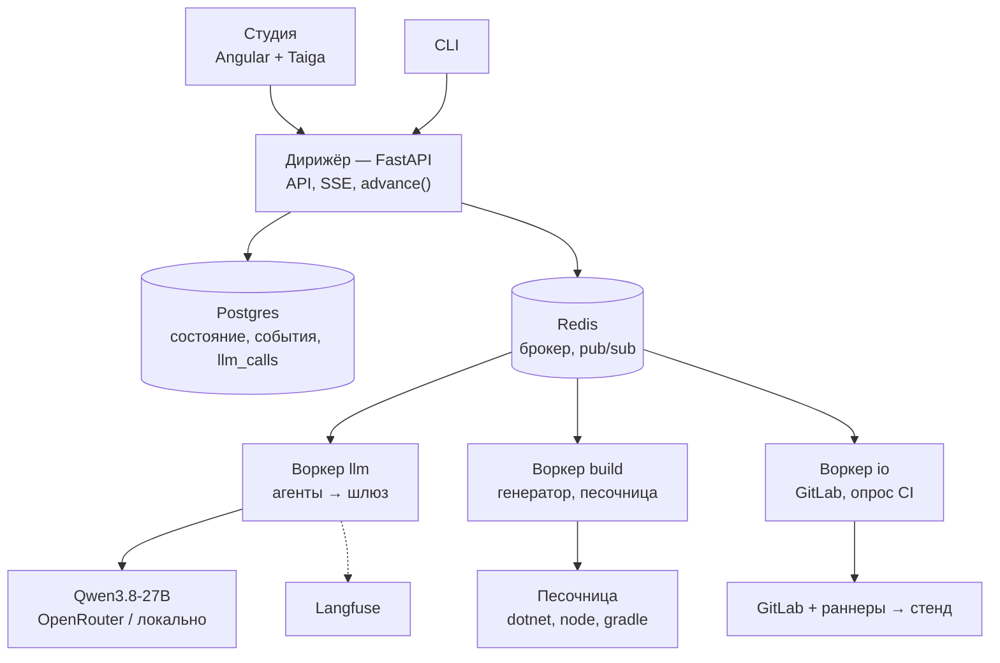
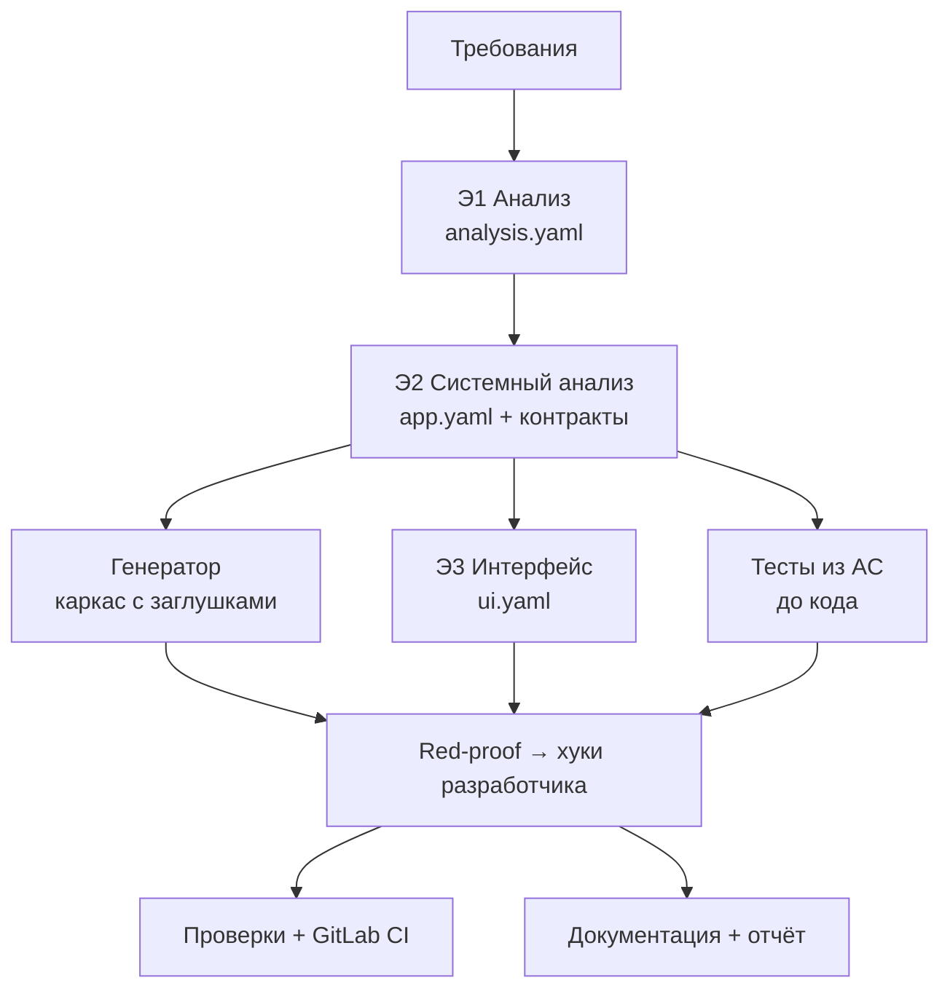

# Архитектура конвейера: верхний уровень

> Рабочий документ, обновляется по мере обсуждения. Основа — пакет «Трасса» v1 (00–03). Здесь — то, о чём договорились поверх него, и места, где мы от него отходим.

## 1. Два слоя

| Слой | Что это | Стек |
|---|---|---|
| **Платформа** | Наш конвейер: Студия, дирижёр, агенты, генератор | Angular + Taiga UI, FastAPI (монолит), Celery, Postgres, Redis, Langfuse |
| **Генерируемое приложение** | То, что конвейер выдаёт по кейсу | Задан ТЗ: Angular + Angular Material, ASP.NET Core 10, PostgreSQL/PostGIS, Kotlin + Compose M3, Kafka, Docker Compose, GitLab CI |

## 2. Компоненты платформы



**Цикл этапа:**
1. `POST /runs` → дирижёр создаёт прогон и этапы по DAG → `advance(run_id)`.
2. `advance` ставит в очередь этапы, у которых готовы все входы: агенты → `llm`, генератор и сборки → `build`, GitLab → `io`.
3. Воркер читает входы из git-workspace прогона, выполняет этап, прогоняет гейты, коммитит, пишет `StageResult` и событие, вызывает `advance`.
4. Ожидание (ответ пользователя, CI) — статус `waiting_*`, воркер освобождается. Продолжение — через API или отложенную задачу `io`.

## 3. Этапы



| Этап | Вопрос | Что делает | Выход | Чем проверяется |
|---|---|---|---|---|
| Э1 Анализ | Что нужно и зачем? | Разбирает требования, находит дыры, уточняет или фиксирует допущения | `analysis.yaml`: REQ, ISS, Q, ASM, US, AC, BR, NFR, профиль | Схема; у каждого BR есть AC |
| Э2 Системный анализ | Как устроено? | Сущности, состояния, роли и права, API, события, интеграции, хуки | `app.yaml` → OpenAPI, AsyncAPI, диаграммы | Схема и линтер модели |
| Э3 Интерфейс | Как выглядит? | Экраны по ролям и платформам, тексты, состояния экранов | `ui.yaml` | Каждую US можно пройти по экранам |
| Э4 Разработка | Как собрать? | Генератор строит каркас, агент пишет хуки | Код backend, админки, Android, mock | Сборка, тесты из AC |
| Э5 Тесты и безопасность | Работает и безопасно? | Тесты из AC до кода, red-proof, сканеры | Тесты, отчёты | Red-proof; нет high/critical |
| Э6 Сборка и деплой | Запускается у пользователя? | GitLab CI, образы, стенд, E2E | Зелёный пайплайн, URL, APK | Health-check, E2E демо-сценария |
| Э7 Документация | Понятно, что сделано? | Три вида документации, паспорт, отчёт | Сайт, паспорт, отчёт о токенах | Все AC и роли упомянуты; числа из журнала |

**Границы Э1–Э3.** Э1 — язык бизнеса, без технологий. Э2 — устройство и поведение. Э3 — внешний вид. **Пользователя спрашивает только Э1.** Дыры, найденные позже, этап закрывает сам допущением с пометкой этапа и к Э1 не возвращается.

## 4. Решения

| № | Решение | Отличие от «Трассы» |
|---|---|---|
| R1 | Студия на Taiga UI; генерируемая админка на Angular Material, мобильное на Compose M3 | В пакете Material 3 везде (D5) |
| R2 | Celery + Postgres; SQLite не используем | В пакете FastAPI + SQLite |
| R3 | Свой DAG-планировщик `advance(run_id)` поверх Celery, без chain/chord: возобновление с любого этапа | — |
| R4 | Очереди `llm` / `build` / `io` с разной конкурентностью; ожидание без занятого воркера (`waiting_*`) | — |
| R5 | Langfuse — трейсы и мониторинг. Цифры отчёта (артефакт №10) — из своей таблицы `llm_calls` | В пакете только свой журнал |
| R6 | Цикл разработчика — одно действие JSON-объектом по схеме за шаг; нативный tool calling — под флагом после спайка S1 | Уточнение D6 |
| R7 | `dispute_test`: разработчик оспаривает тест, тестировщик пересматривает его один раз | Нет в пакете |
| R8 | Починка спецификаций через JSON Patch по путям ошибок линтера, без перегенерации раздела | Уточнение 02 §16 |
| R9 | Жёсткие `max_tokens` и таймаут на каждого агента (рассуждения по умолчанию `xhigh`) | Уточнение 02 §8 |
| R10 | Модуль `geo`: зоны и полигонами, и линиями. Хранятся `geom` и `detect_area` (буфер линии); есть гистерезис и минимальное время в зоне | В пакете только «точка в полигоне» |

## 5. Э1 Анализ — устройство

Цепочка узких шагов с проверками кодом между ними, а не один большой промпт.

| Шаг | Кто | Что делает | Проверка |
|---|---|---|---|
| 0 Приём | Код (+ Qwen-VL для картинок) | Текст, PDF, картинки → единый источник; каждый фрагмент получает ID `S-NNN` | — |
| 1 Извлечение | Модель, по кускам параллельно | Список REQ со ссылками `source: [S-…]` | Ссылки существуют; каждый фрагмент покрыт REQ или помечен как шум |
| 2 Каркас домена | Модель | Роли, глоссарий, профиль: модули шаблона из перечисления в схеме | Профиль валиден; непокрытое → «вне объёма» |
| 3 Поиск дыр | Модель | ISS по чек-листу ГОСТ 34.602 (полнота, однозначность, проверяемость, непротиворечивость) → Q с вариантами, ответом по умолчанию, обоснованием, пометкой «блокирующий» | Схема |
| 4 Уточнение | Код | Интерактивный режим — все вопросы одним пакетом, `waiting_input`, по таймауту ответы по умолчанию. Автономный режим — ответ по умолчанию сразу → ASM | — |
| 5 Синтез | Модель, по фичам параллельно | US, BR с именованными параметрами, AC в Gherkin с граничными примерами, NFR, границы | У каждого BR есть AC; у US есть роль; ID уникальны; трассы REQ → US/BR → AC замкнуты |
| 6 Ревизия | Модель | Пропуски → JSON Patch, не больше двух кругов | Повтор проверок шагов 1 и 5 |

**Выход:** `analysis.yaml` + читаемая версия в Markdown (рендерит код) + метрики: покрытие источника, число ISS и ASM, попытки.

**Пример для понятности — что Э1 должен найти на кейсе №1.** Сам этап доменно-нейтрален, это только иллюстрация:
- по какому правилу нужна новая оплата при смене зоны (в СПб оплата привязана к номеру зоны);
- как система узнаёт об оплате без реальной оплаты: подтверждение водителем или mock-провайдер;
- предупреждение «за 10 минут» при оплате короче 10 минут;
- въезд в зону вне часов её работы (будни 08:00–20:00) и в выходные;
- кто пользуется админкой и что видит в истории.

## 6. Э2 Системный анализ — устройство

Принцип: **модель пишет минимум, остальное выводит код.** CRUD, события на переходах, тесты прав, OpenAPI и AsyncAPI получаются из `app.yaml` механически.

**Вход:** `analysis.yaml` и профили приложенных данных. Если к требованиям приложены файлы с данными (JSON, CSV, GeoJSON), код снимает с них структуру — поля, типы, типы геометрии, единицы — и отдаёт Э2 короткую сводку вместо самих данных.

Шаги идут по порядку: каждый ссылается на предыдущие. После каждого — схема и линтер, ошибки чинятся через JSON Patch (R8).

| Шаг | Что пишет модель | Что достраивает код | Линтер |
|---|---|---|---|
| 1 Домен | Сущности, поля, типы из закрытого списка (`geometry`, `money`, `enum`…), связи, инварианты | Таблицы, миграции, ERD | Типы из списка, ссылки существуют |
| 2 Роли и права | Матрица «роль × операция» | Тесты «роль × операция → 200 или 403» | Каждая роль из Э1 есть; каждое действие из US разрешено своей роли |
| 3 Поведение | Машины состояний: состояния, переходы, триггеры (команда, событие, расписание, гео-событие), условия-хуки | Диаграммы состояний, события на переходах | Достижимость, нет тупиков, у перехода есть триггер |
| 4 Правила → хуки | Для каждого BR — хук из каталога видов (валидатор, калькулятор, решатель, политика) и его параметры | Интерфейсы и заглушки хуков | У каждого BR есть хук или декларативное правило; хук ссылается на AC |
| 5 API | Команды и запросы сверх CRUD | CRUD-эндпоинты, OpenAPI | Каждое действие из US доступно через эндпоинт |
| 6 Окружение | Интеграции (порт, операции, поведение mock), расписания, уведомления по событиям | AsyncAPI, адаптер + mock, задачи планировщика | Уведомление привязано к существующему событию |
| 7 Данные | Тестовые данные и сценарий симулятора | Сид БД, скрипт демо | Сценарий покрывает AC демо-сценария |

**Выход:** `app.yaml` + производные (OpenAPI, AsyncAPI, ERD, диаграммы состояний, матрица прав), прошедшие валидаторы.

**Принципы:**
- **Закрытый словарь.** В DSL только то, что умеет генератор; всё прочее отвергает схема.
- **Аварийный выход `custom`.** Требование, которое DSL не выражает, становится нетиповым эндпоинтом или хуком с текстовым описанием для разработчика на Э4. DSL не блокирует прогон; такие места видны в паспорте.
- **Узкий контекст.** Каждый шаг получает нужный срез `analysis.yaml` и сжатые готовые части `app.yaml`.

**Пример для понятности (кейс №1).** Сущности `Vehicle`, `ParkingZone` (геометрия, импорт через интеграцию), `ParkingSession` с машиной состояний. Хуки: решатель «где машина», политика «нужна ли новая оплата», калькулятор предупреждения с параметром `EXPIRY_WARNING_MIN = 10`. Интеграция `ParkingProvider`: адаптер Паркоматики и mock.

## 7. DSL `app.yaml` — схема верхнего уровня

Контракт C2. Его читают генератор всех трёх стеков, тестировщик, Э3, техписатель и Студия.

### 7.1 Правила формы (под модель на 27B)

- **Плоско.** Разделы верхнего уровня — словари «имя → описание». Ссылки — по имени (`ref: Ticket`), без вложенных деревьев глубже 3 уровней.
- **Один раздел — один шаг Э2.** Каждый раздел генерируется и валидируется отдельно; схема раздела самодостаточна.
- **Закрытые перечисления** для всего, что читает генератор: типы полей, виды хуков, триггеры, каналы, операции.
- **Трассы обязательны:** у сущности, перехода, хука, команды — поле `traces: [US-…, BR-…, AC-…]`.
- **Неявное — по соглашению, а не текстом.** CRUD, события на переходах, топики Kafka, тесты прав генератор выводит сам. Модель их не пишет.

### 7.2 Разделы

| Раздел | Шаг Э2 | Что описывает | Что выводит генератор |
|---|---|---|---|
| `meta` | — | Имя, язык интерфейса, модули из профиля Э1, версия DSL | Каркас проекта, набор модулей |
| `params` | 4 | Именованные параметры правил: тип (`int`, `duration`, `money`…), значение, источник BR | `appsettings`, класс параметров; тесты берут значения отсюда |
| `types` | 1 | Перечисления и составные типы-значения | Enum и value object во всех стеках |
| `entities` | 1 | Поля с типами, обязательность, уникальность, связи, поле владельца, источник (`local` или интеграция), жизненный цикл | Таблицы, миграции, CRUD, формы и списки админки |
| `roles` | 2 | Роли и демо-пользователи | Авторизация, сид пользователей |
| `permissions` | 2 | Матрица «роль × операция» с областью (`all`, `own`, `team`) | Проверки прав, тесты 200/403 |
| `state_machines` | 3 | Состояния, переходы, триггеры, условия-хуки, эффекты | Переходы в домене, события, журнал, диаграммы |
| `hooks` | 4 | Хуки: вид из каталога, вход, выход, параметры, правило, AC | Интерфейс + нейтральная заглушка во всех стеках, где нужен |
| `commands` / `queries` | 5 | Операции сверх CRUD: роль, вход, выход, эффекты | Эндпоинты, OpenAPI, клиенты для Angular и Kotlin |
| `events` | 6 | Доменные события сверх событий переходов, полезная нагрузка | Конверт события, топики, AsyncAPI, лента в админке |
| `integrations` | 6 | Порт внешней системы: операции, импорт данных в сущность, поведение mock | Порт, mock-сервис, адаптер-заглушка, переключатель реализации |
| `schedules` | 6 | Периодические действия: интервал, команда или хук | Задачи на управляемых часах |
| `notifications` | 6 | По какому событию, кому, по каким каналам, текст с подстановками | Шаблоны, доставка в веб и мобильное приложение |
| `seed` | 7 | Тестовые записи и файлы данных | Сид БД |
| `scenarios` | 7 | Сценарии симулятора: шаги по времени, действия, ожидаемые AC | Скрипт симулятора, E2E демо |
| `custom` | любой | Нетиповое: описание, место (эндпоинт, экран, хук), AC | Заглушка с описанием для разработчика; пометка в паспорте |

**Триггеры переходов** (закрытый список): `command`, `event`, `schedule`, `timer` (истекло время относительно поля), `geo` (вход или выход из области).

### 7.3 Каталог видов хуков

Хук — **чистая функция** над сгенерированными типами: без БД, сети и времени. Время и данные передаёт сгенерированный код. Поэтому хуки тестируются unit-тестами, а red-proof дешёвый.

| Вид | Сигнатура | Отвечает на вопрос | Примеры из разных доменов |
|---|---|---|---|
| `validator` | вход команды, состояние → ok или список ошибок | «Можно ли так?» | Заявку нельзя закрыть без решения; инвентарный номер по маске |
| `calculator` | входные данные → значение | «Сколько?» | Срок SLA по приоритету и календарю; стоимость аренды; время предупреждения |
| `decider` | входные данные → один из вариантов перечисления | «Что произошло или куда?» | Какой команде назначить заявку; в какой области находится объект |
| `policy` | субъект, контекст → разрешить или запретить + причина | «Положено ли?» | Можно ли выдать оборудование сотруднику; нужна ли новая оплата |
| `reaction` | событие, состояние → список команд | «Что сделать в ответ?» | При просрочке — эскалация; при списании — закрыть выдачи |

### 7.4 Пример (домен «заявки с SLA», для понятности)

```yaml
params:
  SLA_HIGH: { type: duration, value: 4h, traces: [BR-2] }

entities:
  Ticket:
    fields:
      title:    { type: string, required: true }
      priority: { type: enum, ref: Priority }
      assignee: { type: ref, ref: Employee, nullable: true }
      due_at:   { type: datetime, computed_by: SlaDeadline }
    owner: author
    lifecycle: TicketFlow

state_machines:
  TicketFlow:
    initial: new
    states: [new, in_progress, overdue, resolved]
    transitions:
      - { name: take,    from: new,         to: in_progress, trigger: { command: TakeTicket } }
      - { name: expire,  from: in_progress, to: overdue,     trigger: { timer: due_at } }
      - { name: resolve, from: [in_progress, overdue], to: resolved,
          trigger: { command: ResolveTicket }, guard: ResolutionRequired }

hooks:
  SlaDeadline:        { kind: calculator, in: [Ticket], out: datetime, params: [SLA_HIGH], traces: [BR-2, AC-04, AC-05] }
  ResolutionRequired: { kind: validator,  in: [ResolveTicket], traces: [BR-3, AC-07] }
```

Из этого генератор сам выводит: CRUD для `Ticket`, события `TicketTaken`, `TicketExpired`, `TicketResolved`, топик Kafka, проверку таймера в планировщике и тесты прав.

## 8. Э3 Интерфейс и `ui.yaml`

Контракт C3. Тот же принцип, что в Э2: **базу выводит код, модель только дорабатывает.** Из `app.yaml` механически получаются экраны списков, карточек и форм для каждой сущности и меню по правам. Модель решает то, что из модели данных не следует: какой экран главный для роли, что показать на карте или дашборде, как пройти US за минимум шагов, какие тексты увидит пользователь.

### 8.1 Шаги

| Шаг | Кто | Что делает | Проверка |
|---|---|---|---|
| 0 Вывод базы | Код | Для каждой сущности и роли с правом чтения — `list` + `detail`; с правом создания или изменения — `form`; кнопки команд и переходов на карточке; меню роли из `permissions`; контрол поля по его типу | — |
| 1 Платформы | Модель | Для каждой US — платформа (`web`, `mobile`) и роль-исполнитель; какие базовые экраны не нужны роли вообще | У US ровно одна платформа; роль из Э1 |
| 2 Доработка | Модель, по ролям параллельно | JSON Patch к базе: паттерн экрана, главный экран роли, виджеты сверх CRUD, группировка полей, фильтры | Схема; ссылки на queries, commands, events существуют |
| 3 Проходы US | Модель | Для каждой US — путь по экранам: открыть, заполнить, нажать, увидеть | Линтер проходов (§8.6) |
| 4 Тексты и состояния | Модель | Заголовки, подписи, пустые состояния, сообщения об ошибках на языке `meta.lang`; тексты ошибок валидаторов по кодам | Ключи текстов покрыты; нет текстов на чужом языке |
| 5 Ревизия | Код + модель | Ошибки линтера → JSON Patch, не больше двух кругов (R8) | Повтор шагов 1–4 |

**Выход:** `ui.yaml` + карта экранов (диаграмма навигации по ролям) + проходы US — вход для E2E на Э5 и Э6.

### 8.2 Каталог паттернов экранов

Закрытый список: для каждого паттерна в шаблоне есть готовый компонент в обоих стеках.

| Паттерн | Для чего | Angular Material | Compose M3 |
|---|---|---|---|
| `list` | Таблица или лента записей с фильтрами, поиском, страницами | `mat-table` + `mat-paginator` + `mat-sort` | `LazyColumn` + `ListItem`, `FilterChip` |
| `detail` | Карточка записи: поля, статус, история, доступные действия | `mat-card`, `mat-tab-group` | `Card`, `TabRow` |
| `form` | Создание и изменение; поля по типам, ошибки валидаторов у полей | `mat-form-field`, Reactive Forms | `OutlinedTextField`, `ExposedDropdownMenu` |
| `wizard` | Длинная команда по шагам | `mat-stepper` | Свой степпер на `Scaffold` |
| `dashboard` | Счётчики и графики по queries для роли-наблюдателя | `mat-grid-list` + графики | `LazyVerticalGrid` + `Card` |
| `map` | Объекты и области на карте, своя позиция | Leaflet в обёртке | osmdroid в `AndroidView` |
| `feed` | Лента событий в реальном времени | `mat-list` + поток событий | `LazyColumn` + поток событий |
| `action` | Один крупный сценарий на экран: «начать», «завершить», таймер | `mat-card` + `mat-raised-button` | `Scaffold` + `ExtendedFloatingActionButton` |
| `settings` | Параметры пользователя и `params` для администратора | `mat-slide-toggle`, формы | `Switch`, `ListItem` |

### 8.3 Виджеты

| Виджет | Источник данных | Пример |
|---|---|---|
| `field` | Поле сущности; контрол по типу (`money` → поле с валютой, `geometry` → мини-карта, `enum` → выбор) | Приоритет заявки |
| `status` | Состояние машины; цвет по группе состояний (`active`, `warning`, `done`, `error`) | «Просрочена» красным |
| `countdown` | Поле `datetime` или вывод `calculator` | Время до нарушения SLA |
| `kpi` | Query с агрегатом | Заявок в работе по командам |
| `timeline` | Журнал переходов сущности | История выдач оборудования |
| `map_layer` | Query с геометрией | Точки обхода и пройденный маршрут |
| `action_button` | Command или переход; скрыт без права, неактивен при ложном условии | «Взять в работу» |
| `scan` | Камера → строка (QR, штрихкод) | Инвентарный номер при выдаче |
| `file` | Поле-файл | Фото дефекта при обходе |

### 8.4 Привязки и состояния экрана

Экран связан с `app.yaml` только по именам — это и проверяет линтер:

- `source: { query: OpenTickets, params: { team: $user.team } }` — откуда данные;
- `actions: [{ command: TakeTicket, confirm: true }]` — что можно сделать;
- `live: [TicketExpired, TicketTaken]` — какие события обновляют экран. Backend транслирует события из Kafka клиентам через SignalR; мобильное приложение слушает поток, пока активно.

У каждого экрана с данными обязательны состояния `loading`, `empty`, `error`, `forbidden`; у мобильных — ещё `offline`. Код подставляет стандартные, модель задаёт только тексты `empty` (например «Нет заявок, назначенных вам») и действие из пустого состояния.

### 8.5 Возможности мобильного

Закрытый список `device`. Каждая возможность — модуль шаблона с разрешениями в манифесте и **заменой в эмуляторе и E2E**.

| Возможность | Параметры | Замена в эмуляторе и E2E | Пример |
|---|---|---|---|
| `location` | Источник `gps` / `simulator` / `manual`; режим `foreground` или `background`; интервал; точность | Координаты из сценария симулятора | Отметка прибытия на объект обхода |
| `local_notification` | Событие или таймер на устройстве; текст из `notifications` | Проверка через `NotificationManager` в тесте | Напоминание за N минут до срока |
| `external_link` | Шаблон URL или deep link с подстановками; что делать после возврата | Mock-страница, возвращающая в приложение | Оплата или подпись во внешнем сервисе |
| `scan_code` | Формат (QR, EAN), поле назначения | Строка подставляется тестом | Выдача оборудования по коду |
| `file_pick` | Камера или галерея, ограничения размера | Файл из ресурсов теста | Фото дефекта |

### 8.6 Проходы US

Проход — короткий сценарий в терминах экранов. Он доказывает, что US выполнима в интерфейсе, и механически превращается в E2E (Playwright для веба, Compose UI Test для Android).

```yaml
walks:
  US-07:   # домен «учёт оборудования»: кладовщик выдаёт ноутбук сотруднику
    role: storekeeper
    platform: mobile
    steps:
      - open: IssueScreen
      - scan: { widget: item_code, value: $seed.Item.laptop1.inv_no }
      - fill: { employee: $seed.Employee.ivanov }
      - tap: IssueItem                     # command
      - expect: { screen: ItemDetail, status: issued }
    covers: [AC-15, AC-16]
```

**Линтер проходов:** экраны и виджеты существуют; каждая команда разрешена роли прохода; значения берутся из `seed` и `params`, а не литералами; у каждой US есть проход; каждый AC с пометкой «UI» покрыт хотя бы одним проходом; из главного экрана роли до каждого экрана прохода есть путь по навигации.

**Пример для понятности (кейс №1).** Водитель — `mobile`: главный экран `action` («Я припарковался», таймер оплаты), `map` с зонами, `location` с источником `simulator` для демо, `local_notification` за `EXPIRY_WARNING_MIN` до окончания, `external_link` на оплату у провайдера. Оператор — `web`: `list` сессий, `map` зон, `feed` событий.

## 9. Э4 Разработка — генератор и агент-разработчик

Разработка делится на две неравные части: **генератор** (код, детерминированно) строит всё приложение, кроме смысла; **агент-разработчик** (модель) вписывает только хуки и места `custom`. Объём кода, который пишет модель, — сотни строк, а не десятки тысяч.

### 9.1 Генератор

**Вход:** `app.yaml`, `ui.yaml`, профиль модулей. **Выход:** четыре проекта (backend, админка, мобильное, mock) + инфраструктура, которые сразу собираются и проходят тесты прав и CRUD.

**Конвейер генератора:**
1. `app.yaml` → нормализованная модель (имена во всех нотациях, развёрнутые соглашения: CRUD, события переходов, топики).
2. Модель → OpenAPI и AsyncAPI → `openapi-generator`: клиенты для Angular (TypeScript) и Kotlin (Retrofit + kotlinx.serialization).
3. Модель → шаблоны Jinja по модулям: домен и EF Core, контроллеры, машины состояний, планировщик, компоненты экранов, Compose-экраны, Dockerfile, Compose, CI.
4. Форматтеры (`dotnet format`, `prettier`, `ktlint`) — чтобы диффы между прогонами были чистыми.

**Детерминизм:** одинаковый вход → побайтно одинаковый выход. Шаблоны покрыты снапшот-тестами на трёх эталонных доменах (заявки с SLA, учёт оборудования, обход объектов): ошибка в шаблоне ловится до прогона, а не на защите.

**Generation gap.** Сгенерированное и написанное моделью никогда не лежат в одном файле.

| Стек | Сгенерировано (перезаписывается всегда) | Пишет модель (генератор не трогает) | Механизм |
|---|---|---|---|
| ASP.NET | `Generated/**` | `Hooks/<Name>.cs`, `Custom/<id>/**` | Интерфейс `I<Name>Hook` + регистрация в DI; заглушка — отдельный класс, заменяется привязкой |
| Angular | `src/app/generated/**` | `src/app/custom/<id>/**` | Базовый компонент + слот расширения в маршрутах |
| Kotlin | `generated/**` | `hooks/<Name>.kt`, `custom/<id>/**` | Интерфейс + реализация по умолчанию, выбор в модуле DI |
| Тесты | `tests/generated/**` (права, CRUD) | — (тесты из AC пишет тестировщик, §10) | — |

Повторная генерация после правки `app.yaml` не теряет хуки: меняется сигнатура — ломается компиляция именно в файле хука, и он уходит разработчику с ошибкой компилятора как входом.

**Модули шаблона** (включаются профилем из Э1 и разделами `app.yaml`):

| Модуль | Backend | Админка | Мобильное | Инфраструктура |
|---|---|---|---|---|
| `core` | Auth (JWT), CRUD, аудит, ошибки по RFC 7807, health | Вход, меню, `list`/`detail`/`form` | Вход, навигация | Postgres, миграции |
| `workflow` | Машины состояний, журнал переходов, события | `status`, `timeline` | `status` | — |
| `events` | Outbox → Kafka, SignalR-мост | `feed` | Поток событий | Kafka (KRaft) |
| `scheduler` | Задачи на управляемых часах, таймеры переходов | — | — | — |
| `geo` | PostGIS, `geom` + `detect_area`, гистерезис (R10) | `map` | `map`, `location` | Образ PostGIS |
| `notify` | Шаблоны, доставка по каналам | Колокольчик | `local_notification` | — |
| `integrations` | Порт, адаптер, переключатель реализации | — | `external_link` | Сервис mock |
| `files` | Хранение файлов | `file` | `file_pick`, `scan_code` | Том |
| `sim` | Управляемые часы в API | — | Источник `simulator` | Сервис симулятора |

### 9.2 Цикл агента-разработчика

**Единица работы** — один хук (или одно место `custom`) в одном стеке. Хуки независимы, поэтому задачи идут параллельно в очереди `llm`. Если хук нужен в двух стеках (например, решатель области и на сервере, и на устройстве), сначала пишется C#-версия, затем Kotlin-версия портируется по тем же тестам.

**Контекст задачи** (собирает код, а не модель): сигнатура и сгенерированные типы; BR с параметрами из `params`; AC в Gherkin; тесты хука (только чтение); один-два уже готовых хука того же вида как образец; для `custom` — текст описания из `app.yaml`.

**Действия** — один JSON-объект по схеме за шаг (R6):

| Действие | Аргументы | Что делает код |
|---|---|---|
| `read` | `path` | Отдаёт файл, если путь в разрешённом списке чтения |
| `write` | `path`, `content` | Пишет файл целиком; только разрешённые пути записи |
| `edit` | `path`, `find`, `replace` | Точечная замена; `find` должен встречаться ровно один раз |
| `test` | `filter` (по умолчанию тесты хука) | Сборка + тесты; ответ — сжатый: первые N ошибок с `file:line`, упавшие тесты с ожидаемым и фактическим |
| `dispute_test` | `test`, `reason`, `evidence: [AC-…]` | Передаёт тест тестировщику (R7) |
| `done` | `summary` | Финальная проверка; при успехе — коммит |
| `give_up` | `reason` | Откат к заглушке, пометка в паспорте |

**Разрешённые пути.** Запись — только `Hooks/<Name>.*` или `Custom/<id>/**` своей задачи. Чтение — плюс `Generated/**` и тесты. Любое другое действие отвергается кодом с сообщением, и шаг засчитывается.

**Лимиты (по умолчанию, настраиваются в профиле агента):** 12 шагов, 5 запусков `test`, бюджет токенов на задачу, 10 минут на задачу. Исчерпан лимит — то же, что `give_up`.

**Откат и защита от регрессий.**
- Каждый `write`/`edit` — коммит в ветке задачи в workspace; откат — `git reset` к последнему зелёному состоянию.
- `done` принимается, только если зелёные тесты хука **и** весь набор тестов стека: хук, сломавший чужие тесты, не принимается.
- Повторение одного и того же действия с тем же результатом дважды подряд — сигнал зацикливания: код добавляет в контекст подсказку «предыдущий шаг не изменил результат», на третий раз задача завершается как `give_up`.

**`dispute_test` (R7).** Разработчик считает, что тест противоречит AC (неверное граничное значение, перепутанный параметр). Тестировщик получает тест, AC, BR и аргумент разработчика и выносит одно из решений: `fix` — исправляет тест, тест снова проходит red-proof (§10.2), задача разработчика продолжается; `reject` — тест остаётся, аргумент и ответ попадают в контекст разработчика. На один тест — один спор. Все споры и решения — в отчёте Э7.

**Пример (домен «обход объектов»).** Хук `VisitCounted` (решатель): засчитан ли визит, если сотрудник был в радиусе объекта меньше `MIN_STAY` или вышел и вернулся. Разработчик получает сигнатуру `(track: GeoPoint[], site: Site, p: Params) → VisitResult`, AC с примерами «4 мин 59 с — не засчитан», «две отметки с разрывом 30 с — один визит» и тесты. Типичный ход: `read` образец → `write` → `test` (2 из 6 красные: гистерезис) → `edit` → `test` (зелёные) → `done`.

## 10. Э5 Тесты и безопасность

Тесты пишутся **из AC до кода** другим агентом (тестировщиком), который не видит реализацию. Разработчик не может их менять. Так зелёный прогон означает «требование выполнено», а не «модель подогнала тест под себя».

### 10.1 Уровни тестов

| Уровень | Откуда | Кто пишет | Чем | Что доказывает |
|---|---|---|---|---|
| Unit хуков | AC с примерами, BR, `params` | Тестировщик | xUnit; kotlin.test | Правило посчитано верно, включая границы |
| API по AC | AC в Gherkin: Given → сид и часы, When → команда, Then → query и события | Тестировщик | xUnit + `WebApplicationFactory` + Testcontainers | Поведение системы целиком, с БД и Kafka |
| Права | `permissions` | Код | Генерируемые xUnit | Каждая пара «роль × операция» → 200 или 403; область `own` не видит чужое |
| Переходы | `state_machines` | Код | Генерируемые xUnit | Недопустимый переход → 409; событие на каждом переходе |
| Контракт | OpenAPI | Код | Schemathesis | Ответы соответствуют схеме, нет 500 на краевых входах |
| E2E | Проходы US (§8.6), `scenarios` | Код из проходов | Playwright; Compose UI Test | US выполнима в интерфейсе; демо-сценарий проходит |

**Правила для тестировщика:**
- Каждый пример из AC — строка параметризованного теста; граничные значения обязательны (`N−1`, `N`, `N+1` для порога).
- Значения порогов — из сгенерированного класса параметров, а не литералами: линтер ищет в тестах числа, совпадающие со значениями `params`.
- Время — только через управляемые часы, никаких `DateTime.Now` и `sleep`.
- Имя теста содержит ID AC: так строится матрица трассировки.

**Пример (домен «заявки с SLA»).** AC-05: «заявка высокого приоритета, созданная в пятницу в 17:00 при рабочем дне до 18:00, получает срок в понедельник в 12:00». Тестировщик пишет unit-тест `SlaDeadline` с примерами пятницы, кануна праздника и ровно границы рабочего дня, и API-тест: создать заявку → сдвинуть часы на `SLA_HIGH` рабочих часов + 1 минута → заявка в `overdue`, событие `TicketExpired` в топике.

### 10.2 Red-proof

Тест, который проходит на заглушке, ничего не проверяет. Поэтому перед работой разработчика:

1. Генератор кладёт нейтральные заглушки (возвращают «пусто», «ноль», «разрешено», не бросают исключений).
2. Тесты из AC запускаются на заглушках. Каждый должен упасть **на проверке** (`Assert`), а не на компиляции, настройке или исключении.
3. Тест, прошедший на заглушке или упавший не на проверке, возвращается тестировщику с причиной; не больше двух кругов, дальше тест помечается в паспорте как слабый.

**Green-proof (после разработчика, дёшево за счёт чистых хуков).** На принятом хуке код делает 3–5 мутаций (перевернуть сравнение, сдвинуть порог на единицу, вернуть другой вариант перечисления). Хотя бы один тест обязан покраснеть на каждой мутации. Выжившая мутация — задача тестировщику дописать пример.

### 10.3 Целостность тестов

- После red-proof хэши файлов тестов фиксируются в таблице `test_hashes` (§13). Перед каждым запуском и в CI код сверяет хэши; расхождение — отказ, а не предупреждение.
- Изменить тест можно только через решение `fix` по `dispute_test`: новый хэш записывается вместе со ссылкой на спор.
- Линтер тестов запрещает `Skip`, `[Ignore]`, `@Disabled`, пустые тела, тесты без проверок, `try/catch` вокруг проверок.
- Матрица трассировки AC → тесты замкнута: AC без теста или тест без AC — ошибка этапа.

### 10.4 Сканеры

| Что | Инструмент | Где запускается |
|---|---|---|
| Код (SAST) | Semgrep (C#, TypeScript, Kotlin) | Песочница + CI |
| Зависимости | `dotnet list package --vulnerable`, `npm audit`, OWASP Dependency-Check для Gradle | Песочница + CI |
| Образы и файлы | Trivy | CI после сборки образов |
| Секреты | Gitleaks | Песочница + CI |
| Dockerfile | Hadolint | Песочница + CI |
| Работающий стенд (DAST) | OWASP ZAP baseline | CI после деплоя |

**Гейт:** нет находок high и critical. **Маршрут находки:**
- в сгенерированном коде → исправляется **шаблон**, один раз для всех будущих прогонов; в текущем прогоне — перегенерация;
- в хуке или `custom` → задача разработчику с находкой во входе;
- ложное срабатывание → подавление с обоснованием; список подавлений — в паспорте.

**Безопасность по построению** (в шаблоне, а не в руках модели): JWT и проверка прав в каждом эндпоинте из `permissions`, фильтр области `own`/`team` в запросах, только параметризованные запросы EF Core, валидация входа по схеме, CORS по списку, секреты из переменных окружения и CI, непривилегированный пользователь в образах.
