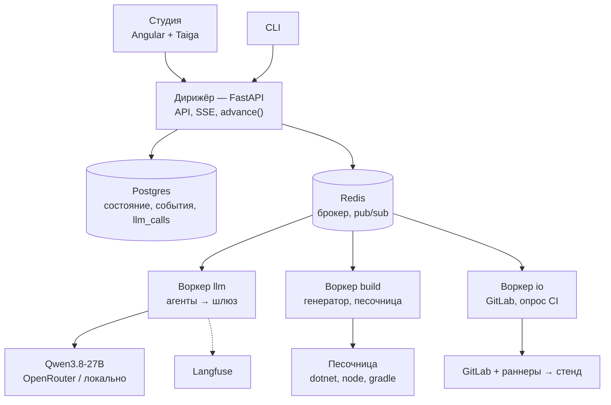
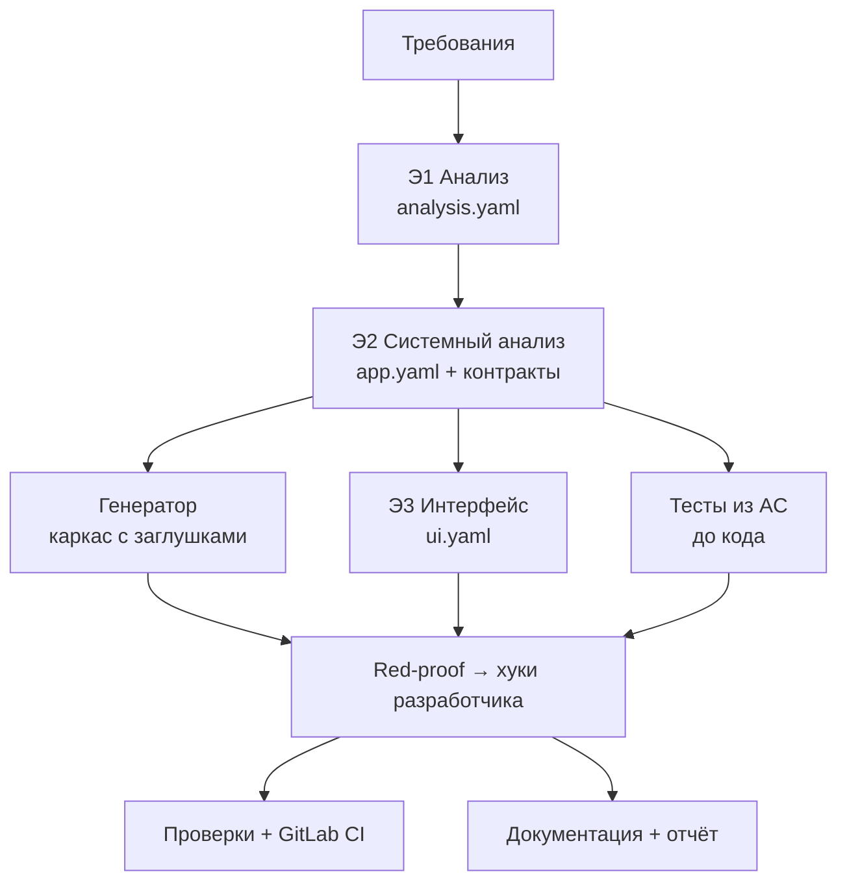

# Архитектура конвейера: верхний уровень

> Рабочий документ, обновляется по мере обсуждения. Основа — пакет «Трасса» v1 (00–03). Здесь — то, о чём договорились поверх него, и места, где мы от него отходим.

## 1. Два слоя

| Слой | Что это | Стек |
|---|---|---|
| **Платформа** | Наш конвейер: Студия, дирижёр, агенты, генератор | Angular + Taiga UI, FastAPI (монолит), Celery, Postgres, Redis, Langfuse |
| **Генерируемое приложение** | То, что конвейер выдаёт по кейсу | Задан ТЗ: Angular + Angular Material, ASP.NET Core 10, PostgreSQL/PostGIS, Kotlin + Compose M3, Kafka, Docker Compose, GitLab CI |

## 2. Компоненты платформы



**Цикл этапа:**
1. `POST /runs` → дирижёр создаёт прогон и этапы по DAG → `advance(run_id)`.
2. `advance` ставит в очередь этапы, у которых готовы все входы: агенты → `llm`, генератор и сборки → `build`, GitLab → `io`.
3. Воркер читает входы из git-workspace прогона, выполняет этап, прогоняет гейты, коммитит, пишет `StageResult` и событие, вызывает `advance`.
4. Ожидание (ответ пользователя, CI) — статус `waiting_*`, воркер освобождается. Продолжение — через API или отложенную задачу `io`.

## 3. Этапы



| Этап | Вопрос | Что делает | Выход | Чем проверяется |
|---|---|---|---|---|
| Э1 Анализ | Что нужно и зачем? | Разбирает требования, находит дыры, уточняет или фиксирует допущения | `analysis.yaml`: REQ, ISS, Q, ASM, US, AC, BR, NFR, профиль | Схема; у каждого BR есть AC |
| Э2 Системный анализ | Как устроено? | Сущности, состояния, роли и права, API, события, интеграции, хуки | `app.yaml` → OpenAPI, AsyncAPI, диаграммы | Схема и линтер модели |
| Э3 Интерфейс | Как выглядит? | Экраны по ролям и платформам, тексты, состояния экранов | `ui.yaml` | Каждую US можно пройти по экранам |
| Э4 Разработка | Как собрать? | Генератор строит каркас, агент пишет хуки | Код backend, админки, Android, mock | Сборка, тесты из AC |
| Э5 Тесты и безопасность | Работает и безопасно? | Тесты из AC до кода, red-proof, сканеры | Тесты, отчёты | Red-proof; нет high/critical |
| Э6 Сборка и деплой | Запускается у пользователя? | GitLab CI, образы, стенд, E2E | Зелёный пайплайн, URL, APK | Health-check, E2E демо-сценария |
| Э7 Документация | Понятно, что сделано? | Три вида документации, паспорт, отчёт | Сайт, паспорт, отчёт о токенах | Все AC и роли упомянуты; числа из журнала |

**Границы Э1–Э3.** Э1 — язык бизнеса, без технологий. Э2 — устройство и поведение. Э3 — внешний вид. **Пользователя спрашивает только Э1.** Дыры, найденные позже, этап закрывает сам допущением с пометкой этапа и к Э1 не возвращается.

## 4. Решения

| № | Решение | Отличие от «Трассы» |
|---|---|---|
| R1 | Студия на Taiga UI; генерируемая админка на Angular Material, мобильное на Compose M3 | В пакете Material 3 везде (D5) |
| R2 | Celery + Postgres; SQLite не используем | В пакете FastAPI + SQLite |
| R3 | Свой DAG-планировщик `advance(run_id)` поверх Celery, без chain/chord: возобновление с любого этапа | — |
| R4 | Очереди `llm` / `build` / `io` с разной конкурентностью; ожидание без занятого воркера (`waiting_*`) | — |
| R5 | Langfuse — трейсы и мониторинг. Цифры отчёта (артефакт №10) — из своей таблицы `llm_calls` | В пакете только свой журнал |
| R6 | Цикл разработчика — одно действие JSON-объектом по схеме за шаг; нативный tool calling — под флагом после спайка S1 | Уточнение D6 |
| R7 | `dispute_test`: разработчик оспаривает тест, тестировщик пересматривает его один раз | Нет в пакете |
| R8 | Починка спецификаций через JSON Patch по путям ошибок линтера, без перегенерации раздела | Уточнение 02 §16 |
| R9 | Жёсткие `max_tokens` и таймаут на каждого агента (рассуждения по умолчанию `xhigh`) | Уточнение 02 §8 |
| R10 | Модуль `geo`: зоны и полигонами, и линиями. Хранятся `geom` и `detect_area` (буфер линии); есть гистерезис и минимальное время в зоне | В пакете только «точка в полигоне» |

## 5. Э1 Анализ — устройство

Цепочка узких шагов с проверками кодом между ними, а не один большой промпт.

| Шаг | Кто | Что делает | Проверка |
|---|---|---|---|
| 0 Приём | Код (+ Qwen-VL для картинок) | Текст, PDF, картинки → единый источник; каждый фрагмент получает ID `S-NNN` | — |
| 1 Извлечение | Модель, по кускам параллельно | Список REQ со ссылками `source: [S-…]` | Ссылки существуют; каждый фрагмент покрыт REQ или помечен как шум |
| 2 Каркас домена | Модель | Роли, глоссарий, профиль: модули шаблона из перечисления в схеме | Профиль валиден; непокрытое → «вне объёма» |
| 3 Поиск дыр | Модель | ISS по чек-листу ГОСТ 34.602 (полнота, однозначность, проверяемость, непротиворечивость) → Q с вариантами, ответом по умолчанию, обоснованием, пометкой «блокирующий» | Схема |
| 4 Уточнение | Код | Интерактивный режим — все вопросы одним пакетом, `waiting_input`, по таймауту ответы по умолчанию. Автономный режим — ответ по умолчанию сразу → ASM | — |
| 5 Синтез | Модель, по фичам параллельно | US, BR с именованными параметрами, AC в Gherkin с граничными примерами, NFR, границы | У каждого BR есть AC; у US есть роль; ID уникальны; трассы REQ → US/BR → AC замкнуты |
| 6 Ревизия | Модель | Пропуски → JSON Patch, не больше двух кругов | Повтор проверок шагов 1 и 5 |

**Выход:** `analysis.yaml` + читаемая версия в Markdown (рендерит код) + метрики: покрытие источника, число ISS и ASM, попытки.

**Пример для понятности — что Э1 должен найти на кейсе №1.** Сам этап доменно-нейтрален, это только иллюстрация:
- по какому правилу нужна новая оплата при смене зоны (в СПб оплата привязана к номеру зоны);
- как система узнаёт об оплате без реальной оплаты: подтверждение водителем или mock-провайдер;
- предупреждение «за 10 минут» при оплате короче 10 минут;
- въезд в зону вне часов её работы (будни 08:00–20:00) и в выходные;
- кто пользуется админкой и что видит в истории.

## 6. Э2 Системный анализ — устройство

Принцип: **модель пишет минимум, остальное выводит код.** CRUD, события на переходах, тесты прав, OpenAPI и AsyncAPI получаются из `app.yaml` механически.

**Вход:** `analysis.yaml` и профили приложенных данных. Если к требованиям приложены файлы с данными (JSON, CSV, GeoJSON), код снимает с них структуру — поля, типы, типы геометрии, единицы — и отдаёт Э2 короткую сводку вместо самих данных.

Шаги идут по порядку: каждый ссылается на предыдущие. После каждого — схема и линтер, ошибки чинятся через JSON Patch (R8).

| Шаг | Что пишет модель | Что достраивает код | Линтер |
|---|---|---|---|
| 1 Домен | Сущности, поля, типы из закрытого списка (`geometry`, `money`, `enum`…), связи, инварианты | Таблицы, миграции, ERD | Типы из списка, ссылки существуют |
| 2 Роли и права | Матрица «роль × операция» | Тесты «роль × операция → 200 или 403» | Каждая роль из Э1 есть; каждое действие из US разрешено своей роли |
| 3 Поведение | Машины состояний: состояния, переходы, триггеры (команда, событие, расписание, гео-событие), условия-хуки | Диаграммы состояний, события на переходах | Достижимость, нет тупиков, у перехода есть триггер |
| 4 Правила → хуки | Для каждого BR — хук из каталога видов (валидатор, калькулятор, решатель, политика) и его параметры | Интерфейсы и заглушки хуков | У каждого BR есть хук или декларативное правило; хук ссылается на AC |
| 5 API | Команды и запросы сверх CRUD | CRUD-эндпоинты, OpenAPI | Каждое действие из US доступно через эндпоинт |
| 6 Окружение | Интеграции (порт, операции, поведение mock), расписания, уведомления по событиям | AsyncAPI, адаптер + mock, задачи планировщика | Уведомление привязано к существующему событию |
| 7 Данные | Тестовые данные и сценарий симулятора | Сид БД, скрипт демо | Сценарий покрывает AC демо-сценария |

**Выход:** `app.yaml` + производные (OpenAPI, AsyncAPI, ERD, диаграммы состояний, матрица прав), прошедшие валидаторы.

**Принципы:**
- **Закрытый словарь.** В DSL только то, что умеет генератор; всё прочее отвергает схема.
- **Аварийный выход `custom`.** Требование, которое DSL не выражает, становится нетиповым эндпоинтом или хуком с текстовым описанием для разработчика на Э4. DSL не блокирует прогон; такие места видны в паспорте.
- **Узкий контекст.** Каждый шаг получает нужный срез `analysis.yaml` и сжатые готовые части `app.yaml`.

**Пример для понятности (кейс №1).** Сущности `Vehicle`, `ParkingZone` (геометрия, импорт через интеграцию), `ParkingSession` с машиной состояний. Хуки: решатель «где машина», политика «нужна ли новая оплата», калькулятор предупреждения с параметром `EXPIRY_WARNING_MIN = 10`. Интеграция `ParkingProvider`: адаптер Паркоматики и mock.

## 7. DSL `app.yaml` — схема верхнего уровня

Контракт C2. Его читают генератор всех трёх стеков, тестировщик, Э3, техписатель и Студия.

### 7.1 Правила формы (под модель на 27B)

- **Плоско.** Разделы верхнего уровня — словари «имя → описание». Ссылки — по имени (`ref: Ticket`), без вложенных деревьев глубже 3 уровней.
- **Один раздел — один шаг Э2.** Каждый раздел генерируется и валидируется отдельно; схема раздела самодостаточна.
- **Закрытые перечисления** для всего, что читает генератор: типы полей, виды хуков, триггеры, каналы, операции.
- **Трассы обязательны:** у сущности, перехода, хука, команды — поле `traces: [US-…, BR-…, AC-…]`.
- **Неявное — по соглашению, а не текстом.** CRUD, события на переходах, топики Kafka, тесты прав генератор выводит сам. Модель их не пишет.

### 7.2 Разделы

| Раздел | Шаг Э2 | Что описывает | Что выводит генератор |
|---|---|---|---|
| `meta` | — | Имя, язык интерфейса, модули из профиля Э1, версия DSL | Каркас проекта, набор модулей |
| `params` | 4 | Именованные параметры правил: тип (`int`, `duration`, `money`…), значение, источник BR | `appsettings`, класс параметров; тесты берут значения отсюда |
| `types` | 1 | Перечисления и составные типы-значения | Enum и value object во всех стеках |
| `entities` | 1 | Поля с типами, обязательность, уникальность, связи, поле владельца, источник (`local` или интеграция), жизненный цикл | Таблицы, миграции, CRUD, формы и списки админки |
| `roles` | 2 | Роли и демо-пользователи | Авторизация, сид пользователей |
| `permissions` | 2 | Матрица «роль × операция» с областью (`all`, `own`, `team`) | Проверки прав, тесты 200/403 |
| `state_machines` | 3 | Состояния, переходы, триггеры, условия-хуки, эффекты | Переходы в домене, события, журнал, диаграммы |
| `hooks` | 4 | Хуки: вид из каталога, вход, выход, параметры, правило, AC | Интерфейс + нейтральная заглушка во всех стеках, где нужен |
| `commands` / `queries` | 5 | Операции сверх CRUD: роль, вход, выход, эффекты | Эндпоинты, OpenAPI, клиенты для Angular и Kotlin |
| `events` | 6 | Доменные события сверх событий переходов, полезная нагрузка | Конверт события, топики, AsyncAPI, лента в админке |
| `integrations` | 6 | Порт внешней системы: операции, импорт данных в сущность, поведение mock | Порт, mock-сервис, адаптер-заглушка, переключатель реализации |
| `schedules` | 6 | Периодические действия: интервал, команда или хук | Задачи на управляемых часах |
| `notifications` | 6 | По какому событию, кому, по каким каналам, текст с подстановками | Шаблоны, доставка в веб и мобильное приложение |
| `seed` | 7 | Тестовые записи и файлы данных | Сид БД |
| `scenarios` | 7 | Сценарии симулятора: шаги по времени, действия, ожидаемые AC | Скрипт симулятора, E2E демо |
| `custom` | любой | Нетиповое: описание, место (эндпоинт, экран, хук), AC | Заглушка с описанием для разработчика; пометка в паспорте |

**Триггеры переходов** (закрытый список): `command`, `event`, `schedule`, `timer` (истекло время относительно поля), `geo` (вход или выход из области).

### 7.3 Каталог видов хуков

Хук — **чистая функция** над сгенерированными типами: без БД, сети и времени. Время и данные передаёт сгенерированный код. Поэтому хуки тестируются unit-тестами, а red-proof дешёвый.

| Вид | Сигнатура | Отвечает на вопрос | Примеры из разных доменов |
|---|---|---|---|
| `validator` | вход команды, состояние → ok или список ошибок | «Можно ли так?» | Заявку нельзя закрыть без решения; инвентарный номер по маске |
| `calculator` | входные данные → значение | «Сколько?» | Срок SLA по приоритету и календарю; стоимость аренды; время предупреждения |
| `decider` | входные данные → один из вариантов перечисления | «Что произошло или куда?» | Какой команде назначить заявку; в какой области находится объект |
| `policy` | субъект, контекст → разрешить или запретить + причина | «Положено ли?» | Можно ли выдать оборудование сотруднику; нужна ли новая оплата |
| `reaction` | событие, состояние → список команд | «Что сделать в ответ?» | При просрочке — эскалация; при списании — закрыть выдачи |

### 7.4 Пример (домен «заявки с SLA», для понятности)

```yaml
params:
  SLA_HIGH: { type: duration, value: 4h, traces: [BR-2] }

entities:
  Ticket:
    fields:
      title:    { type: string, required: true }
      priority: { type: enum, ref: Priority }
      assignee: { type: ref, ref: Employee, nullable: true }
      due_at:   { type: datetime, computed_by: SlaDeadline }
    owner: author
    lifecycle: TicketFlow

state_machines:
  TicketFlow:
    initial: new
    states: [new, in_progress, overdue, resolved]
    transitions:
      - { name: take,    from: new,         to: in_progress, trigger: { command: TakeTicket } }
      - { name: expire,  from: in_progress, to: overdue,     trigger: { timer: due_at } }
      - { name: resolve, from: [in_progress, overdue], to: resolved,
          trigger: { command: ResolveTicket }, guard: ResolutionRequired }

hooks:
  SlaDeadline:        { kind: calculator, in: [Ticket], out: datetime, params: [SLA_HIGH], traces: [BR-2, AC-04, AC-05] }
  ResolutionRequired: { kind: validator,  in: [ResolveTicket], traces: [BR-3, AC-07] }
```

Из этого генератор сам выводит: CRUD для `Ticket`, события `TicketTaken`, `TicketExpired`, `TicketResolved`, топик Kafka, проверку таймера в планировщике и тесты прав.
