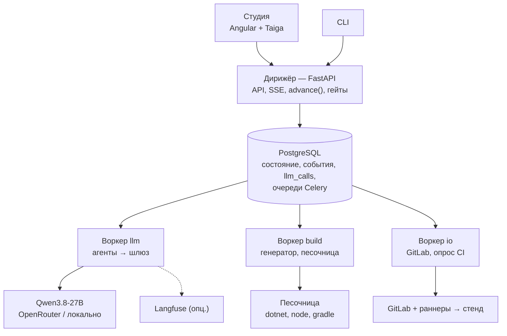
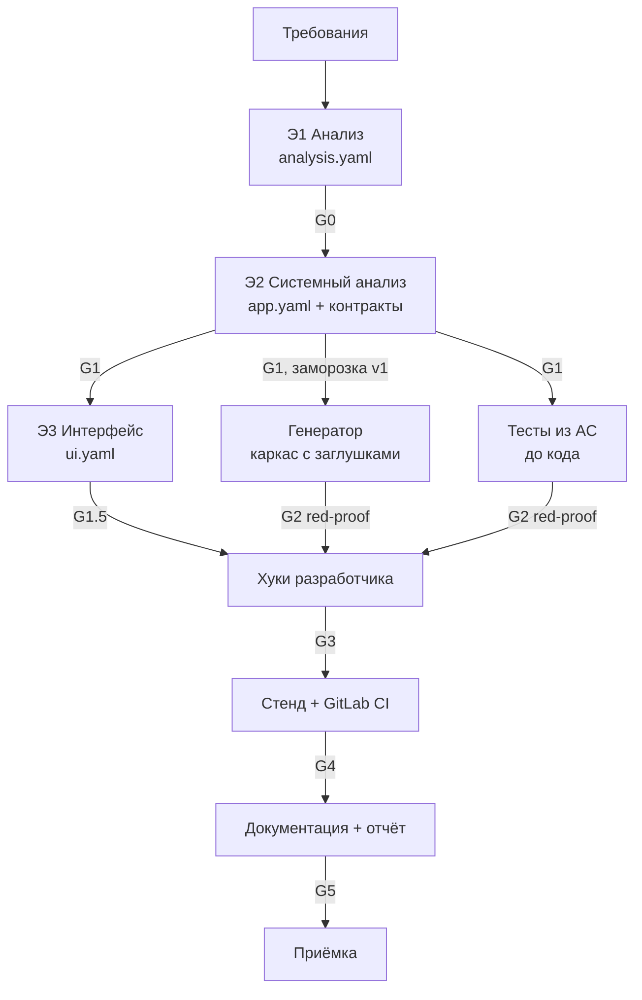

# Архитектура конвейера v2

> Рабочий документ. Основа — наш проект v1 (история `docs/architecture-overview.md` до коммита `1b86987`). Из «Трассы» (`docs/trassa/`) взяты гейты и валидаторы, заморозка спецификации, режимы автономности, профили контекста, лестница попыток разработчика и политика размышлений. Компоненты платформы выровнены по коду `main` (`af1c89c`). Упрощённый MVP-план — `docs/architecture-overview.md`; расхождения с ним и с кодом — в §16.

## 1. Два слоя

| Слой | Что это | Стек |
|---|---|---|
| **Платформа** | Наш конвейер: Студия, дирижёр, агенты, генератор | Angular 20.1.6 + Taiga UI 5, FastAPI, SQLAlchemy + Alembic, Celery, PostgreSQL 17.9 (он же брокер Celery через Kombu SQLAlchemy). Langfuse — по желанию |
| **Генерируемое приложение** | То, что конвейер выдаёт по кейсу | Задан ТЗ: Angular + Angular Material, ASP.NET Core 10, PostgreSQL/PostGIS, Kotlin + Compose M3, Kafka, Docker Compose, GitLab CI |

## 2. Компоненты платформы



**Цикл этапа:**
1. `POST /projects/{id}/runs` → дирижёр создаёт прогон и этапы по DAG → `advance(run_id)`.
2. `advance` ставит в очередь этапы, у которых готовы все входы: агенты → `llm`, генератор и сборки → `build`, GitLab → `io`.
3. Воркер читает входы из git-workspace прогона (`WORKSPACES_DIR/<project_id>/runs/<run_id>`), выполняет этап, затем дирижёр прогоняет гейт этапа (§5), коммитит, пишет результат и событие, вызывает `advance`.
4. Ожидание (ответ пользователя, CI) — статус `waiting_*`, воркер освобождается. Продолжение — через API или отложенную задачу `io`.

## 3. Этапы



| Этап | Вопрос | Что делает | Выход | Гейт |
|---|---|---|---|---|
| Э1 Анализ | Что нужно и зачем? | Разбирает требования, находит дыры, уточняет или фиксирует допущения | `analysis.yaml`: REQ, ISS, Q, ASM, US, AC, BR, NFR, профиль | G0 |
| Э2 Системный анализ | Как устроено? | Сущности, состояния, роли и права, API, события, интеграции, хуки | `app.yaml` → OpenAPI, AsyncAPI, диаграммы | G1 + заморозка |
| Э3 Интерфейс | Как выглядит? | Экраны по ролям и платформам, тексты, состояния экранов | `ui.yaml` | G1.5 |
| Э4 Разработка | Как собрать? | Генератор строит каркас, агент пишет хуки | Код backend, админки, Android, mock | G2 до, G3 после |
| Э5 Тесты и безопасность | Работает и безопасно? | Тесты из AC до кода, red-proof, сканеры | Тесты, отчёты | G2, G3 |
| Э6 Сборка и деплой | Запускается у пользователя? | GitLab CI, образы, стенд, E2E | Зелёный пайплайн, URL, APK | G4 |
| Э7 Документация | Понятно, что сделано? | Три вида документации, паспорт, отчёт | Сайт, паспорт, отчёт о токенах | G5 |

**Границы Э1–Э3.** Э1 — язык бизнеса, без технологий. Э2 — устройство и поведение. Э3 — внешний вид. **Пользователя спрашивает только Э1.** Дыры, найденные позже, этап закрывает сам допущением с пометкой этапа и к Э1 не возвращается.

**Участки в Студии.** В `main` у проекта 10 участков из слайда 9 кейса (`backend/app/projects.py`). Это срезы тех же этапов, а не отдельный конвейер: «Бизнес-анализ» = Э1, «Системный анализ» = Э2, «Интерфейсы» = Э3, «Frontend», «Backend», «База данных» = Э4 по стекам, «Тестирование» и «Безопасность» = Э5, «CI/CD» = Э6, «Документация» = Э7. Студия показывает 7 этапов и даёт фильтр по участку — так каждый участок можно показать отдельно.

## 4. Решения

| № | Решение | Источник |
|---|---|---|
| R1 | Студия на Taiga UI; генерируемая админка на Angular Material, мобильное на Compose M3 | Код `main`; «Трасса» (ADR-13) предлагала Material и для Студии |
| R2 | Celery поверх PostgreSQL: брокер и результаты через Kombu SQLAlchemy. Redis и SQLite не используем | Код `main`; в v1 был Redis, в «Трассе» — SQLite |
| R3 | Свой DAG-планировщик `advance(run_id)` поверх Celery, без chain/chord: возобновление с любого этапа | v1 |
| R4 | Очереди `llm` / `build` / `io` на том же брокере — отдельные процессы воркера с разной конкурентностью; ожидание без занятого воркера (`waiting_*`) | v1 |
| R5 | Свой журнал `llm_calls` — единственный источник чисел отчёта (артефакт №10). Langfuse — по желанию, только для трейсов | v1, ослаблено |
| R6 | **Изменено.** Разработчик пишет хук одноходовыми попытками по лестнице (§10.2), каждая со свежим контекстом. Код возвращается текстом между `<<<CODE` и `CODE>>>`; JSON по схеме — только для данных. Цикл с инструментами из `harness/agent.py` — для мест `custom` | «Трасса» ADR-05, §11.5; в v1 был цикл JSON-действий |
| R7 | `dispute_test`: разработчик оспаривает тест, тестировщик пересматривает его один раз | v1 |
| R8 | Починка спецификаций через JSON Patch по путям находок валидаторов, без перегенерации раздела | v1 |
| R9 | **Изменено.** Политика размышлений по классам задач (§15.2): для кода — выключены, для анализа — `medium` с лимитом. `max_tokens` включает рассуждения, у каждого вызова таймаут. `xhigh` по умолчанию не используем | «Трасса» ADR-06, прил. C |
| R10 | Модуль `geo`: зоны и полигонами, и линиями. Хранятся `geom` и `detect_area` (буфер линии); есть гистерезис и минимальное время в зоне | v1; в «Трассе» тот же вывод из данных (§4, D1–D2) |
| R11 | **Новое.** Гейты G0–G5 — функции дирижёра над артефактами, а не агенты. Результат с адресом находки в спецификации пишется в `gate_results` (§5) | «Трасса» §11.6 |
| R12 | **Новое.** После G1 спецификация замораживается как `v1` и дальше только читается. Изменение — новая версия и перезапуск затронутого по `input_hash` | «Трасса» §11.6, §20.7 + v1 (§14) |
| R13 | **Новое.** Провал гейта понижает результат, а не останавливает прогон: элемент получает статус «под вопросом», зависимые по ссылкам — тоже. Прогон останавливает только сломанный контракт | Наше; в «Трассе» `PARTIAL` на уровне прогона |
| R14 | **Новое.** Режимы автономности A0 / A1 / A2. Для оценки жюри — A2: вопросы закрываются ответами по умолчанию, гейты решает код | «Трасса» §11.11 |
| R15 | **Новое.** Контекст-пакет не больше профиля окна XS–L (§15.2). Токены считает код: локальный токенайзер, потому что у OpenRouter нет `/tokenize` | «Трасса» §6.2, §11.4 |
| R16 | **Изменено.** Живые события клиентам — SSE (в v1 был SignalR). Карты — MapLibre + векторные тайлы `ST_AsMVT` (в v1 Leaflet и osmdroid) | «Трасса» ADR-15, §13 |

## 5. Гейты и валидаторы

Гейт — функция дирижёра. Он читает артефакты этапа и возвращает результат; агент гейт не вызывает и на результат не влияет:

```python
GateResult(gate="G1", passed=False, decided_by="code",
           findings=[Finding(path="state_machines.TicketFlow.transitions[2]",
                             code="SM_UNREACHABLE", severity="error",
                             message="Состояние overdue недостижимо")])
```

`path` указывает в спецификацию, поэтому находка сразу становится JSON Patch-задачей (R8) для шага, который породил элемент. Каждый валидатор — чистая функция над моделью Pydantic, у каждого есть тест с примером нарушения.

### 5.1 Гейты

| Гейт | Когда | Что проверяет | Если не прошёл |
|---|---|---|---|
| **G0** Входы | После шагов 0–1 Э1 | Все файлы разобраны; у каждого REQ якорь — точная подстрока источника; каждый фрагмент покрыт REQ или помечен шумом | Повтор разбора; нечитаемый файл — в отчёт |
| **G1** Спецификация | Конец Э2 | Схема + валидаторы §5.2; все Q закрыты ответами или ASM | До двух кругов JSON Patch → элемент «под вопросом» → заморозка `v1` |
| **G1.5** Интерфейс | Конец Э3 | Линтер проходов (§9.6); `data-testid` уникальны; у экранов с данными есть обязательные состояния | До двух кругов → US без прохода помечается |
| **G2** Red-proof | Перед разработчиком | Тесты AC падают на заглушках на проверке, а не на настройке (§11.2) | До двух возвратов тестировщику → «тест под вопросом» |
| **G3** Сборка и проверки | После Э4–Э5 | Сборка; тесты AC; хэши тестов; green-proof; сканеры без high/critical | Цикл хуков в пределах бюджета → красные AC с причиной |
| **G4** Стенд | Э6 | Health, smoke, E2E по проходам, сценарий демо | Повтор и откат → «не развёрнуто» |
| **G5** Приёмка | После Э7 | A2 — автоматически; A0–A1 — человек проходит сценарий своей роли | Запрос изменения → спецификация `v2` |

### 5.2 Валидаторы G1

Объединение линтеров шагов Э2 из v1 и проверок S2.5 «Трассы».

| Код | Проверка | Важность |
|---|---|---|
| `REF_UNRESOLVED` | Все ссылки по имени и ID разрешаются | error |
| `REQ_UNCOVERED` | Каждый REQ ведёт к US, BR или NFR либо помечен «вне объёма» | error |
| `BR_NO_AC` | У каждого BR есть AC | error |
| `BR_NO_BOUNDARY` | У числового или временного порога есть примеры «N−1 / N / N+1» | error |
| `BR_NO_HOOK` | У каждого BR есть хук или декларативное правило; хук ссылается на AC | error |
| `AC_NOT_TESTABLE` | В AC есть «Дано / Когда / Тогда» и проверяемый результат | error |
| `NFR_NOT_MEASURABLE` | У NFR есть число и способ проверки | warning |
| `VAGUE_WORD` | Слова «быстро», «удобно», «оперативно» и т. п. в AC и NFR без числа | warning |
| `SM_UNREACHABLE`, `SM_DEADLOCK` | Все состояния достижимы; тупики только у терминальных | error |
| `SM_NO_TRIGGER`, `SM_BAD_TRIGGER` | У перехода есть триггер из закрытого списка | error |
| `SM_GUARD_OVERLAP` | Условия переходов одного действия из одного состояния не пересекаются | warning |
| `RBAC_ORPHAN` | У каждого действия роль; у каждой роли действия; действие из US разрешено своей роли | error |
| `EVT_INCOMPLETE` | У события есть производитель, потребитель и ключ | error |
| `NTF_BAD_EVENT` | Уведомление привязано к существующему событию | error |
| `US_NO_ENDPOINT` | Каждое действие из US доступно через операцию API | error |
| `DATA_UNKNOWN_FIELD` | Поля набора данных, на которые ссылается спецификация, есть в карточке данных; единицы указаны | error |
| `PARAM_LITERAL` | Пороги правил вынесены в `params`, а не записаны числом в описании хука | warning |

Ошибки (error) блокируют гейт, предупреждения (warning) уходят в паспорт. Таблица важности — часть кода валидаторов и меняется только вместе с тестами.

### 5.3 Правила применения

- **Понижение вместо остановки (R13).** После двух кругов исправлений элемент получает статус «под вопросом». Всё, что ссылается на него, тоже помечается: генератор делает для этого заглушку, связанные AC становятся красными с причиной. Остальная спецификация идёт дальше. Прогон останавливается, только если сломан контракт: артефакт не проходит схему или не создан.
- **Заморозка (R12).** После G1 `app.yaml` — `v1`, только чтение. Пробел, найденный в Э3–Э7, закрывается допущением в артефакте этого этапа или местом `custom`. Правка спецификации — это `v2`: дирижёр помечает затронутые этапы `stale` и пересчитывает их по `input_hash` (§14.2).
- **Кто решает (R14).** В A2 все гейты решает код. В A1 человек отвечает на вопросы Э1 и подтверждает заморозку на G1. В A0 человек утверждает каждый гейт. Решение человека пишется в `gate_results` с `decided_by="human"` и считается вмешательством в отчёте.
- **Статус AC.** `ac-status.json` — проекция из `gate_results` и отчётов тестов, а не отдельное хранилище. По каждому AC: `specified`, `tested`, `red_proof`, `implemented`, `passes`, `e2e` и причина, если AC красный. Из неё читают Студия, паспорт и отчёт; агенты её не пишут.

## 6. Э1 Анализ — устройство

Цепочка узких шагов с проверками кодом между ними, а не один большой промпт.

| Шаг | Кто | Что делает | Проверка |
|---|---|---|---|
| 0 Приём | Код (+ Qwen-VL для картинок) | Текст, PDF, картинки → единый источник; каждый фрагмент получает ID `S-NNN` | — |
| 1 Извлечение | Модель, по кускам параллельно | Список REQ со ссылками `source: [S-…]` | Ссылки существуют; каждый фрагмент покрыт REQ или помечен как шум |
| 2 Каркас домена | Модель | Роли, глоссарий, профиль: модули шаблона из перечисления в схеме | Профиль валиден; непокрытое → «вне объёма» |
| 3 Поиск дыр | Модель | ISS по чек-листу ГОСТ 34.602 (полнота, однозначность, проверяемость, непротиворечивость) → Q с вариантами, ответом по умолчанию, обоснованием, пометкой «блокирующий» | Схема |
| 4 Уточнение | Код | Интерактивный режим — все вопросы одним пакетом, `waiting_input`, по таймауту ответы по умолчанию. Автономный режим — ответ по умолчанию сразу → ASM | — |
| 5 Синтез | Модель, по фичам параллельно | US, BR с именованными параметрами, AC в Gherkin с граничными примерами, NFR, границы | У каждого BR есть AC; у US есть роль; ID уникальны; трассы REQ → US/BR → AC замкнуты |
| 6 Ревизия | Модель | Пропуски → JSON Patch, не больше двух кругов | Повтор проверок шагов 1 и 5 |

**Выход:** `analysis.yaml` + читаемая версия в Markdown (рендерит код) + метрики: покрытие источника, число ISS и ASM, попытки.

**Пример для понятности — что Э1 должен найти на кейсе №1.** Сам этап доменно-нейтрален, это только иллюстрация:
- по какому правилу нужна новая оплата при смене зоны (в СПб оплата привязана к номеру зоны);
- как система узнаёт об оплате без реальной оплаты: подтверждение водителем или mock-провайдер;
- предупреждение «за 10 минут» при оплате короче 10 минут;
- въезд в зону вне часов её работы (будни 08:00–20:00) и в выходные;
- кто пользуется админкой и что видит в истории.

## 7. Э2 Системный анализ — устройство

Принцип: **модель пишет минимум, остальное выводит код.** CRUD, события на переходах, тесты прав, OpenAPI и AsyncAPI получаются из `app.yaml` механически.

**Вход:** `analysis.yaml` и профили приложенных данных. Если к требованиям приложены файлы с данными (JSON, CSV, GeoJSON), код снимает с них структуру — поля, типы, типы геометрии, единицы — и отдаёт Э2 короткую сводку вместо самих данных.

Шаги идут по порядку: каждый ссылается на предыдущие. После каждого — схема и линтер, ошибки чинятся через JSON Patch (R8).

| Шаг | Что пишет модель | Что достраивает код | Линтер |
|---|---|---|---|
| 1 Домен | Сущности, поля, типы из закрытого списка (`geometry`, `money`, `enum`…), связи, инварианты | Таблицы, миграции, ERD | Типы из списка, ссылки существуют |
| 2 Роли и права | Матрица «роль × операция» | Тесты «роль × операция → 200 или 403» | Каждая роль из Э1 есть; каждое действие из US разрешено своей роли |
| 3 Поведение | Машины состояний: состояния, переходы, триггеры (команда, событие, расписание, гео-событие), условия-хуки | Диаграммы состояний, события на переходах | Достижимость, нет тупиков, у перехода есть триггер |
| 4 Правила → хуки | Для каждого BR — хук из каталога видов (валидатор, калькулятор, решатель, политика) и его параметры | Интерфейсы и заглушки хуков | У каждого BR есть хук или декларативное правило; хук ссылается на AC |
| 5 API | Команды и запросы сверх CRUD | CRUD-эндпоинты, OpenAPI | Каждое действие из US доступно через эндпоинт |
| 6 Окружение | Интеграции (порт, операции, поведение mock), расписания, уведомления по событиям | AsyncAPI, адаптер + mock, задачи планировщика | Уведомление привязано к существующему событию |
| 7 Данные | Тестовые данные и сценарий симулятора | Сид БД, скрипт демо | Сценарий покрывает AC демо-сценария |

**Выход:** `app.yaml` + производные (OpenAPI, AsyncAPI, ERD, диаграммы состояний, матрица прав), прошедшие валидаторы.

**Принципы:**
- **Закрытый словарь.** В DSL только то, что умеет генератор; всё прочее отвергает схема.
- **Аварийный выход `custom`.** Требование, которое DSL не выражает, становится нетиповым эндпоинтом или хуком с текстовым описанием для разработчика на Э4. DSL не блокирует прогон; такие места видны в паспорте.
- **Узкий контекст.** Каждый шаг получает нужный срез `analysis.yaml` и сжатые готовые части `app.yaml`.

**Пример для понятности (кейс №1).** Сущности `Vehicle`, `ParkingZone` (геометрия, импорт через интеграцию), `ParkingSession` с машиной состояний. Хуки: решатель «где машина», политика «нужна ли новая оплата», калькулятор предупреждения с параметром `EXPIRY_WARNING_MIN = 10`. Интеграция `ParkingProvider`: адаптер Паркоматики и mock.

## 8. DSL `app.yaml` — схема верхнего уровня

Контракт C2. Его читают генератор всех трёх стеков, тестировщик, Э3, техписатель и Студия.

### 8.1 Правила формы (под модель на 27B)

- **Плоско.** Разделы верхнего уровня — словари «имя → описание». Ссылки — по имени (`ref: Ticket`), без вложенных деревьев глубже 3 уровней.
- **Один раздел — один шаг Э2.** Каждый раздел генерируется и валидируется отдельно; схема раздела самодостаточна.
- **Закрытые перечисления** для всего, что читает генератор: типы полей, виды хуков, триггеры, каналы, операции.
- **Трассы обязательны:** у сущности, перехода, хука, команды — поле `traces: [US-…, BR-…, AC-…]`.
- **Неявное — по соглашению, а не текстом.** CRUD, события на переходах, топики Kafka, тесты прав генератор выводит сам. Модель их не пишет.

### 8.2 Разделы

| Раздел | Шаг Э2 | Что описывает | Что выводит генератор |
|---|---|---|---|
| `meta` | — | Имя, язык интерфейса, модули из профиля Э1, версия DSL | Каркас проекта, набор модулей |
| `params` | 4 | Именованные параметры правил: тип (`int`, `duration`, `money`…), значение, источник BR | `appsettings`, класс параметров; тесты берут значения отсюда |
| `types` | 1 | Перечисления и составные типы-значения, в том числе `interval` (начало и конец) с опцией «без пересечений в пределах ключа» | Enum и value object во всех стеках; ограничение исключения в БД для `interval` |
| `entities` | 1 | Поля с типами, обязательность, уникальность, связи, поле владельца, источник (`local` или интеграция), жизненный цикл | Таблицы, миграции, CRUD, формы и списки админки |
| `roles` | 2 | Роли и демо-пользователи | Авторизация, сид пользователей |
| `permissions` | 2 | Матрица «роль × операция» с областью (`all`, `own`, `team`) | Проверки прав, тесты 200/403 |
| `state_machines` | 3 | Состояния, переходы, триггеры, условия-хуки, эффекты | Переходы в домене, события, журнал, диаграммы |
| `hooks` | 4 | Хуки: вид из каталога, вход, выход, параметры, правило, AC | Интерфейс + нейтральная заглушка во всех стеках, где нужен |
| `commands` / `queries` | 5 | Операции сверх CRUD: роль, вход, выход, эффекты | Эндпоинты, OpenAPI, клиенты для Angular и Kotlin |
| `events` | 6 | Доменные события сверх событий переходов, полезная нагрузка | Конверт события, топики, AsyncAPI, лента в админке |
| `integrations` | 6 | Порт внешней системы: операции, импорт данных в сущность, поведение mock | Порт, mock-сервис, адаптер-заглушка, переключатель реализации |
| `schedules` | 6 | Периодические действия: интервал, команда или хук | Задачи на управляемых часах |
| `notifications` | 6 | По какому событию, кому, по каким каналам (закрытый список: `web`, `mobile`, `email`, `sms`), текст с подстановками | Шаблоны, доставка в веб и мобильное приложение; `email` и `sms` — через порт интеграции с mock |
| `seed` | 7 | Тестовые записи и файлы данных | Сид БД |
| `scenarios` | 7 | Сценарии симулятора: шаги по времени, действия, ожидаемые AC | Скрипт симулятора, E2E демо |
| `custom` | любой | Нетиповое: описание, место (эндпоинт, экран, хук), AC | Заглушка с описанием для разработчика; пометка в паспорте |

**Триггеры переходов** (закрытый список): `command`, `event`, `schedule`, `timer` (истекло время относительно поля), `geo` (вход или выход из области).

### 8.3 Каталог видов хуков

Хук — **чистая функция** над сгенерированными типами: без БД, сети и времени. Время и данные передаёт сгенерированный код. Поэтому хуки тестируются unit-тестами, а red-proof дешёвый.

Если правилу нужны другие записи (пересечение броней, остаток на складе, число открытых заявок исполнителя), в описании хука указывается `select: <query>` — именованный запрос из раздела `queries`. Генератор выполняет его и передаёт результат хуку как вход. Хук остаётся чистым, а запрос тестируется отдельно.

| Вид | Сигнатура | Отвечает на вопрос | Примеры из разных доменов |
|---|---|---|---|
| `validator` | вход команды, состояние → ok или список ошибок | «Можно ли так?» | Заявку нельзя закрыть без решения; инвентарный номер по маске |
| `calculator` | входные данные → значение | «Сколько?» | Срок SLA по приоритету и календарю; стоимость аренды; время предупреждения |
| `decider` | входные данные → один из вариантов перечисления | «Что произошло или куда?» | Какой команде назначить заявку; в какой области находится объект |
| `policy` | субъект, контекст → разрешить или запретить + причина | «Положено ли?» | Можно ли выдать оборудование сотруднику; нужна ли новая оплата |
| `reaction` | событие, состояние → список команд | «Что сделать в ответ?» | При просрочке — эскалация; при списании — закрыть выдачи |

### 8.4 Пример (домен «заявки с SLA», для понятности)

```yaml
params:
  SLA_HIGH: { type: duration, value: 4h, traces: [BR-2] }

entities:
  Ticket:
    fields:
      title:    { type: string, required: true }
      priority: { type: enum, ref: Priority }
      assignee: { type: ref, ref: Employee, nullable: true }
      due_at:   { type: datetime, computed_by: SlaDeadline }
    owner: author
    lifecycle: TicketFlow

state_machines:
  TicketFlow:
    initial: new
    states: [new, in_progress, overdue, resolved]
    transitions:
      - { name: take,    from: new,         to: in_progress, trigger: { command: TakeTicket } }
      - { name: expire,  from: in_progress, to: overdue,     trigger: { timer: due_at } }
      - { name: resolve, from: [in_progress, overdue], to: resolved,
          trigger: { command: ResolveTicket }, guard: ResolutionRequired }

hooks:
  SlaDeadline:        { kind: calculator, in: [Ticket], out: datetime, params: [SLA_HIGH], traces: [BR-2, AC-04, AC-05] }
  ResolutionRequired: { kind: validator,  in: [ResolveTicket], traces: [BR-3, AC-07] }
```

Из этого генератор сам выводит: CRUD для `Ticket`, события `TicketTaken`, `TicketExpired`, `TicketResolved`, топик Kafka, проверку таймера в планировщике и тесты прав.

## 9. Э3 Интерфейс и `ui.yaml`

Контракт C3. Тот же принцип, что в Э2: **базу выводит код, модель только дорабатывает.** Из `app.yaml` механически получаются экраны списков, карточек и форм для каждой сущности и меню по правам. Модель решает то, что из модели данных не следует: какой экран главный для роли, что показать на карте или дашборде, как пройти US за минимум шагов, какие тексты увидит пользователь.

### 9.1 Шаги

| Шаг | Кто | Что делает | Проверка |
|---|---|---|---|
| 0 Вывод базы | Код | Для каждой сущности и роли с правом чтения — `list` + `detail`; с правом создания или изменения — `form`; кнопки команд и переходов на карточке; меню роли из `permissions`; контрол поля по его типу | — |
| 1 Платформы | Модель | Для каждой US — платформа (`web`, `mobile`) и роль-исполнитель; какие базовые экраны не нужны роли вообще | У US ровно одна платформа; роль из Э1 |
| 2 Доработка | Модель, по ролям параллельно | JSON Patch к базе: паттерн экрана, главный экран роли, виджеты сверх CRUD, группировка полей, фильтры | Схема; ссылки на queries, commands, events существуют |
| 3 Проходы US | Модель | Для каждой US — путь по экранам: открыть, заполнить, нажать, увидеть | Линтер проходов (§9.6) |
| 4 Тексты и состояния | Модель | Заголовки, подписи, пустые состояния, сообщения об ошибках на языке `meta.lang`; тексты ошибок валидаторов по кодам | Ключи текстов покрыты; нет текстов на чужом языке |
| 5 Ревизия | Код + модель | Ошибки линтера → JSON Patch, не больше двух кругов (R8) | Повтор шагов 1–4 |

**Выход:** `ui.yaml` + карта экранов (диаграмма навигации по ролям) + проходы US — вход для E2E на Э5 и Э6.

### 9.2 Каталог паттернов экранов

Закрытый список: для каждого паттерна в шаблоне есть готовый компонент в обоих стеках.

| Паттерн | Для чего | Angular Material | Compose M3 |
|---|---|---|---|
| `list` | Таблица или лента записей с фильтрами, поиском, страницами | `mat-table` + `mat-paginator` + `mat-sort` | `LazyColumn` + `ListItem`, `FilterChip` |
| `detail` | Карточка записи: поля, статус, история, доступные действия | `mat-card`, `mat-tab-group` | `Card`, `TabRow` |
| `form` | Создание и изменение; поля по типам, ошибки валидаторов у полей | `mat-form-field`, Reactive Forms | `OutlinedTextField`, `ExposedDropdownMenu` |
| `wizard` | Длинная команда по шагам | `mat-stepper` | Свой степпер на `Scaffold` |
| `dashboard` | Счётчики и графики по queries для роли-наблюдателя | `mat-grid-list` + графики | `LazyVerticalGrid` + `Card` |
| `map` | Объекты и области на карте, своя позиция | MapLibre GL (`@maplibre/ngx-maplibre-gl`), тайлы `ST_AsMVT` | MapLibre Native в `AndroidView` |
| `feed` | Лента событий в реальном времени | `mat-list` + поток событий | `LazyColumn` + поток событий |
| `action` | Один крупный сценарий на экран: «начать», «завершить», таймер | `mat-card` + `mat-raised-button` | `Scaffold` + `ExtendedFloatingActionButton` |
| `settings` | Параметры пользователя и `params` для администратора | `mat-slide-toggle`, формы | `Switch`, `ListItem` |

### 9.3 Виджеты

| Виджет | Источник данных | Пример |
|---|---|---|
| `field` | Поле сущности; контрол по типу (`money` → поле с валютой, `geometry` → мини-карта, `enum` → выбор) | Приоритет заявки |
| `status` | Состояние машины; цвет по группе состояний (`active`, `warning`, `done`, `error`) | «Просрочена» красным |
| `countdown` | Поле `datetime` или вывод `calculator` | Время до нарушения SLA |
| `kpi` | Query с агрегатом | Заявок в работе по командам |
| `timeline` | Журнал переходов сущности | История выдач оборудования |
| `map_layer` | Query с геометрией | Точки обхода и пройденный маршрут |
| `action_button` | Command или переход; скрыт без права, неактивен при ложном условии | «Взять в работу» |
| `scan` | Камера → строка (QR, штрихкод) | Инвентарный номер при выдаче |
| `file` | Поле-файл | Фото дефекта при обходе |

### 9.4 Привязки и состояния экрана

Экран связан с `app.yaml` только по именам — это и проверяет линтер:

- `source: { query: OpenTickets, params: { team: $user.team } }` — откуда данные;
- `actions: [{ command: TakeTicket, confirm: true }]` — что можно сделать;
- `live: [TicketExpired, TicketTaken]` — какие события обновляют экран. Backend транслирует события из Kafka клиентам по SSE (R16): в вебе поток читается через `fetch`, чтобы передать заголовок авторизации, в мобильном — через `okhttp-sse`, пока приложение активно.

У каждого экрана с данными обязательны состояния `loading`, `empty`, `error`, `forbidden`; у мобильных — ещё `offline`. Код подставляет стандартные, модель задаёт только тексты `empty` (например «Нет заявок, назначенных вам») и действие из пустого состояния.

### 9.5 Возможности мобильного

Закрытый список `device`. Каждая возможность — модуль шаблона с разрешениями в манифесте и **заменой в эмуляторе и E2E**.

| Возможность | Параметры | Замена в эмуляторе и E2E | Пример |
|---|---|---|---|
| `location` | Источник `gps` / `simulator` / `manual`; режим `foreground` или `background`; интервал; точность | Координаты из сценария симулятора | Отметка прибытия на объект обхода |
| `local_notification` | Событие или таймер на устройстве; текст из `notifications` | Проверка через `NotificationManager` в тесте | Напоминание за N минут до срока |
| `external_link` | Шаблон URL или deep link с подстановками; что делать после возврата | Mock-страница, возвращающая в приложение | Оплата или подпись во внешнем сервисе |
| `scan_code` | Формат (QR, EAN), поле назначения | Строка подставляется тестом | Выдача оборудования по коду |
| `file_pick` | Камера или галерея, ограничения размера | Файл из ресурсов теста | Фото дефекта |

### 9.6 Проходы US

Проход — короткий сценарий в терминах экранов. Он доказывает, что US выполнима в интерфейсе, и механически превращается в E2E (Playwright для веба, Compose UI Test для Android).

```yaml
walks:
  US-07:   # домен «учёт оборудования»: кладовщик выдаёт ноутбук сотруднику
    role: storekeeper
    platform: mobile
    steps:
      - open: IssueScreen
      - scan: { widget: item_code, value: $seed.Item.laptop1.inv_no }
      - fill: { employee: $seed.Employee.ivanov }
      - tap: IssueItem                     # command
      - expect: { screen: ItemDetail, status: issued }
    covers: [AC-15, AC-16]
```

**Линтер проходов:** экраны и виджеты существуют; каждая команда разрешена роли прохода; значения берутся из `seed` и `params`, а не литералами; у каждой US есть проход; каждый AC с пометкой «UI» покрыт хотя бы одним проходом; из главного экрана роли до каждого экрана прохода есть путь по навигации.

**Пример для понятности (кейс №1).** Водитель — `mobile`: главный экран `action` («Я припарковался», таймер оплаты), `map` с зонами, `location` с источником `simulator` для демо, `local_notification` за `EXPIRY_WARNING_MIN` до окончания, `external_link` на оплату у провайдера. Оператор — `web`: `list` сессий, `map` зон, `feed` событий.

## 10. Э4 Разработка — генератор и агент-разработчик

Разработка делится на две неравные части: **генератор** (код, детерминированно) строит всё приложение, кроме смысла; **агент-разработчик** (модель) вписывает только хуки и места `custom`. Объём кода, который пишет модель, — сотни строк, а не десятки тысяч.

### 10.1 Генератор

**Вход:** `app.yaml`, `ui.yaml`, профиль модулей. **Выход:** четыре проекта (backend, админка, мобильное, mock) + инфраструктура, которые сразу собираются и проходят тесты прав и CRUD.

**Конвейер генератора:**
1. `app.yaml` → нормализованная модель (имена во всех нотациях, развёрнутые соглашения: CRUD, события переходов, топики).
2. Модель → OpenAPI и AsyncAPI → `openapi-generator`: клиенты для Angular (TypeScript) и Kotlin (Retrofit + kotlinx.serialization).
3. Модель → шаблоны Jinja по модулям: домен и EF Core, контроллеры, машины состояний, планировщик, компоненты экранов, Compose-экраны, Dockerfile, Compose, CI.
4. Форматтеры (`dotnet format`, `prettier`, `ktlint`) — чтобы диффы между прогонами были чистыми.

**Детерминизм:** одинаковый вход → побайтно одинаковый выход. Шаблоны покрыты снапшот-тестами на трёх эталонных доменах (заявки с SLA, учёт оборудования, обход объектов): ошибка в шаблоне ловится до прогона, а не на защите.

**Generation gap.** Сгенерированное и написанное моделью никогда не лежат в одном файле.

| Стек | Сгенерировано (перезаписывается всегда) | Пишет модель (генератор не трогает) | Механизм |
|---|---|---|---|
| ASP.NET | `backend/src/*/Generated/**` | `backend/src/App.Domain/Hooks/<Name>.cs`, `backend/src/App.Api/Custom/<id>/**` | Интерфейс `I<Name>Hook` + регистрация в DI; заглушка — отдельный класс, заменяется привязкой |
| Angular | `admin-web/src/app/generated/**` | `admin-web/src/app/custom/<id>/**` | Базовый компонент + слот расширения в маршрутах |
| Kotlin | `mobile/app/src/main/java/<pkg>/generated/**` | `…/hooks/<Name>.kt`, `…/custom/<id>/**` | Интерфейс + реализация по умолчанию, выбор в модуле DI |
| Тесты | `tests/generated/**` (права, CRUD) | — (тесты из AC пишет тестировщик, §11) | — |

Повторная генерация после правки `app.yaml` не теряет хуки: меняется сигнатура — ломается компиляция именно в файле хука, и он уходит разработчику с ошибкой компилятора как входом.

**Модули шаблона** (включаются профилем из Э1 и разделами `app.yaml`):

| Модуль | Backend | Админка | Мобильное | Инфраструктура |
|---|---|---|---|---|
| `core` | Auth (JWT), CRUD, аудит, ошибки по RFC 7807, health | Вход, меню, `list`/`detail`/`form` | Вход, навигация | Postgres, миграции |
| `workflow` | Машины состояний, журнал переходов, события | `status`, `timeline` | `status` | — |
| `events` | Outbox → Kafka, мост Kafka → SSE | `feed` | Поток событий | Kafka (KRaft) |
| `scheduler` | Задачи на управляемых часах, таймеры переходов | — | — | — |
| `geo` | PostGIS, `geom` + `detect_area`, гистерезис (R10) | `map` | `map`, `location` | Образ PostGIS |
| `notify` | Шаблоны, доставка по каналам | Колокольчик | `local_notification` | — |
| `integrations` | Порт, адаптер, переключатель реализации | — | `external_link` | Сервис mock |
| `files` | Хранение файлов | `file` | `file_pick`, `scan_code` | Том |
| `sim` | Управляемые часы в API | — | Источник `simulator` | Сервис симулятора |

### 10.2 Цикл агента-разработчика

**Единица работы** — один хук в одном стеке. Хуки независимы по данным, но порядок задаёт граф зависимостей: домен → приложение → API → UI. Хуки в разных файлах идут параллельно в очереди `llm`, сборка — последовательно в очереди `build`. Если хук нужен в двух стеках (например, решатель области и на сервере, и на устройстве), сначала пишется C#-версия, затем Kotlin-версия по тем же тестам.

**Спецификация хука** — её пишет генератор, а не модель (формат «Трассы», §11.5):

```yaml
id: SlaDeadline
file: backend/src/App.Domain/Hooks/SlaDeadline.cs
kind: calculator
refs: [BR-2, AC-04, AC-05]
contract:
  summary: "Срок решения заявки по приоритету и рабочему календарю"
  pre: ["created_at — локальное время офиса"]
  post: ["срок не раньше created_at", "нерабочие часы не считаются"]
examples:                 # из таблиц Gherkin AC-04 и AC-05
  - {priority: high, created_at: "2026-11-06T17:00", expected: "2026-11-09T12:00"}
allowed_api: [Ticket, Priority, IWorkCalendar.IsWorkingTime, SlaParams]
max_lines: 60
```

**Контекст попытки** собирает код в пределах профиля окна (§15.2): ролевая карточка, шпаргалка по стеку (≤30 строк из шаблона), спецификация хука, сигнатуры `allowed_api`, один готовый хук того же вида как образец. Истории предыдущих задач в контексте нет.

**Лестница попыток (R6).** Каждая попытка — один вызов модели со свежим контекстом. Модель возвращает тело хука текстом между `<<<CODE` и `CODE>>>`; код вписывает его в файл, собирает проект и гоняет тесты хука.

| Попытка | Режим | Что добавляется в контекст |
|---:|---|---|
| 1 | Без размышлений, T = 0,2 | — |
| 2 | Без размышлений, T = 0,2 | Предыдущее тело + ошибки компилятора или упавшие тесты (до 20 строк, с ожидаемым и фактическим) |
| 3 | Размышления `low`, не больше 2 000 токенов | То же + расширенные сигнатуры |
| 4 | Три кандидата параллельно, T = 0,6; берётся первый, который собирается и проходит тесты | То же |
| — | Заглушка остаётся, хук и его AC красные с причиной, работа над остальными продолжается | — |

**Разрешённые пути.** Модель пишет только в файл своего хука: `backend/src/App.Domain/Hooks/<Name>.cs`, `admin-web/src/app/custom/<id>/**`, `mobile/app/src/main/java/<pkg>/hooks/<Name>.kt`, `db/seed/**`. Тесты (`tests/`, `spec/`, `e2e/`) только читаются; это уже проверяет политика записи в `harness/agent.py`. Новые пакеты добавлять нельзя: хук, которому нужна библиотека вне allowlist, завершается с причиной «нужна зависимость X».

**Места `custom`** — нетиповые эндпоинты и экраны с текстовым описанием из `app.yaml`. Их пишет цикл с инструментами из `harness/agent.py` (`read_file`, `write_file`, `build`, `run_tests`, `finish`) с теми же разрешёнными путями, лимитом ходов и откатом к последнему зелёному снимку при отсутствии прогресса.

**Защита от регрессий.** Хук принимается, только если зелёные его тесты **и** весь набор тестов стека. Принятый хук — коммит в workspace прогона. Перегенерация каркаса хук не трогает (generation gap, §10.1); если поменялась сигнатура, хук снова попадает в лестницу с ошибкой компилятора как входом.

**`dispute_test` (R7).** Если тест противоречит AC (неверное граничное значение, перепутанный параметр), разработчик возвращает вместо кода строку `// DISPUTE: <тест> — <причина>, <AC>`. Тестировщик получает тест, AC, BR и аргумент и выносит одно из решений: `fix` — исправляет тест, тест снова проходит G2, лестница начинается заново; `reject` — тест остаётся, аргумент и ответ попадают в контекст следующей попытки. На один тест — один спор. Все споры и решения — в отчёте Э7.

**Пример (домен «обход объектов»).** Хук `VisitCounted` (решатель): засчитан ли визит, если сотрудник был в радиусе объекта меньше `MIN_STAY` или вышел и вернулся. Спецификация содержит сигнатуру `(track: GeoPoint[], site: Site, p: Params) → VisitResult` и примеры «4 мин 59 с — не засчитан», «две отметки с разрывом 30 с — один визит». Попытка 1 не проходит 2 теста из 6 (гистерезис); попытка 2 с этими тестами в контексте проходит все.

## 11. Э5 Тесты и безопасность

Тесты пишутся **из AC до кода** другим агентом (тестировщиком), который не видит реализацию. Разработчик не может их менять. Так зелёный прогон означает «требование выполнено», а не «модель подогнала тест под себя».

### 11.1 Уровни тестов

| Уровень | Откуда | Кто пишет | Чем | Что доказывает |
|---|---|---|---|---|
| Unit хуков | AC с примерами, BR, `params` | Тестировщик | xUnit; kotlin.test | Правило посчитано верно, включая границы |
| API по AC | AC в Gherkin: Given → сид и часы, When → команда, Then → query и события | Тестировщик | xUnit + `WebApplicationFactory` + Testcontainers | Поведение системы целиком, с БД и Kafka |
| Права | `permissions` | Код | Генерируемые xUnit | Каждая пара «роль × операция» → 200 или 403; область `own` не видит чужое |
| Переходы | `state_machines` | Код | Генерируемые xUnit | Недопустимый переход → 409; событие на каждом переходе |
| Контракт | OpenAPI | Код | Schemathesis | Ответы соответствуют схеме, нет 500 на краевых входах |
| E2E | Проходы US (§9.6), `scenarios` | Код из проходов | Playwright; Compose UI Test | US выполнима в интерфейсе; демо-сценарий проходит |

**Правила для тестировщика:**
- Каждый пример из AC — строка параметризованного теста; граничные значения обязательны (`N−1`, `N`, `N+1` для порога).
- Значения порогов — из сгенерированного класса параметров, а не литералами: линтер ищет в тестах числа, совпадающие со значениями `params`.
- Время — только через управляемые часы, никаких `DateTime.Now` и `sleep`.
- Имя теста содержит ID AC: так строится матрица трассировки.

**Пример (домен «заявки с SLA»).** AC-05: «заявка высокого приоритета, созданная в пятницу в 17:00 при рабочем дне до 18:00, получает срок в понедельник в 12:00». Тестировщик пишет unit-тест `SlaDeadline` с примерами пятницы, кануна праздника и ровно границы рабочего дня, и API-тест: создать заявку → сдвинуть часы на `SLA_HIGH` рабочих часов + 1 минута → заявка в `overdue`, событие `TicketExpired` в топике.

### 11.2 Red-proof

Тест, который проходит на заглушке, ничего не проверяет. Поэтому перед работой разработчика:

1. Генератор кладёт нейтральные заглушки (возвращают «пусто», «ноль», «разрешено», не бросают исключений).
2. Тесты из AC запускаются на заглушках. Тест, который ожидает **не нейтральное** значение, должен упасть **на проверке** (`Assert`), а не на компиляции, настройке или исключении.
3. Тест, который ожидает нейтральное значение (например, «заявку без решения закрыть нельзя» против заглушки «разрешено»), может пройти на заглушке законно. Для него требование другое: он обязан покраснеть хотя бы на одной мутации из green-proof.
4. Тест, нарушивший пункты 2–3, возвращается тестировщику с причиной; не больше двух кругов, дальше тест помечается в паспорте как слабый (G2, §5.1).

**Green-proof (после разработчика, дёшево за счёт чистых хуков).** На принятом хуке код делает 3–5 мутаций (перевернуть сравнение, сдвинуть порог на единицу, вернуть другой вариант перечисления). Хотя бы один тест обязан покраснеть на каждой мутации. Выжившая мутация — задача тестировщику дописать пример.

### 11.3 Целостность тестов

- После red-proof хэши файлов тестов фиксируются в таблице `test_hashes` (§14). Перед каждым запуском и в CI код сверяет хэши; расхождение — отказ, а не предупреждение.
- Изменить тест можно только через решение `fix` по `dispute_test`: новый хэш записывается вместе со ссылкой на спор.
- Линтер тестов запрещает `Skip`, `[Ignore]`, `@Disabled`, пустые тела, тесты без проверок, `try/catch` вокруг проверок.
- Матрица трассировки AC → тесты замкнута: AC без теста или тест без AC — ошибка этапа.

### 11.4 Сканеры

| Что | Инструмент | Где запускается |
|---|---|---|
| Код (SAST) | Semgrep (C#, TypeScript, Kotlin) | Песочница + CI |
| Зависимости | `dotnet list package --vulnerable`, `npm audit`, OWASP Dependency-Check для Gradle | Песочница + CI |
| Образы и файлы | Trivy | CI после сборки образов |
| Секреты | Gitleaks | Песочница + CI |
| Dockerfile | Hadolint | Песочница + CI |
| Работающий стенд (DAST) | OWASP ZAP baseline | CI после деплоя |

**Гейт:** нет находок high и critical. **Маршрут находки:**
- в сгенерированном коде → исправляется **шаблон**, один раз для всех будущих прогонов; в текущем прогоне — перегенерация;
- в хуке или `custom` → задача разработчику с находкой во входе;
- ложное срабатывание → подавление с обоснованием; список подавлений — в паспорте.

**Безопасность по построению** (в шаблоне, а не в руках модели): JWT и проверка прав в каждом эндпоинте из `permissions`, фильтр области `own`/`team` в запросах, только параметризованные запросы EF Core, валидация входа по схеме, CORS по списку, секреты из переменных окружения и CI, непривилегированный пользователь в образах.

## 12. Э6 Сборка и деплой

### 12.1 Структура генерируемого репозитория

```
backend/      ASP.NET Core 10: App.sln, src/App.{Api,Application,Domain,Infrastructure,Worker}/,
              Hooks/ в App.Domain, Custom/ в App.Api, tests/ (только чтение для разработчика)
admin-web/    Angular 20 + Material: src/app/generated, src/app/custom, e2e/
db/seed/      сид данных из раздела seed
spec/         замороженные analysis.yaml, app.yaml, ui.yaml
mobile/       Kotlin 2.2 + Compose M3: generated/, hooks/, custom/, androidTest/
mock/         mock-сервисы интеграций (по разделу integrations)
simulator/    прогон scenarios на управляемых часах
infra/        docker-compose.yml, .env.example, скрипты стенда
docs/         сайт документации (§13)
.gitlab-ci.yml
```

Всё в `infra/` и `.gitlab-ci.yml` — из шаблонов. Модель эти файлы не пишет. Имена каталогов совпадают с разрешёнными путями и командами сборки в `harness/agent.py` (`backend/App.sln`, `admin-web`, `mobile`), чтобы харнесс и генератор не разошлись.

### 12.2 Docker Compose

| Сервис | Образ | Health-check | Зависит от |
|---|---|---|---|
| `db` | `postgis/postgis:17` | `pg_isready` | — |
| `kafka` | Kafka в режиме KRaft | `kafka-topics --list` | — |
| `backend` | Сборка `backend/` | `GET /health` (БД + Kafka) | `db`, `kafka` — `service_healthy` |
| `admin` | Сборка `admin/` → nginx | `GET /` | `backend` |
| `mock` | Сборка `mock/` | `GET /health` | — |
| `simulator` | Сборка `simulator/`, профиль `demo` | — | `backend` |

Один `docker compose up` поднимает всё; миграции и сид выполняет `backend` при старте. Профиль `demo` добавляет симулятор и демо-данные. Версии образов закреплены.

### 12.3 GitLab CI

| Стадия | Задачи | Правило |
|---|---|---|
| `lint` | Форматтеры, линтер тестов, Hadolint, Gitleaks | Всегда |
| `build` | `dotnet build`, `ng build`, `gradle assembleDebug` | Всегда |
| `test` | Unit + API (Testcontainers), права, переходы, Jest, unit Kotlin; сверка `test_hashes` | Всегда |
| `security` | Semgrep, аудит зависимостей, Trivy по образам | Всегда |
| `package` | Образы в GitLab Registry с тегом коммита; APK как артефакт | Ветка по умолчанию и MR |
| `deploy` | Выкатка на стенд (§12.5) | Ветка по умолчанию |
| `e2e` | Playwright по проходам US; демо-сценарий симулятора; Schemathesis; ZAP baseline | После `deploy` |
| `docs` | Сборка сайта → GitLab Pages | Ветка по умолчанию |

Кэши NuGet, npm и Gradle — по lock-файлам. Отчёты тестов в формате JUnit и отчёты сканеров публикуются артефактами: их читают Студия и Э7.

### 12.4 Песочница

Перед пушем в GitLab воркер `build` прогоняет тот же путь локально — **в тех же образах, что и CI**: сборка трёх стеков, тесты, сканеры, `docker compose up` + health-check. Цель — чтобы CI почти всегда был зелёным с первого раза: минута в песочнице дешевле круга «пуш → очередь раннера → лог».

- Изоляция: контейнер без сети, кроме зеркала пакетов и реестра; лимиты CPU и памяти; таймаут на шаг.
- Кэши пакетов — общий том между прогонами (только чтение для задач).
- Результат песочницы — те же JUnit-отчёты, что в CI; гейты Э4 и Э5 считаются по ним.

### 12.5 Деплой и стенд

Стенд — ВМ с Docker и раннером GitLab. Задача `deploy`: `docker compose pull && docker compose up -d` с тегом коммита → ожидание health всех сервисов → smoke (вход демо-пользователем каждой роли, один запрос на роль). Ошибка health-check → откат на предыдущий тег и красная задача. Выход этапа — URL админки, URL API, ссылка на APK, учётные записи ролей.

### 12.6 Починка CI

Воркер `io` следит за пайплайном (вебхук GitLab, запасной вариант — опрос раз в 30 с); пока пайплайн идёт, этап в статусе `waiting_ci` и воркер свободен (R4). При падении:

1. Код скачивает лог упавшей задачи и вырезает фрагмент ошибки по шаблонам инструмента (компилятор, xUnit, Gradle, Playwright, docker).
2. Классификация — сначала правилами, затем моделью, если правила не узнали ошибку:

| Класс | Признак | Действие |
|---|---|---|
| Хук или `custom` | Ошибка указывает в разрешённые пути задачи | Задача разработчику с фрагментом лога (§10.2) |
| Шаблон | Ошибка в `Generated/**`, `infra/`, CI | Модель предлагает JSON Patch к параметрам `app.yaml` или к настройкам шаблона; правка шаблона — вне прогона, отмечается в отчёте |
| Нестабильный тест | Тест упал, при перезапуске задачи прошёл | Один перезапуск; повтор — пометка в паспорте |
| Окружение | Таймаут раннера, сеть, реестр | Перезапуск с паузой 30 с → 2 мин; дальше — `waiting_human` |

3. Не больше трёх кругов починки на прогон. Каждый круг — коммит с меткой круга; число кругов идёт в отчёт.

Модель **не редактирует** `.gitlab-ci.yml` и `docker-compose.yml` напрямую: только параметры, из которых их собирает шаблон. Иначе починка одного прогона ломает воспроизводимость остальных.

## 13. Э7 Документация и отчёт

Принцип прежний: **факты выводит код, модель пишет связки.** Таблицы, схемы, списки AC, параметры, эндпоинты и все числа берутся из артефактов прогона. Модель пишет вводные абзацы и пошаговые инструкции, опираясь на проходы US.

### 13.1 Три вида документации

| Вид | Для кого | Что из кода | Что пишет модель |
|---|---|---|---|
| Пользовательская | Каждая роль | Список экранов роли, скриншоты из прогонов E2E, тексты ошибок | «Как сделать …» для каждой US роли — по шагам её прохода |
| Эксплуатационная | Администратор стенда | Переменные окружения, сервисы Compose, порты, задачи CI, health-эндпоинты, `params` с значениями и BR | Установка с нуля, обновление, типовые неполадки |
| Разработческая | Тот, кто продолжит | ERD, диаграммы состояний, матрица прав, OpenAPI и AsyncAPI, список хуков и `custom` | Устройство, как добавить хук, как поменять правило через `params` |

Сайт собирается MkDocs Material в задаче `docs` и публикуется в GitLab Pages; те же страницы открываются в Студии. Модель вставляет факты через ссылки-плейсхолдеры (`{{param:SLA_HIGH}}`, `{{screen:IssueScreen}}`, `{{ac:AC-05}}`), код подставляет значения при сборке. Плейсхолдер на несуществующий объект — ошибка сборки.

### 13.2 Паспорт приложения

Одна страница для жюри и для того, кто примет приложение:

| Раздел | Содержимое | Источник |
|---|---|---|
| Что построено | Роли, платформы, модули, URL стенда, APK, демо-учётки | `app.yaml`, Э6 |
| Трассировка | REQ → US → BR → AC → хук → тест → статус (зелёный / слабый / не реализован) | `analysis.yaml`, `app.yaml`, JUnit |
| Допущения | Все ASM с этапом, где приняты, и ответом по умолчанию | Э1–Э3 |
| Нетиповое | Места `custom`, хуки после `give_up`, тесты, помеченные слабыми | Э2, Э4, Э5 |
| Безопасность | Итоги сканеров, подавления с обоснованием | Э5 |
| Риски | Нестабильные тесты, ручные шаги, что не проверено | Э5, Э6 |
| Версии | Версии стека, DSL, шаблонов, промптов, модели | Дирижёр |

### 13.3 Отчёт о расходе

Отдельный артефакт; все числа — запросами к `llm_calls`, `stage_runs`, `tasks` (§14), модель чисел не пишет.

| Срез | Метрики |
|---|---|
| Прогон целиком | Время от старта до зелёного стенда; из него — работа модели, сборки, ожидание CI, ожидание пользователя |
| По этапам | Время, вызовы модели, токены (вход / выход / рассуждения), попытки и круги починки, гейты с первого раза |
| По агентам | То же + доля ответов, прошедших схему с первого раза, средняя длина контекста |
| Разработчик | Хуков всего / с первой попытки / после починки / `give_up`; среднее число шагов и запусков `test`; споры `dispute_test` и их исходы |
| Тесты | Тестов по уровням, отклонено red-proof, выжившие мутации |
| CI | Пайплайнов, кругов починки по классам ошибок |

Отчёт выводится таблицами и двумя графиками (время по этапам, токены по агентам) и экспортируется в JSON для сравнения прогонов между собой.

### 13.4 Проверки этапа

- Каждая роль и каждая US упомянуты в пользовательской документации; каждый AC есть в трассировке.
- Все плейсхолдеры разрешены; внутренние ссылки сайта живые.
- В тексте модели нет чисел, совпадающих с метриками отчёта или значениями `params` (они должны идти через плейсхолдеры).
- Скриншоты соответствуют последнему зелёному прогону E2E.

## 14. Дирижёр: модель данных и `advance()`

Состояние прогона живёт в Postgres, артефакты — в git-workspace прогона. Celery — только транспорт: потеря задачи или воркера не теряет прогон, потому что истина в таблицах.

**Связь с `main`.** Таблица `projects` остаётся входом: требования и имя; у проекта может быть несколько прогонов. Таблица `stages` из `main` становится видом участков Студии (§3): её статус вычисляется из `stage_runs`, журнала исполнения в ней нет. Новые таблицы добавляются миграцией `0002`.

### 14.1 Таблицы

| Таблица | Ключевые поля | Назначение |
|---|---|---|
| `runs` | `id`, `project_id`, `autonomy` (`A0` / `A1` / `A2`), `status`, `spec_version`, `workspace_path`, `config` (JSON: лимиты, профиль окна, модель), `created_at`, `finished_at` | Прогон |
| `stage_runs` | `id`, `run_id`, `stage` (`e1`…`e7`, `gen`, `tests`, `redproof`, `ci`…), `status`, `attempt`, `input_hash`, `output_commit`, `lease_until`, `worker`, `started_at`, `finished_at`, `error` | Экземпляр этапа; уникален по (`run_id`, `stage`, `attempt`) |
| `stage_deps` | `run_id`, `stage`, `depends_on` | DAG прогона; строится из шаблона DAG при создании |
| `tasks` | `id`, `stage_run_id`, `kind` (`hook`, `custom`, `test`, `ci_fix`…), `target`, `status`, `steps`, `attempts`, `result` | Подзадачи этапа, идущие параллельно |
| `artifacts` | `run_id`, `path`, `hash`, `stage_run_id`, `kind` (`analysis`, `app`, `ui`, `openapi`, `report`…) | Что произвёл этап; вход для `input_hash` следующих |
| `gate_results` | `stage_run_id`, `gate`, `passed`, `decided_by` (`code` / `human`), `findings` (JSON: `path`, `code`, `severity`, `message`), `round` | Итог каждого гейта и каждого круга исправлений (§5) |
| `spec_flags` | `run_id`, `spec_version`, `path`, `status` (`questioned` / `blocked_by`), `reason`, `gate` | Элементы спецификации «под вопросом» и зависимые от них (R13) |
| `questions` | `id`, `run_id`, `stage_run_id`, `payload` (вопрос, варианты, ответ по умолчанию), `answer`, `answered_by` (`user` / `default`), `deadline` | Вопросы Э1 |
| `test_hashes` | `run_id`, `path`, `hash`, `reason` (`redproof` / `dispute:<id>`) | Целостность тестов (§11.3) |
| `disputes` | `id`, `task_id`, `test`, `reason`, `decision`, `decided_at` | Споры `dispute_test` |
| `ci_pipelines` | `run_id`, `gitlab_id`, `commit`, `status`, `repair_round`, `failed_job`, `log_excerpt` | Пайплайны и круги починки |
| `events` | `id` (bigserial), `run_id`, `type`, `payload`, `ts` | Журнал только на добавление: источник SSE для Студии и аудита |
| `llm_calls` | §15.3 | Каждый вызов модели |

**Статусы `stage_runs`:** `pending` → `queued` → `running` → `succeeded` | `failed` | `waiting_input` | `waiting_ci` | `waiting_human` | `skipped` | `stale`.

### 14.2 `advance(run_id)`

Единственная функция, которая двигает прогон. Вызывается после создания прогона, после завершения любого этапа, после ответа пользователя, по вебхуку CI и по периодической задаче-сторожу. Идемпотентна: лишний вызов ничего не ломает.

```python
def advance(run_id):
    with tx(), advisory_lock(run_id):                # один advance на прогон в момент времени
        reclaim_expired_leases(run_id)               # running с истёкшим lease_until → pending, attempt+1
        for st in stages(run_id, status="pending"):
            deps = deps_of(st)
            if any(d.status in FAILED_OR_BLOCKED for d in deps):
                continue
            if not all(d.status in ("succeeded", "skipped") for d in deps):
                continue
            h = input_hash(st)                       # хэш артефактов всех входов + версия промптов и шаблонов
            prev = last_success(run_id, st.stage)
            if prev and prev.input_hash == h:        # вход не изменился — результат переиспользуем
                mark(st, "skipped", output_commit=prev.output_commit)
                continue
            mark(st, "queued", input_hash=h)
            after_commit(lambda: enqueue(QUEUE[st.stage], run_stage, st.id))
        finalize_if_done(run_id)                     # все этапы зелёные → runs.status = succeeded
```

**Исполнение этапа (`run_stage`)** на воркере: взять этап, только если он `queued` (`UPDATE … WHERE status='queued' RETURNING`), выставить `running` и `lease_until`; продлевать lease сердцебиением; выполнить шаги; прогнать гейт этапа (§5): находки-ошибки становятся JSON Patch-задачами, после двух кругов элемент попадает в `spec_flags`; закоммитить артефакты в workspace; записать `artifacts`, `gate_results`, `output_commit`, событие; выставить итоговый статус; вызвать `advance`. Celery-задачи — с `acks_late` и без ретраев на уровне Celery: повтор решает `advance` через `attempt`.

**Ожидание.** Этап, которому нужен пользователь или CI, сохраняет состояние, выставляет `waiting_*` и завершает задачу. Ответ через API или вебхук переводит этап обратно в `queued`; этап продолжает с сохранённой точки (например, с шага 5 Э1 при уже полученных ответах).

**Возобновление и перезапуск.**
- Перезапуск с этапа X: X и все этапы ниже по DAG помечаются `stale`, создаются новые `attempt` в `pending`, workspace откатывается к `output_commit` входов X. Благодаря `input_hash` неизменившиеся ветки DAG не пересчитываются (например, правка `ui.yaml` не перезапускает тесты из AC).
- Падение воркера: lease истекает, сторож вызывает `advance`, этап повторяется со следующим `attempt`. Внутри этапа долгие подзадачи (`tasks`) тоже идемпотентны: готовые хуки не переписываются.
- Лимит `attempt` на этап (по умолчанию 3) → `failed` и `waiting_human` в интерактивном режиме.

**События для Студии.** Каждое изменение статуса, вопрос, гейт, вызов модели пишет строку в `events` и публикует её id через PostgreSQL `LISTEN/NOTIFY`; SSE-эндпоинт отдаёт поток с `Last-Event-ID`, поэтому переподключение Студии ничего не теряет.

## 15. Шлюз модели

Все вызовы модели идут через один модуль. Его основа — клиент `OpenRouter` из `harness/agent.py`: модель закреплена (`qwen/qwen3.8-27b`), провайдер закреплён без подмены (`allow_fallbacks: false`, `require_parameters: true`), есть повторы с джиттером, маскировка ключа и разбор расхода, включая токены рассуждений и кэша. Агенты не знают, где стоит модель: они передают промпт, класс задачи и форму ответа.

```python
result = gateway.call(
    task_class="system_analysis",   # строка таблицы §15.2
    prompt=render("e2/domain", ctx),
    output=EntitiesSection,         # Pydantic-модель → JSON по схеме; или "code" → текст между <<<CODE и CODE>>>
    run_id=..., stage_run_id=..., task_id=...,
)
```

### 15.1 Что делает шлюз

| Обязанность | Как |
|---|---|
| Провайдер | Один, из конфигурации прогона. Запасного нет: смена провайдера меняет поведение модели и ломает воспроизводимость. Локальный vLLM с той же моделью — другая конфигурация, а не автоматический переход |
| Конкурентность | Конкурентность воркера очереди `llm` плюс семафор процесса (`_GATE` в харнессе) |
| Повторы | 429, 500, 502, 503, обрыв соединения — повтор с экспоненциальной паузой и джиттером, не больше 4. Остальные ошибки — сразу отказ |
| Бюджеты (R9) | Размышления, лимит ответа и таймаут — из класса задачи (§15.2). `max_tokens` = лимит рассуждений + лимит ответа. Бюджет токенов и времени на прогон проверяется перед каждым вызовом: 80% — предупреждение в Студии, 100% — остановка генерации и частичный отчёт |
| JSON по схеме | Если провайдер поддерживает — `response_format` с JSON Schema. Иначе: извлечь JSON → проверить Pydantic → короткое сообщение-починка со списком ошибок по путям, не больше двух кругов |
| Код | Ровно один блок между `<<<CODE` и `CODE>>>`. Нет маркеров или несколько блоков — повтор |
| Обрыв ответа | `finish_reason = length` без результата — продолжение в том же вызове (как `LIMIT_HIT` в харнессе), не больше трёх раз |
| Контекст | Пакет собирает этап по профилю окна; шлюз считает токены локальным токенайзером модели до отправки и отказывает, если пакет больше профиля. Пакет, не влезший в бюджет, не отправляется никогда |
| Кэш | Ответ кэшируется по хэшу (модель, параметры, сообщения, схема). Повтор этапа с тем же входом не тратит токены |
| Учёт | Строка в `llm_calls` на начало и на завершение вызова |
| Гигиена | Секреты вырезаются из промптов и логов; требования пользователя обрамляются как недоверенные данные; промпты — файлы в git платформы с версией |

### 15.2 Профили окна и классы задач

Профиль окна выбирается по `max_model_len`, который даёт сервер или конфигурация (по «Трассе», §6.2). Даже при большом окне его не заполняем: качество падает с длиной входа.

| Профиль | Окно | Вход на вызов, максимум | Резерв на ответ |
|---|---:|---:|---:|
| XS | 8k | 5 000 | 2 000 |
| S | 16k | 10 000 | 3 000 |
| **M** (по умолчанию) | 32k | 18 000 | 4 000 |
| L | ≥ 64k | 24 000 | 6 000 |

Классы задач (по «Трассе», прил. C; при размышлениях — рекомендованные моделью T = 1,0, top_p = 0,95):

| Класс | Размышления, лимит | T | Лимит ответа | Форма |
|---|---|---:|---:|---|
| Извлечение REQ (Э1) | `low`, 1 500 | 1,0 | 3 000 | JSON |
| Поиск дыр и вопросы (Э1) | `medium`, 4 000 | 1,0 | 3 500 | JSON |
| Шаги Э2 | `medium`, 6 000 | 1,0 | 4 000 | JSON |
| Э3 и тексты интерфейса | выкл. | 0,7 | 3 000 | JSON |
| Починка JSON Patch | выкл. | 0,2 | 2 000 | JSON |
| Хук, попытки 1–2 | выкл. | 0,2 | 1 500 | Код |
| Хук, попытка 3 | `low`, 2 000 | 1,0 | 1 500 | Код |
| Хук, попытка 4 (×3) | выкл. | 0,6 | 1 500 | Код |
| Тестировщик | выкл.; при возврате — `low`, 2 000 | 0,3 | 2 500 | Код |
| Классификатор ошибок CI | выкл. | 0,0 | 1 000 | JSON |
| Техписатель | выкл. | 0,7 | 2 000 | Markdown |

Лимиты — стартовые. Калибруются на eval-наборе (§15.4); изменение без прогона по набору не принимается.

### 15.3 `llm_calls`

`id`, `run_id`, `stage_run_id`, `task_id`, `task_class`, `provider`, `model`, `prompt_name`, `prompt_version`, `context_profile`, `tokens_in`, `tokens_cached`, `tokens_out`, `tokens_reasoning`, `from_cache` (кэш шлюза), `latency_ms`, `status` (`started`, `ok`, `schema_error`, `repaired`, `timeout`, `provider_error`), `repair_rounds`, `ts_start`, `ts_end`.

Это **единственный источник** чисел отчёта Э7 (R5). Строка пишется при начале вызова и обновляется по завершении, отдельно от транзакции результата этапа. Если воркер упал посреди вызова, строка остаётся в `started`, а расход — пустым: ноль не записываем и не придумываем.

### 15.4 Eval-набор и трейсы

- **Eval-набор:** кейс №1 и его вариации + синтетические требования из вероятных доменов кейса №2 (список «Трассы», §21.3: заявки с SLA, согласование закупок, бронирование, учёт ИТ-активов, обходы, приёмка товара и др.). Метрики: доля прогонов до стенда, доля зелёных AC, токены, время, вмешательства. Изменение промпта, шаблона или класса задач без прогона по набору не принимается.
- **Langfuse — по желанию.** Если подключён: trace = прогон, span = этап, generation = вызов модели, итоги гейтов — оценки на span. Отправка фоновая; недоступность Langfuse прогон не останавливает. Промпты в любом случае живут в git платформы.

## 16. Расхождения с MVP-планом и кодом

### 16.1 С MVP-планом (`docs/architecture-overview.md`)

| Тема | MVP-план | v2 | Как сблизить |
|---|---|---|---|
| Охват генерируемого | Только web; без Android, PostGIS, Kafka | Полный стек ТЗ | Стек ТЗ менять нельзя (слайд 8). PostGIS и Kafka стоят дёшево на уровне шаблона; Android — шаблон с экранами из `ui.yaml` |
| Порядок этапов | Фиксированная цепочка | DAG с гейтами | DAG работает и с одним воркером; параллель включается конкурентностью очередей |
| Граница этапа | `execute(data, workspace, llm) -> dict` | Этап — функция, гейт — дирижёр | Принимаем сигнатуру MVP и добавляем `sandbox` — фиксированные команды сборки и тестов с лимитами |
| Форматы | JSON с `schema_version` | YAML | Источник истины — модели Pydantic; принимаем JSON из MVP |
| Противоречие в требованиях | Остановка с вопросом | A2: допущение ASM, прогон идёт дальше | Кейс №2 запускается без человека — остановка обнуляет результат |
| Упавший этап | Останавливает цепочку | Понижение результата (R13) | Остановка — только для сломанного контракта |
| Red-proof | Не требуем падения каждого теста | Падает тест с не нейтральным ожиданием; остальные — через мутации | Сошлись (§11.2) |
| Разработчик | До двух исправлений, без tool-агента | Лестница из четырёх попыток; tool-цикл только для `custom` | Совместимо: лестница — расширение цикла MVP |
| Восстановление | Ручное, без lease | Lease + сторож | Начать с ручного, lease включить после первых прогонов |
| Redis, Langfuse | Нет | Нет / по желанию | Сошлись |

### 16.2 Что поменять в коде `main`

1. `agents/*/config.yaml`: `effort: xhigh` → класс задачи из §15.2; у разработчика размышления выключены для попыток 1, 2 и 4.
2. `harness/agent.py`:
   - добавить режим «код между маркерами» к клиенту: сейчас есть только инструменты и JSON;
   - добавить мобильный путь записи `mobile/app/src/main/java/**/hooks`: `mobile` есть в `TARGETS`, но не в `WRITE_ROOTS`;
   - брать пути и команды сборки из манифеста шаблона, а не из констант.
3. `backend/app/tasks.py`: рабочая папка прогона (`<project_id>/runs/<run_id>`) вместо папки проекта.
4. `backend/app/models.py` + миграция `0002`: `runs`, `stage_runs`, `gate_results`, `spec_flags`, `artifacts`, `events`, `llm_calls`; статус `stages` — вычисляемый.
5. Новый модуль `backend/app/gates/`: реестр гейтов и валидаторов §5.2, у каждого тест с нарушением.
6. Запись `llm_calls` из шлюза вместо подсчёта расхода только в результате `run()`.
