# Система

## Сущности

```mermaid
erDiagram
    ParkingZone {
        string externalZoneId
        string displayName
        string geometry
        string state
        string price
        string priceDescription
        string minTime
        string timeStep
        string tariff
        string initDate
        string lastSyncedAt
    }
    Tariff {
        string hasHolidays
        string periods
    }
    TariffPeriod {
        string from
        string to
        string duration
        string price
        string type
        string vehicleType
    }
    Vehicle {
        string licensePlate
        string vehicleType
        string currentLocation
        string lastPositionAt
        string assignedDriverId
        string driverId
        string status
        string routeId
        string plate
    }
    Driver {
        string fullName
        string employeeId
        string name
        string phone
    }
    ParkingSession {
        string vehicleId
        string zoneId
        string startedAt
        string endsAt
        string state
        string createdAt
        string status
        string plannedEndAt
        string actualEndAt
    }
    WorkObject {
        string name
        string address
        string location
    }
    ParkingEvent {
        string sessionId
        string type
        string occurredAt
        string zoneId
        string message
    }
    Route {
        string name
        string points
        string isMock
    }
    Notification {
        string sessionId
        string driverId
        string type
        string sentAt
        string message
    }
    GeoPoint {
        string latitude
        string longitude
    }
    VehicleStatus {
        string values
    }
    ParkingSessionStatus {
        string values
    }
    ParkingEventType {
        string values
    }
    ZoneState {
        string values
    }
    VehicleType {
        string values
    }
    NotificationType {
        string values
    }
```



## Права

```json
[
  {
    "role": "ROLE-01",
    "op": "ParkingZone.read",
    "scope": "all"
  },
  {
    "role": "ROLE-01",
    "op": "Tariff.read",
    "scope": "all"
  },
  {
    "role": "ROLE-01",
    "op": "TariffPeriod.read",
    "scope": "all"
  },
  {
    "role": "ROLE-01",
    "op": "Vehicle.read",
    "scope": "own"
  },
  {
    "role": "ROLE-01",
    "op": "ParkingSession.create",
    "scope": "own"
  },
  {
    "role": "ROLE-01",
    "op": "ParkingSession.read",
    "scope": "own"
  },
  {
    "role": "ROLE-01",
    "op": "ParkingSession.update",
    "scope": "own"
  },
  {
    "role": "ROLE-01",
    "op": "ParkingEvent.read",
    "scope": "own"
  },
  {
    "role": "ROLE-01",
    "op": "Notification.read",
    "scope": "own"
  },
  {
    "role": "ROLE-01",
    "op": "Route.read",
    "scope": "own"
  },
  {
    "role": "ROLE-01",
    "op": "WorkObject.read",
    "scope": "all"
  },
  {
    "role": "ROLE-01",
    "op": "GeoPoint.read",
    "scope": "all"
  },
  {
    "role": "ROLE-01",
    "op": "ParkingSession.read",
    "scope": "own"
  },
  {
    "role": "ROLE-02",
    "op": "ParkingZone.read",
    "scope": "all"
  },
  {
    "role": "ROLE-02",
    "op": "ParkingZone.create",
    "scope": "all"
  },
  {
    "role": "ROLE-02",
    "op": "ParkingZone.update",
    "scope": "all"
  },
  {
    "role": "ROLE-02",
    "op": "Tariff.read",
    "scope": "all"
  },
  {
    "role": "ROLE-02",
    "op": "TariffPeriod.read",
    "scope": "all"
  },
  {
    "role": "ROLE-02",
    "op": "Vehicle.read",
    "scope": "all"
  },
  {
    "role": "ROLE-02",
    "op": "Vehicle.create",
    "scope": "all"
  },
  {
    "role": "ROLE-02",
    "op": "Vehicle.update",
    "scope": "all"
  },
  {
    "role": "ROLE-02",
    "op": "Driver.read",
    "scope": "all"
  },
  {
    "role": "ROLE-02",
    "op": "Driver.create",
    "scope": "all"
  },
  {
    "role": "ROLE-02",
    "op": "ParkingSession.read",
    "scope": "all"
  },
  {
    "role": "ROLE-02",
    "op": "ParkingSession.create",
    "scope": "all"
  },
  {
    "role": "ROLE-02",
    "op": "ParkingEvent.read",
    "scope": "all"
  },
  {
    "role": "ROLE-02",
    "op": "ParkingEvent.create",
    "scope": "all"
  },
  {
    "role": "ROLE-02",
    "op": "Notification.read",
    "scope": "all"
  },
  {
    "role": "ROLE-02",
    "op": "Notification.create",
    "scope": "all"
  },
  {
    "role": "ROLE-02",
    "op": "Route.read",
    "scope": "all"
  },
  {
    "role": "ROLE-02",
    "op": "Route.create",
    "scope": "all"
  },
  {
    "role": "ROLE-02",
    "op": "Route.update",
    "scope": "all"
  },
  {
    "role": "ROLE-02",
    "op": "GeoPoint.read",
    "scope": "all"
  },
  {
    "role": "ROLE-02",
    "op": "GeoPoint.create",
    "scope": "all"
  },
  {
    "role": "ROLE-02",
    "op": "WorkObject.read",
    "scope": "all"
  },
  {
    "role": "ROLE-02",
    "op": "WorkObject.create",
    "scope": "all"
  },
  {
    "role": "ROLE-02",
    "op": "WorkObject.update",
    "scope": "all"
  },
  {
    "role": "ROLE-01",
    "op": "parking_confirm_session",
    "scope": "own"
  },
  {
    "role": "ROLE-01",
    "op": "parking_renew_session",
    "scope": "own"
  },
  {
    "role": "ROLE-01",
    "op": "parking_end_session",
    "scope": "own"
  },
  {
    "role": "ROLE-01",
    "op": "Vehicle.update",
    "scope": "own"
  },
  {
    "role": "ROLE-01",
    "op": "ParkingSession.read",
    "scope": "own"
  },
  {
    "role": "ROLE-01",
    "op": "parking_get_session_history",
    "scope": "own"
  },
  {
    "role": "ROLE-01",
    "op": "Route.read",
    "scope": "own"
  },
  {
    "role": "ROLE-01",
    "op": "ParkingZone.read",
    "scope": "own"
  },
  {
    "role": "ROLE-01",
    "op": "ParkingZone.read",
    "scope": "own"
  },
  {
    "role": "ROLE-02",
    "op": "parking_get_zone_tariff",
    "scope": "all"
  },
  {
    "role": "ROLE-02",
    "op": "parking_get_parking_events",
    "scope": "all"
  },
  {
    "role": "ROLE-01",
    "op": "parking_get_parking_events",
    "scope": "own"
  },
  {
    "role": "ROLE-02",
    "op": "Vehicle.read",
    "scope": "all"
  }
]
```

## Параметры

```json
{
  "zone_detection_radius": {
    "type": "duration",
    "value": "PT0S",
    "traces": [
      "BR-01"
    ]
  },
  "payment_warning_lead_time": {
    "type": "duration",
    "value": "PT10M",
    "traces": [
      "BR-06"
    ]
  },
  "statement": {
    "type": "string",
    "value": "Для определения нахождения автомобиля в зоне (REQ-05, REQ-10, REQ-11) используется проверка пересечения GPS-точки с геометрией LineString/MultiLineString из данных зон с заданным радиусом буфера (допущение: 10 метров).",
    "traces": [
      "ASM-01"
    ]
  },
  "risk": {
    "type": "string",
    "value": "low",
    "traces": [
      "ASM-01"
    ]
  },
  "basis": {
    "type": "string",
    "value": "В данных представлены только линейные геометрии (LineString, MultiLineString), а не полигоны. Для корректной работы геолокации необходим буфер.",
    "traces": [
      "ASM-01"
    ]
  }
}
```

## Состояния

```json
{
  "ParkingSession": {
    "entity": "ParkingSession",
    "initial": "created",
    "final": [
      "completed"
    ],
    "states": [
      "created",
      "active",
      "warning_sent",
      "expired",
      "completed"
    ],
    "transitions": [
      {
        "name": "confirm_session",
        "from": [
          "created"
        ],
        "to": "active",
        "trigger": {
          "command": "ConfirmParkingSession",
          "event": null,
          "schedule": null,
          "timer": null,
          "geo": null
        },
        "guard": null,
        "roles": [
          "ROLE-01"
        ],
        "traces": [
          "REQ-33",
          "US-06",
          "BR-09"
        ]
      },
      {
        "name": "send_warning",
        "from": [
          "active"
        ],
        "to": "warning_sent",
        "trigger": {
          "command": null,
          "event": null,
          "schedule": null,
          "timer": "plannedEndAt",
          "geo": null
        },
        "guard": null,
        "roles": [],
        "traces": [
          "REQ-35",
          "REQ-13",
          "US-08",
          "BR-06"
        ]
      },
      {
        "name": "renew_session_from_warning",
        "from": [
          "warning_sent"
        ],
        "to": "active",
        "trigger": {
          "command": "RenewParkingSession",
          "event": null,
          "schedule": null,
          "timer": null,
          "geo": null
        },
        "guard": null,
        "roles": [
          "ROLE-01"
        ],
        "traces": [
          "REQ-35",
          "US-08"
        ]
      },
      {
        "name": "expire_after_warning",
        "from": [
          "warning_sent"
        ],
        "to": "expired",
        "trigger": {
          "command": null,
          "event": null,
          "schedule": null,
          "timer": "endsAt",
          "geo": null
        },
        "guard": null,
        "roles": [],
        "traces": [
          "REQ-12",
          "US-07"
        ]
      },
      {
        "name": "end_session_by_driver",
        "from": [
          "active"
        ],
        "to": "completed",
        "trigger": {
          "command": "EndParkingSession",
          "event": null,
          "schedule": null,
          "timer": null,
          "geo": null
        },
        "guard": null,
        "roles": [
          "ROLE-01"
        ],
        "traces": [
          "US-06"
        ]
      },
      {
        "name": "end_session_on_exit",
        "from": [
          "active"
        ],
        "to": "completed",
        "trigger": {
          "command": null,
          "event": null,
          "schedule": null,
          "timer": null,
          "geo": "zone_boundary"
        },
        "guard": null,
        "roles": [],
        "traces": [
          "REQ-10",
          "US-03",
          "BR-08"
        ]
      },
      {
        "name": "end_session_by_driver_after_warning",
        "from": [
          "warning_sent"
        ],
        "to": "completed",
        "trigger": {
          "command": "EndParkingSession",
          "event": null,
          "schedule": null,
          "timer": null,
          "geo": null
        },
        "guard": null,
        "roles": [
          "ROLE-01"
        ],
        "traces": [
          "US-06"
        ]
      },
      {
        "name": "end_session_on_exit_after_warning",
        "from": [
          "warning_sent"
        ],
        "to": "completed",
        "trigger": {
          "command": null,
          "event": null,
          "schedule": null,
          "timer": null,
          "geo": "zone_boundary"
        },
        "guard": null,
        "roles": [],
        "traces": [
          "REQ-10",
          "US-03",
          "BR-08"
        ]
      },
      {
        "name": "renew_expired_session",
        "from": [
          "expired"
        ],
        "to": "active",
        "trigger": {
          "command": "RenewParkingSession",
          "event": null,
          "schedule": null,
          "timer": null,
          "geo": null
        },
        "guard": null,
        "roles": [
          "ROLE-01"
        ],
        "traces": [
          "REQ-35",
          "US-08"
        ]
      },
      {
        "name": "end_expired_session_on_exit",
        "from": [
          "expired"
        ],
        "to": "completed",
        "trigger": {
          "command": null,
          "event": null,
          "schedule": null,
          "timer": null,
          "geo": "zone_boundary"
        },
        "guard": null,
        "roles": [],
        "traces": [
          "REQ-10",
          "US-03"
        ]
      },
      {
        "name": "end_expired_session_by_driver",
        "from": [
          "expired"
        ],
        "to": "completed",
        "trigger": {
          "command": "EndParkingSession",
          "event": null,
          "schedule": null,
          "timer": null,
          "geo": null
        },
        "guard": null,
        "roles": [
          "ROLE-01"
        ],
        "traces": [
          "US-06"
        ]
      }
    ]
  },
  "Vehicle": {
    "entity": "Vehicle",
    "initial": "outside_zone",
    "final": [],
    "states": [
      "outside_zone",
      "in_zone"
    ],
    "transitions": [
      {
        "name": "enter_parking_zone",
        "from": [
          "outside_zone"
        ],
        "to": "in_zone",
        "trigger": {
          "command": null,
          "event": null,
          "schedule": null,
          "timer": null,
          "geo": "zone_boundary"
        },
        "guard": "zone_matched",
        "roles": [],
        "traces": [
          "REQ-05",
          "REQ-11",
          "US-03",
          "BR-01"
        ]
      },
      {
        "name": "exit_parking_zone",
        "from": [
          "in_zone"
        ],
        "to": "outside_zone",
        "trigger": {
          "command": null,
          "event": null,
          "schedule": null,
          "timer": null,
          "geo": "zone_boundary"
        },
        "guard": "no_zone_matched",
        "roles": [],
        "traces": [
          "REQ-10",
          "US-03",
          "BR-08"
        ]
      },
      {
        "name": "change_parking_zone",
        "from": [
          "in_zone"
        ],
        "to": "in_zone",
        "trigger": {
          "command": null,
          "event": null,
          "schedule": null,
          "timer": null,
          "geo": "zone_boundary"
        },
        "guard": "ZoneTransitionDecider",
        "roles": [],
        "traces": [
          "REQ-11",
          "REQ-37",
          "US-03",
          "BR-08"
        ]
      }
    ]
  }
}
```

## События

```json
{
  "events": {
    "vehicle_location_updated": {
      "producer": "mobile_app",
      "consumers": [
        "vehicle_tracking_service",
        "parking_event_logger"
      ],
      "key": "vehicleId"
    },
    "zone_data_synced": {
      "producer": "zone_data_adapter",
      "consumers": [
        "parking_zone_service"
      ],
      "key": "zoneId"
    }
  },
  "integrations": {
    "parking_zone_data_service": {
      "port": "adapter",
      "operations": [
        "getZones",
        "getZoneTariff"
      ],
      "mock_behavior": "Returns a predefined set of parking zones with geometry (LineString) and tariff periods from a local JSON fixture. Simulates the official St. Petersburg parking zone data source.",
      "producer": "ParkingZoneDataService",
      "consumer": "ZoneDetectionService"
    },
    "payment_service": {
      "port": "adapter",
      "operations": [
        "getPaymentUrl"
      ],
      "mock_behavior": "Returns a fixed URL to the official St. Petersburg parking payment portal. No real payment processing is performed.",
      "producer": "PaymentService",
      "consumer": "PaymentUrlProvider"
    },
    "gps_location_service": {
      "port": "adapter",
      "operations": [
        "getCurrentLocation",
        "getRoutePoints"
      ],
      "mock_behavior": "Replays a predefined mock route (sequence of GeoPoint objects) at a configurable interval, simulating vehicle movement through parking zones in St. Petersburg.",
      "producer": "GpsLocationService",
      "consumer": "VehicleLocationTracker"
    }
  },
  "schedules": {
    "zone_data_sync": {
      "cron": "0 */30 * * * *",
      "action": "Fetch and persist latest parking zone data from external source via parking_zone_data_service adapter",
      "producer": "ParkingService",
      "consumer": "ParkingZone"
    }
  },
  "notifications": {
    "zone_entry_notification": {
      "on": "enter_parking_zone",
      "producer": "Vehicle",
      "consumer": "ROLE-01",
      "key": "zone_entry_alert",
      "to": "driver",
      "channels": [
        "mobile"
      ],
      "text": "Вы въехали в зону платной парковки «{zoneName}». Требуется оплата парковки."
    },
    "session_warning_notification": {
      "on": "send_warning",
      "producer": "ParkingSession",
      "consumer": "ROLE-01",
      "key": "session_expiry_warning",
      "to": "driver",
      "channels": [
        "mobile"
      ],
      "text": "Оплаченная парковка истекает через 10 минут. Проверьте статус или продлите оплату."
    },
    "zone_change_notification": {
      "on": "change_parking_zone",
      "producer": "Vehicle",
      "consumer": "ROLE-01",
      "key": "zone_change_alert",
      "to": "driver",
      "channels": [
        "mobile"
      ],
      "text": "Автомобиль перешёл в зону платной парковки «{newZoneName}». Проверьте необходимость новой оплаты."
    }
  }
}
```

## Интеграции

```json
{
  "ParkingService": {
    "description": "Интеграция с официальным сервисом платных парковок Санкт-Петербурга через адаптер с возможностью замены на mock",
    "port": "REST API",
    "operations": [
      {
        "name": "GetZoneGeodata",
        "description": "Получение геоданных (границ) платных парковочных зон",
        "input": "none",
        "output": "Список зон с идентификаторами и полигонами границ (GeoJSON)"
      },
      {
        "name": "GetPaymentLink",
        "description": "Получение ссылки на официальный сервис оплаты парковки для указанной зоны",
        "input": "zone_id, duration_minutes",
        "output": "URL официального сервиса оплаты"
      }
    ],
    "mock_behavior": "Возвращает предопределённые полигоны трёх зон (Zone-1, Zone-2, Zone-3) с фиксированными границами в пределах Санкт-Петербурга и фиксированный URL оплаты https://parking.spb.mock/pay"
  },
  "LocationProvider": {
    "description": "Источник данных о местоположении служебного автомобиля (GPS или демонстрационный mock-маршрут)",
    "port": "Internal interface (adapter pattern)",
    "operations": [
      {
        "name": "GetCurrentPosition",
        "description": "Получение текущих координат автомобиля",
        "input": "none",
        "output": "Latitude, Longitude, Timestamp"
      },
      {
        "name": "SubscribeToPositionUpdates",
        "description": "Подписка на периодические обновления позиции автомобиля",
        "input": "callback, interval_seconds",
        "output": "Поток обновлений позиции (Latitude, Longitude, Timestamp)"
      }
    ],
    "mock_behavior": "Возвращает последовательность координат из предопределённого демонстрационного маршрута (10 точек, шаг 5 секунд), имитируя движение автомобиля с въездом в Zone-1, затем перемещением в Zone-2"
  }
}
```
