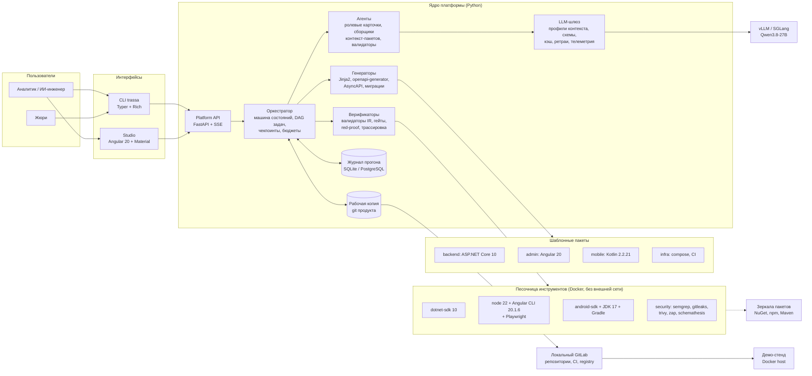
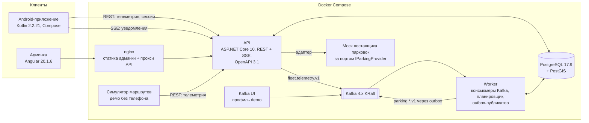
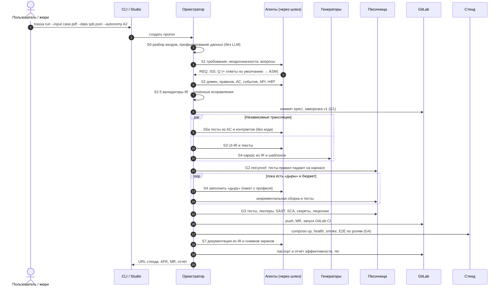
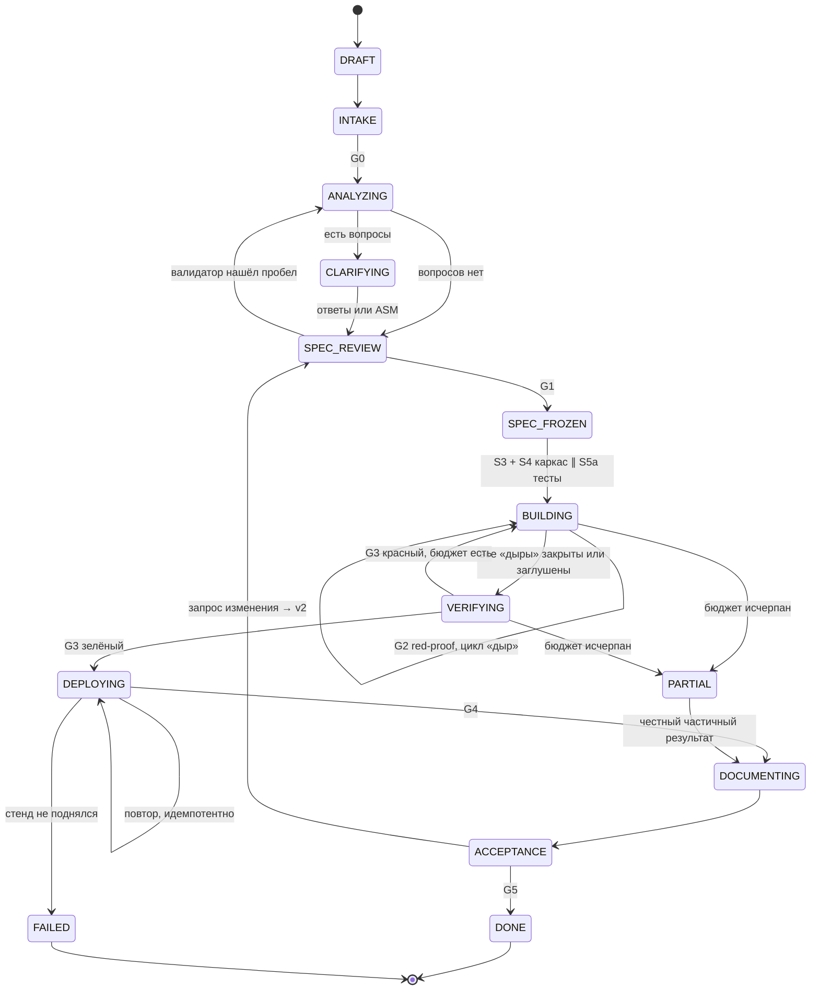

# Часть IV. Архитектура решения

## 9. Принципы и архитектурные решения (ADR)

| ADR | Решение | Рассмотренные альтернативы | Почему так | Последствия |
|---|---|---|---|---|
| 01 | Оркестратор — детерминированная машина состояний на Python. Агенты — функции без состояния с типизированными входом и выходом | Автономный агент; чат ролей (MetaGPT, AutoGen); LangGraph как основа | Малой модели нужна предсказуемость (§8). LangGraph допустим как библиотека графа, но не обязателен | Чекпоинты — своя таблица событий, это около 300 строк кода |
| 02 | **AppSpec IR** — единственный источник истины. Все артефакты выводятся из него | Генерировать код прямо из текста требований | Трассируемость, автоматические проверки, детерминированная генерация | Схему IR нужно версионировать. Расширения — через `extensions` |
| 03 | Золотые шаблоны и генераторы. LLM заполняет только «дыры» | LLM пишет приложение целиком | Время зависит от выходных токенов (§6.3). Популярный стек + шаблон (BaxBench) | Шаблоны — вложение до хакатона. Универсальность обеспечивают пакеты возможностей (§12.4) |
| 04 | Контекст-пакеты не больше профиля окна; истории диалога нет | Длинный агентный цикл с историей | Context rot, lost in the middle (§6.2) | Нужны индекс символов и нарезка IR |
| 05 | Данные — JSON по схеме с ограниченным декодированием; код — обычным текстом | Всё в JSON; всё текстом с парсингом | §8: Aider, «Let Me Speak Freely?» | Два вида парсеров ответа |
| 06 | Политика размышлений по стадиям с жёсткими бюджетами | Размышления по умолчанию | Переразмышление (§6.1) | Политику калибруем на eval-наборе |
| 07 | Независимая проверка: агент QA не видит код, есть red-proof, гейты — это код | Тесты пишет тот же агент | Доказательность | Больше вызовов, но они короткие |
| 08 | Всё живёт в GitLab: репозиторий продукта, коммит на стадию, MR, CI | Артефакты в локальной папке | Требование кейса; аудит | Нужна интеграция с API GitLab |
| 09 | Готовность работать без интернета | Интернет во время оценки | Кейс №2 запускается вживую | Заранее собранные образы и зеркала пакетов |
| 10 | Продукт — модульный монолит на ASP.NET Core 10: вертикальные срезы, порты и адаптеры, transactional outbox, SSE | Микросервисы; SignalR; MediatR | Прототип, поддерживаемость, лицензии (§8) | Границы модулей проверяют архитектурные тесты |
| 11 | Пайплайн на Python 3.12+: FastAPI, Pydantic v2, asyncio, Typer, Jinja2, python-gitlab, Docker SDK. Хранилище — SQLite по умолчанию или PostgreSQL | .NET для всего, единый стек | Лучшая экосистема для LLM-инструментов; Python предпочтителен по постановке | В команде два языка |
| 12 | Интерфейсы: CLI (обязателен — канал жюри) и Studio (Angular 20 + Material). Голос — опционально, через локальный Whisper | Streamlit или Gradio; React | Общий фасад дизайн-системы с админкой. Studio можно сгенерировать самим пайплайном | Angular дороже в разработке, но команда всё равно его осваивает для шаблона |
| 13 | UI Kit — Angular Material 20 с собственным фасадом компонентов | Taiga UI (российский; официально заявленной совместимости v4 с Angular 20 мы не нашли — проверить); PrimeNG | Гарантированная совместимость, самый большой корпус примеров в обучении моделей, доступность | Вид доводим темой и токенами |
| 14 | Зона определяется на сервере (PostGIS). Телеметрия идёт REST → Kafka. На устройстве — только таймеры и офлайн-очередь | Детекция на устройстве; системный геофенсинг Android | **[Факт]** Системный геофенсинг Android — не больше 100 геозон на приложение ([Android Developers](https://developer.android.com/training/location/geofencing)), а сегментов 6 867. Единый источник истины для админки; логика тестируется в C# | Нужна связь с сервером; на устройстве — буфер на время офлайна |
| 15 | Живые события клиентам — через SSE | SignalR или WebSocket; push через FCM или RuStore | Проще, проходит через прокси, встроено в ASP.NET Core 10. Push — расширение | При закрытом приложении уведомления даёт сервис переднего плана |
| 16 | Unit-тесты Angular — на Jest, E2E — на Playwright | Karma (устарел); Vitest (в v20 экспериментальный) | Стабильность на 20.1.6 | Миграция на Vitest — после обновления Angular |
| 17 | Android без KSP и kapt: ручной DI, DataStore вместо Room | Hilt + Room | Меньше движущихся частей, быстрее сборка, проще ошибки для малой модели | При росте приложения — Hilt и Room |
| 18 | Клиенты API для TS и Kotlin генерируются из OpenAPI детерминированно | Клиенты пишет LLM | Ноль токенов и ноль расхождений с контрактом | openapi-generator (JVM) нужен в образе инструментов |

---

## 10. Общая архитектура

Решение живёт на двух уровнях. **Платформа «Трасса»** — сам пайплайн. **Сгенерированный продукт** — то, что пайплайн выпускает.

### 10.1 Платформа «Трасса» (контейнеры)



### 10.2 Сгенерированный продукт на примере кейса №1



### 10.3 Как идёт прогон



---

## 11. Направление PIPELINE

**Миссия.** Платформа, которая автономно и воспроизводимо превращает требования в проверенный продукт на стеке RWB, укладываясь в малое окно модели. Владелец — направление Pipeline (§22).

### 11.1 Стадии, агенты, артефакты и гейты

| Этап RWB | Стадия «Трассы» | Агенты | Артефакты | Гейт |
|---|---|---|---|---|
| 1. Приём и анализ требований | S0 Intake → S1 Analysis → S1.5 Clarify | Intake (почти без LLM), Business Analyst | `spec/source/*.md`, `spec/data-cards/*.yaml`, `requirements.yaml`, `issues.yaml`, `questions.yaml`, `assumptions.yaml`, `glossary.yaml` | **G0:** все входы разобраны; у каждого REQ есть якорь на фрагмент источника |
| 2. Системный анализ | S2 System Analysis → S2.5 Model Checks | Systems Analyst, Domain Expert, Architect, Reviewer | `domain.yaml`, `rules.yaml`, `features/*.feature`, `events.yaml`, `api.yaml`, `integrations.yaml`, `nfr.yaml`, `capabilities.yaml`, `adr/*.md`, `openapi.json`, `asyncapi.yaml` | **G1:** валидаторы IR зелёные; спецификация заморожена — автоматически в A2 или человеком в A0–A1 |
| 3. Проектирование интерфейса | S3 UX | UX Designer, Reviewer | `ui.yaml` (UI-IR), `copy.yaml` (тексты), превью экранов | **G1.5:** у каждого сценария есть экран; у каждого экрана есть состояния |
| 4. Разработка ПО | S4 Scaffold → S4 Fill → S4 Build & Repair | Backend Dev, Frontend Dev, Mobile Dev + генераторы | `backend/`, `admin/`, `mobile/`, `mocks/`, `deploy/` | **G2:** red-proof; **G3:** сборка |
| 5. Тестирование и безопасность | S5a тесты (параллельно с S4) → S5b прогон → S5c безопасность | QA, Security | `tests/**`, `reports/tests/*`, `reports/security/*`, `docs/security/threat-model.md` | **G3:** тесты и гейты безопасности |
| 6. Сборка и развёртывание | S6 Package & Deploy + GitLab CI | DevOps: детерминированно, LLM — только для диагностики сбоев | Образы, compose, `.gitlab-ci.yml`, APK, URL стенда | **G4:** health, smoke, E2E на стенде |
| 7. Документация | S7 Docs → S8 Passport & Report | Tech Writer | `docs/**`, `reports/passport/*`, `reports/run-<id>/*` | **G5:** приёмка — автоматическая или человеком |

**[Решение]** Тесты (S5a) пишутся сразу после заморозки спецификации, **параллельно** с кодом (S4). Это две независимые трансляции одной утверждённой спецификации. Их согласие — свидетельство того, что код делает то, что написано в требованиях.

### 11.2 AppSpec IR — контракт между стадиями

IR — это набор YAML-файлов в `spec/`. У каждого элемента устойчивый ID, его проверяют модели Pydantic v2. Из тех же моделей экспортируется JSON Schema для ограниченного декодирования ответов агентов. Одна схема служит и валидатором, и грамматикой генерации. Фрагмент — в [приложении A](#приложение-a-схема-appspec-ir-фрагмент).

| Слой | Элементы (ID) | Кто пишет |
|---|---|---|
| `meta` | Имя приложения, версия спецификации, города и локали, включённые возможности | Architect |
| `requirements` | `REQ-*` (с якорем в источнике), `ISS-*` (с характеристикой ГОСТ), `Q-*`, `ASM-*`, глоссарий, роли, «вне объёма» | Business Analyst |
| `domain` | Сущности и поля (string, text, int, decimal, money, bool, date, datetime, duration, enum, ref, geo_point, geo_line, geo_polygon, json), связи, инварианты | Systems Analyst |
| `behavior` | `WF-*` (машины состояний: состояния, переходы, guards, действия, таймеры), `BR-*` (формула, таблица решений или расписание с параметрами), `NTF-*` (триггер → канал → шаблон), `JOB-*` | Systems Analyst + Domain Expert |
| `integration` | `EVT-*` (схема данных, производитель, потребители, топик, ключ), `PORT-*` (операции, DTO, поведение mock), `DS-*` (спецификации импорта наборов данных) | Systems Analyst + Architect |
| `interface` | `API-*` (ресурсы, операции, роли, ошибки), `SCR-*` (экраны по ролям и платформам: компоненты фасада, данные, действия, состояния, testid) | Systems Analyst + UX Designer |
| `quality` | `AC-*` (Gherkin с примерами, ссылки на BR, US и REQ), `NFR-*` (измеримо + способ проверки), `TD-*` (тестовые данные, маршруты), `SEC-*` (ссылки на ASVS) | Systems Analyst + QA + Security |
| `delivery` | Профиль развёртывания, окружения, опции CI | Architect |

**Детерминированные валидаторы (S2.5).** Каждый выдаёт ошибку с адресом в IR. Ошибка превращается в точечную задачу на исправление — только для нужного фрагмента и только для ответственного агента.

| Проверка | Правило |
|---|---|
| Ссылочная целостность | Все ID разрешаются; нет висячих ссылок |
| Покрытие требований | Каждый `REQ` ведёт хотя бы к одному `US`, `BR` или `NFR` либо явно помечен «вне объёма» |
| Правила → критерии | У каждого `BR` есть `AC`. У числовых правил есть примеры «граница −1 / граница / граница +1» |
| Проверяемость | У каждого `AC` есть шаги «Дано / Когда / Тогда» и проверяемый результат. У каждого `NFR` — число и способ проверки |
| Машины состояний | Все состояния достижимы; тупики только у терминальных; guards одного действия не пересекаются |
| RBAC | У каждого действия есть роль; у каждой роли есть действия или обоснование |
| События | У каждого события есть производитель, хотя бы один потребитель и ключ партиционирования |
| API ↔ сценарии | Каждый сценарий отображается на операцию API, у каждой операции есть роль |
| UI ↔ сценарии | Каждый сценарий доступен с экрана; у каждого экрана есть состояния «пусто», «загрузка» и «ошибка» |
| Данные | Поля наборов данных, на которые ссылается IR, существуют в карточке данных; единицы измерения указаны |
| Неоднозначность | В `AC` и `NFR` нет слов-триггеров («быстро», «удобно», «большой», «оперативно» и т. п.) без числа |

### 11.3 Агенты

Агент — это ролевая карточка, сборщик контекст-пакета, схема выхода и постобработчик. Агент не хранит состояния и не вызывает инструменты. Исполняет код только оркестратор.

| Агент | Вход: контекст-пакет | Выход | Размышления (профиль M) | Проверка выхода | Попыток |
|---|---|---|---|---|---:|
| Intake | Файлы. Для слайдов-картинок — изображение страницы | `source/*.md`, карточки данных | — / vision только для изображений | Непустой текст, структура слайдов | 2 |
| Business Analyst: извлечение | Фрагмент источника до 3 тыс. токенов + глоссарий | `REQ[]` с якорями | low | JSON Schema; якорь — подстрока источника | 3 |
| Business Analyst: линтер | Пакет REQ + чек-листы ГОСТ 34.602-2020 и ISO/IEC/IEEE 29148 | `ISS[]`, `Q[]` с вариантами и ответом по умолчанию | medium | Схема; у ISS есть характеристика; у Q — ответ по умолчанию | 3 |
| Domain Expert | Срез REQ + карточки данных | Подсказки к правилам: параметры, риски, семантика полей | medium | Схема | 2 |
| Systems Analyst | Срез REQ и ASM + карточки данных + ранее принятые решения | Слои `domain`, `behavior`, `integration`, `interface/api`, `quality` — по одному вызову на слой или на фичу | medium | Схема + валидаторы S2.5 | 3 |
| Architect | IR без деталей + каталог пакетов возможностей | `capabilities.yaml`, черновики ADR | low | Пакеты существуют; конфликтов нет | 2 |
| Reviewer | Срез IR + чек-лист | Замечания → задачи на исправление | low | Схема | 1 |
| UX Designer | Сценарии роли + каталог фасада + правила UX-письма | `SCR-*` (UI-IR), `copy.yaml` | low | Компоненты из каталога; testid уникальны | 3 |
| Backend / Frontend / Mobile Dev | Спецификация «дыры» + сигнатуры + шпаргалка + 1 пример | Тело метода или компонента (текст) | off → low при ремонте | Компиляция, линтер, тесты | 4 |
| QA | AC с примерами + API тестового DSL, page objects, драйверы | Тестовый код (текст) + маршруты и данные | off → low | Компиляция; red-proof | 3 |
| Security | Потоки данных из IR + находки сканеров (SARIF, срез кода) | Модель угроз; разбор находок: true или false positive, исправление | low | Схема | 2 |
| DevOps | Лог упавшей сборки или деплоя (до 150 строк) | Класс причины + исправление | low | Схема | 2 |
| Tech Writer | Факты раздела: IR, результаты тестов, снимки | Markdown раздела | off | Каждый AC упомянут; ссылки живые | 2 |

### 11.4 Контекст-инжиниринг под малое окно

**Анатомия пакета.** Порядок секций выбран так, чтобы стабильная часть стояла в начале и попадала в кэш префиксов vLLM.

| # | Секция | Стабильность | Бюджет M, токенов | Что внутри |
|---:|---|---|---:|---|
| 1 | Ролевая карточка | Постоянна для агента | ≤ 900 | Роль, правила, запреты (приложение B) |
| 2 | Шпаргалка по стеку | Постоянна для агента | ≤ 1 100 | 15–30 строк идиом зафиксированных версий: Minimal API в .NET 10, signals в Angular 20, Compose. Взяты из золотого шаблона, а не «из памяти модели» |
| 3 | Контракт выхода | Постоянен для типа задачи | ≤ 500 | Схема или формат и 1 мини-пример |
| 4 | Задача | Переменная | ≤ 500 | Что сделать, ID элементов |
| 5 | Срез IR | Переменная | ≤ 4 000 | Элементы, связанные с задачей по графу ID (глубина 2) |
| 6 | Сигнатуры и API | Переменная | ≤ 3 000 | Публичные типы и методы, на которые можно опираться. Из индекса символов (tree-sitter) |
| 7 | Пример | Переменная | ≤ 3 000 | 1–2 похожих фрагмента из шаблона |
| 8 | Ремонт | Только при повторе | ≤ 2 000 | Ошибки компилятора или упавшего теста, предыдущая версия |
| | **Итого** | | **≤ 15 000** | Остальное — резерв профиля M (18 тыс.) |

**Алгоритм сборки:**
1. Секции заполняются по приоритету: 1 → 4 → 3 → 5 → 6 → 8 → 2 → 7. Счёт токенов — через `/tokenize` сервера.
2. Если пакет не помещается, секции ужимаются в обратном порядке: меньше примеров; только сигнатуры, на которые прямо ссылается задача; срез IR в сокращённой форме.
3. Если и это не помогло, задача делится — например, меньше AC на один вызов.
4. Пакет, который не уложился в бюджет, никогда не отправляется. Это ошибка сборщика, её ловят тесты.

**Другие приёмы:**
- **Нарезка IR по графу ID.** Для «дыры» `BR-3` в пакет попадают сам `BR-3`, его `AC` с примерами, связанные сущности и поля, параметры (`ASM`) и события. Поиск идёт по графу, а не по эмбеддингам: так точнее и воспроизводимо.
- **Заметки передачи.** Каждая стадия пишет `handoff.md` до 300 токенов: решения и открытые риски. Следующие стадии видят заметку, а не всю историю.
- **Map-reduce для длинных входов.** Документ требований режется по разделам до 3 тыс. токенов. REQ извлекаются с якорями из каждого куска. Дубликаты сливаются детерминированно (нормализация текста), а LLM сверяет только заголовки похожих REQ.
- **Карточки данных** вместо файлов (§4.4).
- **Индекс символов.** tree-sitter (грамматики C#, TypeScript, Kotlin) извлекает публичные сигнатуры из сгенерированного кода, по имени выдаётся точная сигнатура.

### 11.5 Генерация кода: каркас → «дыры» → сборка → ремонт

**Каркас.** Генераторы из IR и шаблонных пакетов создают **компилируемый** проект. Каждая точка бизнес-логики в нём — «дыра» с заглушкой, которая бросает исключение. Поэтому каркас собирается до любого вызова LLM, а тесты правил на нём падают естественно — так и работает red-proof.

```csharp
// <trassa:hole id="BR-04.is-paid-now" refs="BR-04,AC-11,AC-12" max-lines="60">
public bool IsPaidNow(TariffSchedule schedule, LocalDateTime at, VehicleType type)
{
    throw new NotImplementedException("trassa:hole BR-04.is-paid-now");
}
// </trassa:hole>
```

```typescript
// <trassa:hole id="SCR-ADM-03.session-timeline" refs="US-07,AC-19" max-lines="80">
buildTimeline(events: SessionEventDto[]): TimelineItem[] {
  throw new Error('trassa:hole SCR-ADM-03.session-timeline');
}
// </trassa:hole>
```

```kotlin
// <trassa:hole id="SCR-MOB-02.remaining-label" refs="AC-05" max-lines="30">
fun remainingLabel(paidUntil: Instant, now: Instant): String =
    TODO("trassa:hole SCR-MOB-02.remaining-label")
// </trassa:hole>
```

**Спецификация «дыры»** — её пишет генератор, а не LLM:

```yaml
id: BR-04.is-paid-now
file: backend/src/Parking.Domain/Tariffs/TariffEngine.cs
symbol: TariffEngine.IsPaidNow
language: csharp
kind: method-body
refs: [BR-04, AC-11, AC-12]
contract:
  summary: "Платна ли парковка в момент `at` для типа ТС `type` по расписанию `schedule`"
  pre: ["schedule.Periods не пуст", "at — локальное время города"]
  post: ["false в праздник, если schedule.FreeOnHolidays", "окна через полночь учитываются"]
examples:                      # из таблиц Examples в Gherkin AC-11 и AC-12
  - {at: "2026-11-02T07:59", type: car, expected: false}
  - {at: "2026-11-02T08:00", type: car, expected: true}
  - {at: "2026-11-02T19:59", type: car, expected: true}
  - {at: "2026-11-02T20:00", type: car, expected: false}
  - {at: "2026-11-07T12:00", type: car, expected: false}   # суббота, «пн-пт»
  - {at: "2026-11-04T12:00", type: car, expected: false}   # праздник
allowed_api: [TariffSchedule, TariffPeriod, DayOfWeekSet, IHolidayCalendar.IsHoliday, LocalDateTime]
max_lines: 60
```

**Порядок и параллельность.**
- «Дыры» выполняются в топологическом порядке по зависимостям: домен → приложение → API → UI.
- «Дыры» в разных файлах идут параллельно, в одном файле — последовательно.
- После каждой партии выполняется инкрементальная сборка затронутого проекта: `dotnet build` одного проекта с `--no-restore`, `tsc -p` для админки, `gradle compileDebugKotlin` для мобильного приложения. Демоны сборки (dotnet build-server, Gradle daemon) держатся «тёплыми» в контейнерах песочницы.

**Обратная связь.**
- Вывод компилятора (`file:line:col: error CODE: message`) раскладывается по «дырам» по номерам строк. Ошибка вне «дыры» — это баг генератора: стоп и отчёт. Генераторы покрыты golden-тестами, поэтому такого быть не должно.
- Упавшие тесты отображаются на AC, а AC — на «дыры» по связям IR и по покрытию: `coverlet` с контекстом теста или Jest coverage.
- **[Решение]** Агент-разработчик **видит** код упавшего теста и сообщение assertion — так работает TDD и подтверждают исследования (§8). **Менять тест он не может**: `tests/` и `spec/` смонтированы только для чтения, после стадии сверяются хэши.

**Политика попыток для одной «дыры».**

| Попытка | Режим | Что добавляется в пакет |
|---:|---|---|
| 1 | Без размышлений, T = 0,2 | — |
| 2 | Без размышлений, T = 0,2 | Ошибки компилятора или тестов (до 20 строк) + предыдущее тело |
| 3 | Размышления low, не больше 2 000 токенов, T = 0,3 | То же + расширенные сигнатуры |
| 4 | Best-of-3 при T = 0,6, параллельно; выбирается первый кандидат, который компилируется и проходит тесты (по мотивам CodeT) | То же |
| — | **Честная заглушка:** `throw new NotImplementedException("BR-04: не реализовано пайплайном")`, AC становится красным в паспорте, работа над остальными продолжается | — |

**Запрет на новые зависимости.** Агент-разработчик не может добавить пакет. Если «дыре» нужна библиотека вне allowlist, задача завершается с причиной «нужна зависимость X». Решение принимает Architect по политике allowlist. Если решения нет — честный частичный результат.

### 11.6 Гейты качества

| Гейт | Что проверяется | Кто решает | Если не прошло |
|---|---|---|---|
| G0 Входы | Все файлы разобраны. У каждого REQ есть якорь — подстрока источника | Код | Повтор разбора; файл без текста помечается в отчёте |
| G1 Спецификация | Все валидаторы S2.5 зелёные; вопросы закрыты ответами или ASM | Код + человек в A0/A1 | Точечные исправления, не больше 3 кругов; затем элементы «под вопросом» |
| G1.5 UX | Каждый сценарий доступен с экрана; testid уникальны; у экранов есть состояния | Код | Исправление UI-IR |
| G2 Red-proof | Каждый тест бизнес-правила **падает** на каркасе с заглушками | Код | Тест возвращается QA — не больше 2 итераций; затем AC «тест под вопросом» |
| G3 Сборка и проверки | Все AC-тесты зелёные; линтеры чистые; SAST без high и critical; зависимости из allowlist и без известных уязвимостей с исправлением; секретов 0; лицензии из allowlist; миграции применяются с нуля; хэши `tests/` и `spec/` не изменились | Код | Возврат в цикл «дыр» в пределах бюджета; затем `PARTIAL` |
| G4 Стенд | Health, smoke, E2E по ролям, сценарный тест демо, DAST baseline, fuzzing API | Код | Повтор деплоя, откат; затем «не развёрнуто» в паспорте |
| G5 Приёмка | Человек прошёл сценарий своей роли — или автоматически в A2 | Человек / код | Запрос изменения → спецификация v2 |

**Файл статусов `reports/ac-status.json`** — аналог списка фич в harness Anthropic. Флаги `implemented`, `tested`, `red_proof`, `e2e`, `passes` меняет **только оркестратор** по фактам гейтов. Агенты этот файл не пишут.

### 11.7 Оркестратор



- **DAG задач внутри стадий.** Исполнитель с семафорами по ресурсам: параллельные вызовы LLM — по умолчанию 8, подстраивается по замеру; контейнеры сборки — 3.
- **Чекпоинты и идемпотентность.** Результат задачи хранится по ключу `sha256(stage, task_id, input_hash, prompt_version, model_id)`. После падения прогон продолжается с последнего чекпоинта. Повторный прогон с тем же входом берёт ответы из кэша.
- **Бюджеты.** На прогон и на стадию задаются токены (вход, выход, размышления), время и попытки. На 80% — предупреждение, на 100% — `PARTIAL` с объяснением в паспорте.
- **Журнал событий.** Append-only таблица `run_events` транслируется в Studio и CLI по SSE. По ней же строится отчёт эффективности (§19).
- **Отмена** доступна из любого нетерминального состояния. Рабочая копия остаётся консистентной: коммит делается только после гейта.

### 11.8 LLM-шлюз

| Функция | Как устроено |
|---|---|
| Опрос возможностей при старте | `GET /v1/models` → `max_model_len` → профиль контекста. Пробные вызовы: структурированный вывод, выключение размышлений, вызов инструментов. Замер пропускной способности при 1, 4 и 8 потоках |
| Формирование запроса | `system` = ролевая карточка + шпаргалка + контракт (стабильный префикс); `user` = задача и переменные секции. Параметры — по классу задачи (приложение C) |
| Структурированный вывод | `response_format: {type: "json_schema", json_schema: {name, schema, strict: true}}`. Если сервер не поддерживает — «только JSON», затем `json-repair`, валидация Pydantic и повтор с текстом ошибки, не больше 2 раз |
| Вывод кода | Ровно один блок между строками `<<<CODE` и `CODE>>>` (приложение B). Несколько блоков или отсутствие маркеров — повтор |
| Управление размышлениями | `chat_template_kwargs: {"enable_thinking": false}` или уровень `reasoning_effort`, если сервер его принимает. Токены рассуждений учитываются отдельно |
| Обрыв переразмышления | Потоковый режим: если рассуждения превысили бюджет стадии, запрос прерывается и повторяется без размышлений с инструкцией «реши сейчас» |
| Ретраи | 429, 5xx, таймауты → экспоненциальная задержка с джиттером (tenacity), не больше 4 раз. Circuit breaker при доле ошибок выше 30% за минуту |
| Кэш | Ключ — `sha256(model, params, messages, schema)`. Режим `--replay` воспроизводит прогон без модели — страховка демо |
| Параллельность | Асинхронный семафор с адаптацией по задержке (AIMD) |
| Телеметрия | Каждый вызов → строка журнала (схема — §19.2) |

### 11.9 Скорость

| Куда уходит время | Приём | Ожидаемый эффект [Допущение — замерить] |
|---|---|---|
| Выходные токены LLM | Модель пишет только «дыры»; компактные ключи JSON; без пояснений; жёсткий `max_tokens` | Выход в 5–10 раз меньше, чем при генерации всего кода |
| Последовательные вызовы | Параллельность DAG: куски анализа, фичи спецификации, «дыры», тесты, разделы документации | Общее время делится на число параллельных потоков |
| Prefill | Стабильные префиксы → попадания в кэш префиксов vLLM | Ниже TTFT на повторяющихся ролях |
| Скорость декодирования | MTP speculative decoding, если включён на сервере (§6.1) | До +72% на одном потоке (по замеру в llama.cpp) |
| Сборки | Образы с прогретыми кэшами, демоны сборки, инкрементальные сборки по проектам, параллельные контейнеры | Сборка за секунды-минуты вместо минут |
| Тесты | Сначала быстрые unit-тесты, потом интеграционные; E2E — только в финале | Ранний выход при ошибке |
| Повторные прогоны | Кэш ответов + идемпотентные стадии | Минуты |
| Документация | Таблицы и диаграммы — детерминированно; LLM пишет только связный текст, параллельно | — |

**Целевые цифры для приложения размера кейса №1** (около 10 сущностей, 12 BR, 25–30 AC, 15 экранов). Это **[Допущение]** для калибровки:

| Стадия | Время | Вызовов LLM |
|---|---:|---:|
| S0 разбор и профилирование | 1–2 мин | 0–5 |
| S1 анализ и вопросы | 2–4 мин | 6–12 |
| S2 системный анализ + валидаторы | 5–9 мин | 15–25 |
| S3 UX | 2–4 мин | 8–12 |
| S4 каркас + «дыры» + ремонт | 10–18 мин | 50–90 |
| S5 тесты, прогоны, безопасность | 8–12 мин | 25–40 |
| S6 сборка и деплой | 4–6 мин | 0–2 |
| S7–S8 документация и отчёты | 3–5 мин | 15–20 |
| **Итого** | **35–60 мин** | **120–200** |

Ориентир по токенам — 0,8–1,5 млн на прогон: основная масса — вход, выход — 120–200 тыс.

### 11.10 Интеграция с GitLab

- **Проект продукта** создаётся в группе `trassa-runs` через python-gitlab. Ветка прогона — `run/<run-id>`, основная — `main`.
- **Коммит на каждую стадию** с машиночитаемыми трейлерами:

```text
spec(S2): системный анализ — 12 BR, 28 AC, 9 событий

Trassa-Run: 20261030-1200-7f3a
Trassa-Stage: S2
Trassa-Agents: systems_analyst, domain_expert, reviewer
Trassa-Tokens: in=182340 out=24112 reasoning=9120
Trassa-Attempts: 23
Trassa-Gate: G1=passed
```

- **MR** `run/<id> → main` с описанием-паспортом: вердикты AC, гейты и ссылки. Push запускает GitLab CI. Оркестратор опрашивает статус pipeline через API, забирает отчёты JUnit, Cobertura и SARIF и добавляет их в паспорт.
- **Тег** `spec-v1-run-<id>` ставится при приёмке.
- **Репозиторий самого пайплайна** `trassa` — тоже в GitLab, со своим CI: линтеры, unit-тесты, golden-тесты генераторов, сборка шаблонов, smoke на eval-наборе.
- **GitLab недоступен.** Прогон продолжается в локальном git, push выполняется позже. В отчёте ставится отметка.

### 11.11 Уровни автономности

| Уровень | Где человек | Когда применять |
|---|---|---|
| A0 «Пошагово» | Утверждает каждую стадию | Обучение, разбор ошибок |
| A1 «Только важное» | Отвечает на вопросы и замораживает спецификацию; дальше всё автоматически | Реальная работа аналитика |
| **A2 «Полный автомат»** — режим жюри | Нигде. Вопросы закрываются ответами по умолчанию (ASM), заморозка — автоматическая после зелёных валидаторов | Скрытый кейс, CI, eval-набор |

Если у вопроса нет безопасного ответа по умолчанию, в A2 требование помечается «вне объёма — требует решения» и прогон продолжается. Число ручных вмешательств — метрика отчёта; цель в A2 — 0.

### 11.12 Безопасность самого пайплайна

| Угроза (OWASP LLM 2025) | Мера — техническая, а не словесная |
|---|---|
| LLM01 Prompt injection через текст требований | Агенты анализа не имеют инструментов: только текст → JSON по схеме. Инструкции из требований не исполняются. Требования — данные, они обрамляются в пакете маркерами `<<<SOURCE … SOURCE>>>` |
| LLM02 Утечка чувствительных данных | В промптах нет секретов. Наборы данных попадают в модель только в виде карточек и образцов. В демо — синтетика |
| LLM03 Цепочка поставок | Allowlist пакетов, lock-файлы, зеркала, лицензионный гейт, SBOM |
| LLM05 Небезопасная обработка вывода | Сгенерированный код исполняется только в песочнице, проходит компиляцию и SAST до деплоя |
| LLM06 Избыточная автономия | Агенты не деплоят и не пушат. Это делает оркестратор, цели фиксированы |
| LLM10 Неограниченное потребление | Бюджеты токенов, времени и попыток; обрыв размышлений |
| Побег из песочницы, эксфильтрация | Контейнеры без внешней сети (internal network + доступ только к зеркалам), не root, лимиты CPU, RAM и времени, без docker.sock. `tests/` и `spec/` — только чтение |
| Секреты | Токены GitLab и модели хранятся только в окружении оркестратора и шлюза; у токена GitLab минимальные права на группу |

**[Вывод]** Ни у одного компонента нет всех трёх элементов «смертельной триады» ([Willison](https://simonwillison.net/2025/Jun/16/the-lethal-trifecta/)). У агентов анализа есть недоверенный контент, но нет приватных данных и внешней связи. У песочницы нет внешней связи. Оркестратор исполняет только детерминированный код.

### 11.13 Отказы и деградация

| Отказ | Признак | Реакция | Что видит пользователь |
|---|---|---|---|
| Модель недоступна | 429, 5xx, таймаут | Ретраи с задержкой → circuit breaker → `BLOCKED` с автоповтором | «Модель недоступна, повтор через N с» |
| Невалидный JSON | Схема не прошла | Повтор с текстом ошибки, не больше 2 раз → упрощённый контракт → `PARTIAL` для элемента | Ничего, если исправилось |
| Переполнение окна | Пакет не помещается | Делим задачу. Не отправляем никогда | — |
| Переразмышление | Бюджет размышлений превышен | Обрыв → повтор без размышлений | — |
| «Дыра» не компилируется | 4 попытки исчерпаны | Честная заглушка, AC красный | AC красный с причиной |
| Нет прогресса | Те же красные тесты 3 итерации подряд | Откат к последнему зелёному коммиту, AC — «застрял» | Жёлтая метка |
| Тест не может упасть | G2 | Возврат QA, не больше 2 раз → «тест под вопросом» | Метка в паспорте |
| Нужна зависимость вне allowlist | Ошибка установки из зеркала или запрос агента | Решение Architect по политике → иначе `PARTIAL` | Строка «не сделано» |
| Сбой инфраструктуры сборки | Ошибка Docker или Gradle | DevOps-диагностика по логу → повтор → стоп стадии | Карточка ошибки с логом |
| GitLab недоступен | Ошибка API | Локальный git, push позже | Отметка в отчёте |
| Деплой не поднялся | health не 200 | Повтор, откат к прошлому образу | «Стенд не поднялся» + логи |
| Бюджет исчерпан | 100% лимита | `PARTIAL` → документация и паспорт честно | Индикатор бюджета |
| Падение оркестратора | Перезапуск процесса | Продолжение с чекпоинта | Прогон продолжается |

### 11.14 Качество самого пайплайна

- **Golden-тесты генераторов.** Фиксированный IR → ожидаемое дерево файлов, снимок проверяется в CI.
- **Сборка шаблонов в CI.** Каждый пакет собирается и проходит свои тесты в двух вариантах: с пустыми «дырами» (тесты правил падают — red-proof самого шаблона) и с эталонными реализациями (всё зелёное).
- **Eval-набор:** 12–20 документов требований. Кейс №1, его вариации с изменёнными правилами и синтетические кейсы из вероятных доменов RWB (§21.3). Метрики: успешность прогона, доля зелёных AC, токены, время, вмешательства. Запуск — ночной и на каждое изменение промптов.
- **Версионирование промптов.** Промпты лежат в репозитории с ID версии. Изменение промпта без eval-прогона не мёржится.
- **A/B-эксперименты:** инструкции на русском и на английском; код в JSON и текстом; уровни размышлений; размер пакетов.

---
