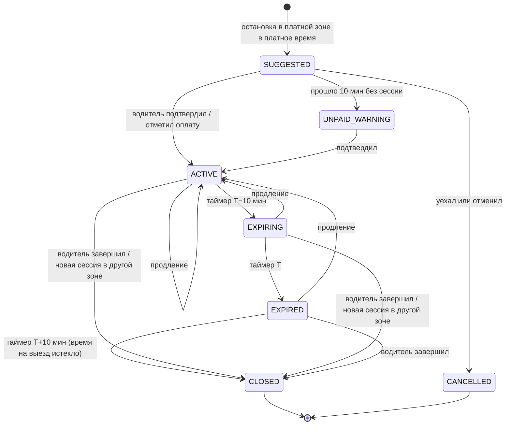

## 12. Направление BACKEND

**Миссия.** Шаблон бэкенда, из которого пайплайн собирает надёжный, поддерживаемый и безопасный бэкенд для любого кейса класса «мобильный клиент + админка + события + интеграции». Плюс эталонная реализация кейса №1, с которой сравнивается результат пайплайна. Эталон в результат прогона не попадает.

### 12.1 Зона ответственности

- Золотой шаблон ASP.NET Core 10 и пакеты возможностей на C#.
- Шаблоны генераторов C#-кода (Jinja2) и их golden-тесты — вместе с направлением Pipeline.
- Mock-сервис поставщика и контрактные тесты адаптеров.
- Бэкенд-части `docker-compose` и `.gitlab-ci.yml`.
- Эталонная реализация кейса №1 для eval-сравнения.

### 12.2 Архитектура шаблона

**[Решение]** Модульный монолит с вертикальными срезами и чистым доменом. Почему так:
- для прототипа и последующей поддержки это проще микросервисов;
- «дыры» получаются маленькими чистыми функциями или обработчиками с явными портами, а значит, маленькими контекст-пакетами.

```text
backend/
  global.json                    # SDK 10.0.x закреплён
  Directory.Build.props          # LangVersion 14, Nullable, AnalysisLevel, правила предупреждений
  Directory.Packages.props       # Central Package Management: версии = allowlist
  BannedSymbols.txt              # запрет DateTime.Now, Console.WriteLine и т. п.
  src/
    App.Api/                     # хост: Minimal API (MapGroup по фичам), auth, OpenAPI 3.1, SSE, health
    App.Application/             # фичи (вертикальные срезы): команды, запросы, обработчики, валидаторы; порты
    App.Domain/                  # сущности, value objects, машины состояний, правила (чистые функции), события
    App.Infrastructure/          # EF Core + Npgsql + NetTopologySuite, миграции, Kafka, outbox, адаптеры, импорт
    App.Worker/                  # хост консьюмеров, планировщика и outbox-публикатора (тот же образ)
  tests/
    App.Domain.Tests/            # unit + property-based (FsCheck)
    App.Application.Tests/       # обработчики с фейками портов
    App.Api.Tests/               # WebApplicationFactory + PostGIS и Kafka (сервисы CI / Testcontainers локально)
    App.Architecture.Tests/      # NetArchTest: Domain не зависит от Infrastructure и т. п.
    App.Acceptance.Tests/        # тесты AC от агента QA — для разработчиков только чтение
```

| Правило слоя | Как обеспечено |
|---|---|
| `Domain` не зависит ни от чего, кроме BCL и NetTopologySuite | Архитектурный тест |
| Эндпоинт — тонкий: только привязка, авторизация и вызов обработчика | Генератор + архитектурный тест (размер метода и зависимости) |
| Время только через `TimeProvider` | `BannedApiAnalyzers`: `DateTime.Now` и `DateTime.UtcNow` — ошибка компиляции |
| Внешние системы только через порты в `Application` | Архитектурный тест: `Application` не ссылается на HTTP-клиенты |
| События только через outbox | Публикатор Kafka доступен только в `Infrastructure.Outbox` |

**[Вывод]** Запрещённые API и архитектурные тесты нужны не только людям. Малая модель по привычке пишет `DateTime.Now`. Анализатор превращает это в ошибку компиляции, а цикл ремонта её исправляет — дисциплина обеспечивается механически.

### 12.3 Библиотеки и лицензии

| Задача | Выбор | Почему |
|---|---|---|
| HTTP API | ASP.NET Core 10 Minimal API, `MapGroup`, `TypedResults` | Встроено, мало кода для генерации |
| Валидация | Встроенная `AddValidation()` и DataAnnotations; FluentValidation для сложных правил | FluentValidation остался открытым ([codewithmukesh](https://codewithmukesh.com/blog/ai-agent-nuget-package-guardrails-dotnet/)) |
| OpenAPI | `Microsoft.AspNetCore.OpenApi` (OpenAPI 3.1) + Scalar UI | Встроено в .NET 10 ([InfoQ](https://infoq.com/news/2025/12/asp-net-core-10-release)) |
| Ошибки | ProblemDetails (RFC 9457) | Единый формат ошибок для клиентов и тестов |
| ORM и гео | EF Core 10 + Npgsql + NetTopologySuite; сложные геозапросы — SQL через `SqlQuery` | Типы PostGIS, индексы, KNN |
| Kafka | Confluent.Kafka + тонкая своя абстракция | MassTransit v9 стал коммерческим (§8) |
| Медиатор | Нет: обработчики через DI | MediatR — двойная лицензия (§8) |
| Маппинг | Mapperly (source generator) или вручную | AutoMapper — двойная лицензия (§8) |
| Время | `TimeProvider` + `FakeTimeProvider` | Детерминированные тесты таймеров «за 10 минут до конца» |
| Планировщик | Свой `BackgroundService` + таблица `scheduled_jobs` с `FOR UPDATE SKIP LOCKED` | Прозрачно, без Quartz и Hangfire |
| Аутентификация | JWT Bearer; встроенный выпуск токенов для демо-пользователей; Keycloak — опциональный профиль | Быстрый старт стенда |
| Наблюдаемость | OpenTelemetry (трассы, метрики, логи), health checks | Runbook и диагностика |
| Ограничение нагрузки | Встроенный RateLimiter | ASVS |
| Тесты | xUnit v3, FsCheck, Shouldly или AwesomeAssertions, WireMock.Net, NetArchTest, Bogus, coverlet, Testcontainers локально, Stryker.NET | FluentAssertions 8 — коммерческая лицензия (§8) |

### 12.4 Пакеты возможностей

Каждый пакет описан манифестом `pack.yaml`. В нём перечислено, какие элементы IR пакет обслуживает, какие файлы генерирует, где оставляет «дыры», какие зависимости разрешены, а также команды сборки и тестов. Пакет включается по содержимому IR, а не по названию кейса.

| Пакет | Что даёт | Где «дыры» | Включается, если в IR есть… |
|---|---|---|---|
| `core` | Хост, конфиг, ProblemDetails, health, OpenAPI, логирование, CORS, rate limit | — | Всегда |
| `auth-rbac` | JWT, роли, политики по действиям из матрицы RBAC, демо-пользователи | — (генерируется) | Всегда |
| `crud` | EF-конфигурации, миграции, DTO, эндпоинты списка, карточки, создания и изменения с фильтрами и пагинацией | Нетривиальные инварианты | Сущности |
| `workflow` | Машина состояний из `WF-*`: таблица переходов, guards, действия, аудит переходов | Guards и действия с логикой | `WF-*` |
| `rules` | `BR-*` как чистые функции или таблицы решений с параметрами из ASM | Тела правил | `BR-*` |
| `events` | Outbox, публикатор, идемпотентный консьюмер, DLQ, CloudEvents, AsyncAPI | Доменная логика обработчиков | `EVT-*` |
| `realtime` | SSE-потоки по ролям и подпискам | Фильтры подписки | Живые экраны |
| `notifications` | `NTF-*` → уведомления → каналы (SSE, журнал), дедупликация | Условия срабатывания | `NTF-*` |
| `scheduler` | Отложенные задачи и таймеры «за N минут до» и «через N минут после» | — | Таймеры в `WF` или `NTF` |
| `geo` | Типы PostGIS, импорт WKT и GeoJSON, запросы «рядом» и «внутри», MVT-тайлы, детектор входа и выхода с гистерезисом | Параметры и правила выбора | Гео-поля |
| `tracking` | Пакетный приём телеметрии, Kafka, хранение и упрощение треков | — | Трекинг |
| `integration` | Порт → адаптеры (mock, real-stub) → mock-сервис с поведением из IR + контрактные тесты | Маппинг DTO поставщика | `PORT-*` |
| `import` | Импорт наборов данных по карточке: валидация, карантин, идемпотентный upsert, отчёт качества | Правила маппинга | `DS-*` |
| `reports` | Агрегаты и выгрузка CSV | Запросы агрегатов | Отчёты |
| `audit` | Журнал действий и переходов, только чтение | — | Всегда |

**Что генерируется детерминированно, а что пишет LLM:**

| Детерминированно, 0 токенов | Пишет LLM («дыры») |
|---|---|
| Решение и проекты, конфигурации | Тела бизнес-правил |
| Сущности, EF-конфигурации, миграции, сиды | Guards и действия переходов с логикой |
| DTO, эндпоинты, политики авторизации | Доменная логика обработчиков событий |
| Валидаторы из ограничений полей | Маппинг особенностей внешнего формата |
| Движок машины состояний, таблицы переходов | Нестандартные запросы и агрегаты |
| Outbox, консьюмеры, топики, SSE | Нетривиальная валидация |
| Скелет адаптеров и mock-сервиса | — |
| Импорт по карточке данных | — |
| OpenAPI, AsyncAPI | — |
| Тестовая инфраструктура: фабрики, драйверы, фейковое время | — |

### 12.5 Эталонный дизайн для кейса №1

Так выглядит результат, который пайплайн должен выпустить для кейса №1. Направление Backend собирает эту же реализацию вручную как эталон для eval-сравнения.

**Модули:**

| Модуль | Ответственность |
|---|---|
| Zones | Импорт `spb.json` и Москвы, поиск рядом, по ID и по адресу, MVT-тайлы, карточка тарифа |
| Tracking | `POST /api/v1/telemetry` — пачка точек → Kafka `fleet.telemetry.v1` |
| Geofencing (Worker) | Консьюмер телеметрии → сохранение точек → детектор состояния → события зон через outbox |
| Sessions | Машина состояний сессии, старт и подтверждение, продление, завершение, таймеры T−10, T, T+10 |
| Tariffs | Тарифный движок: «платно ли сейчас», ближайшая граница «платно ↔ бесплатно», оценка стоимости |
| Notifications | Правила → уведомления → SSE водителю и в админку, история, дедупликация |
| Provider | `IParkingProvider` + `MockParkingProvider` (HTTP к mock), `LinkOutProvider` (только deep link) и заготовки реальных адаптеров |
| Admin | Пользователи, водители, ТС, настройки (радиусы, задержки, минуты предупреждения), аудит |
| Simulator | Воспроизведение маршрутов для демо без телефона: шлёт телеметрию как приложение |

**Детектор «в зоне / вне зоны»** — реакция на данные из §4 (D1, D2):

```text
on fix f(vehicle v, ts, point p, accuracy a, speed s):
  store(f)
  if a > A_MAX (50 м):                           # точка низкого качества — только храним
      return
  # 1) Уровень «зона платной парковки» (район): есть ли сегмент в радиусе R_AREA
  inArea = exists zone within R_AREA (50 м) of p
  areaState = hysteresis(inArea, N_IN = 2 точки, N_OUT = 3 точки или 30 с)
  emit PaidAreaEntered / PaidAreaLeft по переходам areaState (с паузой между уведомлениями 10 мин)

  # 2) Уровень «конкретная зона» — только при остановке
  stopped = speed < V_STOP (5 км/ч) в течение T_DWELL (60 с)
  r = R_BASE (15 м) + min(a, 25 м)
  cand = KNN(zones, p, within r, limit 5)        # ST_DWithin + ORDER BY <->
  if stopped and cand:
      z = cand[0]; if current zone within r: z = current   # не скачем между соседями
      if state.zone is null:      emit ZoneEntered(z) [+ SessionSuggested, если платно сейчас]
      elif z != state.zone:       emit ZoneChanged(state.zone → z)
                                  [+ PaymentCheckRequired, если есть активная сессия и платно сейчас]
  # 3) Выход из текущей зоны
  if state.zone and dist(p, state.zone) > R_EXIT (40 м) в течение T_EXIT (30 с или 3 точки):
      emit ZoneLeft(state.zone)
```

Все параметры живут в настройках и связаны с допущениями `ASM-*`. Их проверяют тесты свойств («нет дребезга при шуме ±20 м») и прогон записанных маршрутов.

```sql
-- Ближайшие сегменты: индекс GiST по geography, метры
SELECT z.id, z.external_id, ST_Distance(z.geog, @p) AS dist_m
FROM parking_zone AS z
WHERE z.city = @city
  AND ST_DWithin(z.geog, @p, @radius_m)
ORDER BY z.geog <-> @p
LIMIT 5;
```

**Машина состояний сессии:**



**Выезд из зоны не закрывает сессию автоматически** (ASM-11 в §20.3). Оплаченное время сохраняется, а водитель получает уведомление «Вы покинули текущую парковочную зону» с предложением завершить сессию. Поэтому при остановке в другой зоне правило «Проверьте необходимость новой оплаты» видит активную сессию и срабатывает так, как требует кейс.

**Тарифный движок:**
- **Расписание** — периоды по типу ТС: `from` и `to` в минутах суток; `null` — весь день; `from > to` — переход через полночь.
- **Дни недели** — из парсера описания; по умолчанию «пн-вс».
- **Праздники** — по календарю, если `hasHolidays`.
- **Функции:**
  - `IsPaidNow(at)`;
  - `NextBoundary(at)` — когда сменится «платно ↔ бесплатно»; нужна для текста «Сейчас бесплатно, платно с 08:00»;
  - `Estimate(duration)` — первые `duration` минут по первой ставке, остаток — по следующей; минимум `minTime`, шаг `timeStep`.
- **Тесты свойств (FsCheck):**
  - стоимость не убывает с ростом длительности;
  - вне платных окон — ноль;
  - сдвиг на сутки не меняет ответ для окон через полночь;
  - оценка равна сумме частей.

**API (эталон).**

| Роль | Метод и путь | Назначение |
|---|---|---|
| Водитель | `POST /api/v1/auth/token` | Вход (демо-учётки) |
| Водитель | `POST /api/v1/telemetry` | Пачка точек, идемпотентно по `fixId` |
| Водитель | `GET /api/v1/zones/nearby?lat&lon&radius` | Ближайшие зоны |
| Водитель | `GET /api/v1/zones/{id}` | Номер, адрес, геометрия, тариф сейчас, «платно сейчас», ближайшая граница, `minTime`, `timeStep` |
| Водитель | `GET /api/v1/sessions/current` | Активная сессия |
| Водитель | `POST /api/v1/sessions` | Старт или подтверждение: `zoneId`, `durationMinutes` → оценка, ссылка на оплату |
| Водитель | `POST /api/v1/sessions/{id}/extend` · `/stop` · `/payment-confirmation` | Продление, завершение, отметка «оплачено до» |
| Водитель | `GET /api/v1/sessions?from&to` · `GET /api/v1/trips/{date}/track` | История и маршрут |
| Водитель | `GET /api/v1/me/notifications` · `GET /api/v1/me/notifications/stream` (SSE) | Уведомления |
| Администратор | `GET /api/v1/admin/vehicles` · `/{id}/state` · `/{id}/track?date` | Автопарк, состояние, трек |
| Администратор | `GET /api/v1/admin/sessions?status&vehicle&from&to` | Сессии |
| Администратор | `GET /api/v1/admin/events?type&vehicle&from&to` · `/events/stream` (SSE) | Журнал и живая лента событий |
| Администратор | `GET /api/v1/admin/zones?city&q` · `GET /api/v1/tiles/zones/{z}/{x}/{y}.mvt` | Зоны и векторные тайлы |
| Администратор | `GET`/`PUT /api/v1/admin/settings` | Параметры детектора и уведомлений |
| Администратор | `POST /api/v1/admin/imports/zones` · `GET /api/v1/admin/imports/{id}` | Импорт и отчёт качества |
| Администратор | `POST`/`DELETE /api/v1/admin/simulations` | Запуск и остановка демо-маршрута |
| Все | `/health/live` · `/health/ready` · `/openapi/v1.json` · `/scalar` | Здоровье и документация API |

### 12.6 Качество кода бэкенда

- `Nullable` включён. Предупреждения анализаторов категорий Reliability, Security и Usage считаются ошибками.
- `dotnet format --verify-no-changes` в CI.
- `BannedApiAnalyzers` и архитектурные тесты (§12.2).
- Миграции генерируются и дополнительно выгружаются в идемпотентный SQL-скрипт для ревью.
- Все эндпоинты: авторизация по умолчанию — `RequireAuthorization` на группе; явный `AllowAnonymous` только для health и токена. Ответы — `TypedResults` с описанными кодами для OpenAPI.

### 12.7 Definition of Done направления Backend

- Шаблон собирается без предупреждений и проходит свои тесты в двух вариантах: с пустыми «дырами» (тесты правил красные) и с эталоном (всё зелёное).
- У каждого пакета есть `pack.yaml`, golden-тест генерации и раздел в шпаргалке для агентов (≤ 30 строк).
- Эталон кейса №1 проходит демо-сценарий (§20.6) автоматическим тестом.
- Все зависимости — из `Directory.Packages.props`, лицензии проверены.

---
