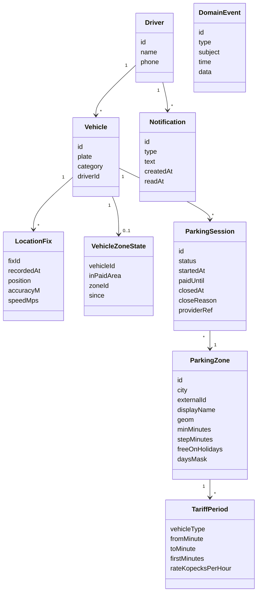

# Часть V. Применение

## 20. Сквозной прогон проверочного кейса

> **Это образец того, что должна выпустить каждая стадия на кейсе №1, а не запись реального прогона.** Значения тестов, времени и токенов появятся после первых прогонов.

### 20.1 S0: входы

- **Слайды 13–17** (PDF → Markdown, якоря на номера слайдов): контекст и цель, функциональные требования, примеры уведомлений, ожидаемые компоненты, источники данных и интеграции, демонстрационный сценарий.
- **`spb.json`** — основной набор (карточка данных — §4.4).
- **`response.json`** — второй город, для проверки универсальности и качества импорта.

### 20.2 S1: атомарные требования

| ID | Требование | Источник | Тип |
|---|---|---|---|
| REQ-01 | Определять местоположение автомобиля | сл. 14 | функция |
| REQ-02 | Определять нахождение автомобиля в платной парковочной зоне | сл. 14 | функция |
| REQ-03 | Показывать номер и границы зоны | сл. 14 | функция |
| REQ-04 | Отображать доступные параметры парковки | сл. 14 | функция |
| REQ-05 | Хранить информацию об активной парковочной сессии | сл. 14 | данные |
| REQ-06 | Отслеживать перемещение автомобиля | сл. 14 | функция |
| REQ-07 | Определять выход из текущей зоны | сл. 14 | правило |
| REQ-08 | Определять переход в другую парковочную зону | сл. 14 | правило |
| REQ-09 | Контролировать время окончания оплаченной сессии | сл. 14 | правило |
| REQ-10 | Предупреждать о необходимости проверки или новой оплаты | сл. 14 | правило |
| REQ-11 | Предоставлять переход к официальному сервису оплаты | сл. 14 | интеграция |
| REQ-12 | Отображать маршрут и историю парковочных сессий | сл. 14 | функция |
| REQ-13 | Пять типов уведомлений с заданными текстами | сл. 14 | интерфейс |
| REQ-14 | Водитель запускает или подтверждает парковочную сессию | сл. 17 | функция |
| REQ-15 | Показывать время окончания сессии | сл. 17 | интерфейс |
| REQ-16 | Предупреждать за 10 минут до окончания | сл. 17 | правило |
| REQ-17 | События отображаются в административном интерфейсе и сохраняются в истории | сл. 17 | функция |
| REQ-18 | Компоненты: мобильное приложение на Kotlin, админка на Angular, бэкенд на C# / ASP.NET Core, PostgreSQL + PostGIS | сл. 15 | ограничение |
| REQ-19 | Документированный API и модель событий | сл. 15 | артефакт |
| REQ-20 | Тестовые данные и автоматизированные тесты | сл. 15 | артефакт |
| REQ-21 | Docker-окружение и CI/CD-пайплайн | сл. 15 | артефакт |
| REQ-22 | Системная, продуктовая и пользовательская документация | сл. 15 | артефакт |
| REQ-23 | Интеграция через адаптер и mock-сервис; без промышленного доступа, реальной оплаты и своего платёжного механизма | сл. 16 | ограничение |
| REQ-24 | Источники данных: открытые данные о зонах, GPS или mock-маршрут, геоданные зон | сл. 16 | данные |
| REQ-25 | Цель: снизить риск повторной оплаты, пропуска окончания сессии и штрафа | сл. 13 | бизнес-цель |

### 20.3 S1: неоднозначности, вопросы и допущения

**Неоднозначности.** Характеристики — по ГОСТ 34.602-2020. «Полнота» и «данные» — дополнительные проверки линтера.

| ID | Где | Проблема | Характеристика | Действие |
|---|---|---|---|---|
| ISS-01 | REQ-03 «номер зоны» | В данных только `externalZoneId` сегмента; официального номера зоны для оплаты нет (D8) | однозначность | Q-01 |
| ISS-02 | REQ-03 «границы зоны» | Геометрия — линии, а не полигоны (D1) | однозначность, выполнимость | ASM-03 |
| ISS-03 | REQ-02 «нахождение в зоне» | Нет порога расстояния; погрешность GPS; плотность сегментов (D2) | проверяемость | Q-02 |
| ISS-04 | REQ-02, REQ-13 «въехали в зону» | Проезд мимо даст поток уведомлений | однозначность | Q-03 |
| ISS-05 | REQ-10 «необходимость новой оплаты» | Условия не определены | проверяемость | Q-04 |
| ISS-06 | REQ-04 «доступные параметры» | Перечень не задан | полнота | ASM-06 |
| ISS-07 | Данные: дни недели | Есть только в тексте описания (D4) | данные | ASM-07 |
| ISS-08 | Данные: `price` и `duration` | Семантика полей не описана (D3) | однозначность | Q-05 |
| ISS-09 | Данные: `hasHolidays` | Нет календаря праздников | однозначность | ASM-09 |
| ISS-10 | REQ-09, REQ-16 | Что после окончания оплаты; правило города «10 минут на выезд» (§5) | полнота | ASM-10 |
| ISS-11 | REQ-14 | Кто источник «оплачено до»: водитель или поставщик | однозначность | Q-06 |
| ISS-12 | Тариф и категория ТС | В данных car, truck и bus; в правилах города — категории A, B, C | однозначность | ASM-12 |
| ISS-13 | REQ-17 «административный интерфейс» | Роли не определены | полнота | Q-07 |
| ISS-14 | REQ-06, REQ-12 | Срок хранения трека, персональные данные | актуальность, выполнимость | ASM-14 |
| ISS-15 | REQ-11 «официальный сервис» | Какой: приложение, сайт или SMS | однозначность | ASM-15 |
| ISS-16 | Данные Москвы | Аномалии (D6); нужен ли второй город | актуальность | Q-08 |
| ISS-17 | REQ-25 | Нет метрик успеха | проверяемость | ASM-17 |
| ISS-18 | Весь кейс | Нет нефункциональных требований | проверяемость | ASM-18 → NFR-01…08 |
| ISS-19 | REQ-13 | Доставка уведомлений при закрытом приложении | выполнимость | ASM-19 |
| ISS-20 | REQ-09 | Часовой пояс расчётов | однозначность | ASM-20 |

**Вопросы.** В режиме A1 их задают человеку, в A2 принимаются ответы по умолчанию (★).

| ID | Вопрос | Варианты | Почему спрашиваем |
|---|---|---|---|
| Q-01 | Что считать номером зоны? | ★ `externalZoneId` из данных поставщика; адаптер может вернуть официальный номер · другое | Номер нужен для оплаты, а официального номера в данных нет |
| Q-02 | Когда машина «в зоне»? | ★ Ближайший сегмент в пределах 15 м + погрешность (не больше 25 м), подтверждение по 2 точкам; выход — дальше 40 м в течение 30 с · свои значения | «Нахождение в зоне» непроверяемо без порогов |
| Q-03 | Когда уведомлять о въезде? | ★ При въезде в район платной парковки (не чаще раза в 10 минут) и при остановке не меньше 60 с в конкретной зоне — с предложением сессии · у каждого сегмента | Иначе уведомления посыплются при проезде |
| Q-04 | Нужна ли новая оплата при смене зоны? | ★ Да, если сейчас платное время: оплата привязана к зоне. Решение остаётся за водителем: «Проверьте необходимость…» · нет | Ключевое бизнес-правило |
| Q-05 | Как читать тариф? | ★ `price` — копейки за час; период с `duration` — первые N минут по своей ставке, без `duration` — дальше; дни недели — из описания · другое | Семантика полей не описана |
| Q-06 | Откуда «оплачено до»? | ★ Водитель отмечает после оплаты в официальном сервисе; в режиме mock — ответ адаптера · только адаптер | Источник истины для таймеров |
| Q-07 | Роли админки? | ★ Диспетчер: наблюдение и история. Администратор: настройки, справочники, импорт · одна роль | Права и экраны |
| Q-08 | Какие города? | ★ Санкт-Петербург — основной, Москва — для проверки универсальности · только Петербург | Объём импорта и тестов |

**Журнал допущений.** Целиком попадает в паспорт.

| ID | Допущение | Статус в A2 | Влияет на |
|---|---|---|---|
| ASM-01 | Номер зоны = `externalZoneId` | по умолчанию (Q-01) | REQ-03, экраны, уведомления |
| ASM-02 | Порог зоны 15 м + погрешность (≤ 25 м), 2 точки; выход — 40 м и 30 с | по умолчанию (Q-02) | BR-01, BR-08 |
| ASM-03 | «Границы» зоны = коридор ±10 м вокруг сегмента; граница района — объединение буферов 50 м | без вопроса | REQ-03, карты |
| ASM-04 | Уведомление о районе не чаще раза в 10 минут; конкретная зона — после 60 с остановки | по умолчанию (Q-03) | BR-02, BR-03 |
| ASM-05 | Тариф: копейки за час; «первый интервал + дальше» | по умолчанию (Q-05) | BR-04, BR-06 |
| ASM-06 | Параметры парковки: номер, адрес, тариф сейчас для категории ТС, «платно сейчас / бесплатно до», минимальное время, шаг, расписание, праздники | без вопроса | REQ-04 |
| ASM-07 | Дни недели — из описания; если не распознаны — «пн-вс» с флагом качества | без вопроса | BR-04 |
| ASM-09 | `hasHolidays=true` = бесплатно в нерабочие праздничные дни по производственному календарю РФ | без вопроса | BR-04 |
| ASM-10 | В момент T — уведомление «Время оплаты истекло. Продлите парковку или покиньте зону в течение 10 минут»; в T+10 сессия закрывается | без вопроса, правило города (§5) | BR-07 |
| ASM-11 | Выезд из зоны не закрывает сессию: оплаченное время сохраняется, водителю предлагается завершить её | без вопроса | BR-08 |
| ASM-12 | Служебные ТС по умолчанию — `car` (категория B); настраивается в профиле ТС | без вопроса | BR-04, BR-06 |
| ASM-13 | Через 10 минут стоянки в платной зоне без сессии — напоминание «на оплату даётся 15 минут» | без вопроса, правило города (§5) | BR-10 |
| ASM-14 | Трекинг только во время смены; сырые точки хранятся 30 дней, сессии — 1 год; согласие на онбординге | без вопроса | §14.4 |
| ASM-15 | Официальный сервис настраивается по городу. Для Петербурга — приложение «Парковки Санкт-Петербурга», сайт parking.spb.ru, подсказка про SMS 3065 | без вопроса | REQ-11 |
| ASM-16 | Роли: водитель, диспетчер, администратор | по умолчанию (Q-07) | BR-12, RBAC |
| ASM-17 | Метрики пилота: просроченные сессии, повторные оплаты и штрафы на ТС в месяц — до и после | без вопроса | Паспорт, питч |
| ASM-18 | НФТ — NFR-01…08 (§20.4) | без вопроса | Тесты |
| ASM-19 | Уведомления во время смены идут от foreground service; push через FCM или RuStore — вне объёма прототипа | без вопроса | REQ-13 |
| ASM-20 | Часовой пояс — Europe/Moscow; хранение в UTC | без вопроса | Все таймеры |

### 20.4 S2: спецификация

**Доменная модель** (фрагмент):



**Бизнес-правила:**

| ID | Правило | Источник |
|---|---|---|
| BR-01 | Зона определяется по ближайшему сегменту в пределах `r = 15 м + min(погрешность, 25 м)`. При равенстве остаётся текущая зона | REQ-02, ASM-02 |
| BR-02 | Въезд в район платной парковки — сегмент в пределах 50 м по 2 точкам подряд. Выезд — сегмента нет 3 точки или 30 с. Уведомление не чаще раза в 10 минут | REQ-02, ASM-04 |
| BR-03 | Остановка — скорость меньше 5 км/ч не меньше 60 с. Тогда определяется конкретная зона и, если сейчас платно, предлагается сессия | REQ-14, ASM-04 |
| BR-04 | «Платно сейчас»: окно периода с учётом перехода через полночь, дни недели, праздники, тип ТС | REQ-10, ASM-05, ASM-07, ASM-09 |
| BR-05 | Длительность сессии не меньше `minTime` и кратна `timeStep` | REQ-14, данные |
| BR-06 | Оценка стоимости: первый интервал по своей ставке, дальше — поминутно по ставке «дальше» | REQ-04, ASM-05 |
| BR-07 | Таймеры: T−10 — «До окончания парковки осталось 10 минут»; T — истечение; T+10 — закрытие | REQ-09, REQ-16, ASM-10 |
| BR-08 | Выход из зоны — дальше 40 м не меньше 30 с: «Вы покинули текущую парковочную зону» и предложение завершить сессию | REQ-07, ASM-11 |
| BR-09 | Остановка в другой зоне при активной сессии в платное время: «Вы въехали в другую парковочную зону. Проверьте необходимость новой оплаты» | REQ-08, REQ-10, Q-04 |
| BR-10 | Остановка в платной зоне без сессии дольше 10 минут — напоминание об оплате | REQ-10, ASM-13 |
| BR-11 | Не больше одной живой сессии на ТС. Новая сессия в другой зоне закрывает прежнюю с причиной «переезд» | REQ-05 |
| BR-12 | Видимость: водитель — только свои данные; диспетчер — все ТС; администратор — всё и настройки | REQ-17, ASM-16 |
| BR-13 | Остановка вне платного времени: «Сейчас парковка бесплатна до 08:00», сессия не предлагается | REQ-10, BR-04 |

**Критерии приёмки** — около 28 AC. Три ключевых в Gherkin; ключевые слова русской локализации взяты из официального словаря Gherkin:

```gherkin
# language: ru
Функция: Парковочный помощник — платность, таймеры и смена зоны

  Правило: BR-04 — платно только в окно тарифа, в рабочие дни и не в праздники

    @AC-11 @BR-04
    Структура сценария: Платно ли сейчас в зоне с тарифом «пн-пт 08:00-20:00»
      Дано зона "517641" с тарифом "пн-пт 08:00-20:00" для легкового автомобиля
      Когда наступает время "<момент>"
      Тогда парковка "<состояние>"

      Примеры:
        | момент           | состояние |
        | 2026-11-02 07:59 | бесплатна |
        | 2026-11-02 08:00 | платна    |
        | 2026-11-02 19:59 | платна    |
        | 2026-11-02 20:00 | бесплатна |
        | 2026-11-07 12:00 | бесплатна |
        | 2026-11-04 12:00 | бесплатна |

  Правило: BR-07 — предупреждение за 10 минут до окончания оплаченного времени

    @AC-14 @BR-07
    Сценарий: Предупреждение за 10 минут
      Дано активная сессия в зоне "512726", оплаченная до "15:20"
      Когда наступает время "15:10"
      Тогда водитель получает уведомление "До окончания парковки осталось 10 минут"
      И в административном интерфейсе появляется событие "SessionExpiringSoon"

  Правило: BR-09 — смена зоны при активной сессии

    @AC-19 @BR-09
    Сценарий: Остановка в другой зоне в платное время
      Дано активная сессия в зоне "512726"
      И сейчас платное время
      Когда автомобиль переезжает к зоне "514335" и стоит 60 секунд
      Тогда водитель получает уведомление "Вы въехали в другую парковочную зону. Проверьте необходимость новой оплаты"
      И событие "ZoneChanged" содержит зоны "512726" и "514335"
```

В примерах AC-11: 2 ноября 2026 — понедельник, 7 ноября — суббота, 4 ноября — День народного единства, нерабочий праздник.

**Нефункциональные требования:**

| ID | Требование | Как проверяем |
|---|---|---|
| NFR-01 | Уведомление о событии зоны — не позже 10 с после точки, вызвавшей событие (p95, стенд) | Сценарный тест с отметками времени |
| NFR-02 | Поиск ближайших зон — p95 ≤ 20 мс на 23,5 тыс. сегментов | Интеграционный бенчмарк + `EXPLAIN` |
| NFR-03 | Ноль ложных «смен зоны» на записанном маршруте с шумом ±20 м | Тест свойств детектора |
| NFR-04 | Карта админки с 23,5 тыс. сегментов открывается не дольше 2 с | Playwright, замер на стенде |
| NFR-05 | Мобильные экраны: ширина 360 dp без обрезаний, подписи TalkBack, элементы не меньше 48 dp | Robolectric + проверки доступности |
| NFR-06 | Админка: axe — ноль нарушений critical и serious | Playwright + axe |
| NFR-07 | Гейты безопасности §16.3 зелёные | CI |
| NFR-08 | Трекинг только во время смены; сроки хранения соблюдены | Тест задачи очистки, интеграционный тест |

### 20.5 S3–S6 кратко

- **Экраны** — §13.2 и §13.4.
- **API** — §12.5. **События** — §15.1.
- **Код:** каркас генерирует пакеты `core`, `auth-rbac`, `crud`, `workflow`, `rules`, `events`, `realtime`, `notifications`, `scheduler`, `geo`, `tracking`, `integration`, `import`. «Дыры» — около 40–60: тела BR-01…BR-13, маппинг формата поставщика, парсер описаний тарифа, таймлайн сессии в админке, логика экранов «Сессия» и «Главная» на мобильном.
- **Тесты** пишет агент QA по AC (§16).
- **Стенд** поднимается из `deploy/`.

### 20.6 Демо-сценарий кейса = автоматический тест

**Маршрут** собирается детерминированно из реальных зон `spb.json`:
1. Старт южнее зоны покрытия данных (lat ≈ 59,905).
2. Движение к сегменту **512726** «Большая Московская улица дом 11» (360 ₽/ч) — остановка.
3. Переезд примерно на 640 м к сегменту **514335** «переулок Джамбула дом 11» — остановка.
4. Выезд из района.

| # | Шаг кейса | Что происходит | Событие | Уведомление водителю | Проверка |
|---:|---|---|---|---|---|
| 1 | Служебный автомобиль движется по маршруту | Демо-маршрут или симулятор шлёт точки → `fleet.telemetry.v1` | `LocationFixReceived` | — | Драйвер маршрута в сценарном тесте |
| 2 | Въезжает в зону платной парковки | Сегмент в 50 м по 2 точкам | `PaidAreaEntered` | «Вы въехали в зону платной парковки» | AC (BR-02) |
| 3 | Система определяет зону и уведомляет | Остановка 60 с → ближайший сегмент 512726 | `ZoneEntered`, `SessionSuggested` | Карточка зоны: № 512726, адрес, 360 ₽/ч, платно до 20:00 | AC (BR-01, BR-03, BR-04) |
| 4 | Водитель запускает или подтверждает сессию | 60 минут → «Перейти к оплате» → «Я оплатил до 15:20» | `SessionStarted` | «Парковка оплачена до 15:20» | AC (BR-05) |
| 5 | Система показывает время окончания | Экран сессии: «Оплачено до 15:20», обратный отсчёт | — | — | Robolectric-тест экрана |
| 6 | За 10 минут до окончания — предупреждение | Таймер T−10: в тесте — `FakeTimeProvider`, в демо — перемотка | `SessionExpiringSoon` | «До окончания парковки осталось 10 минут» | AC-14 |
| 7 | Автомобиль покидает зону или переезжает в другую | Отъезд от 512726 дальше 40 м; остановка у 514335 | `ZoneLeft`, затем `ZoneChanged` | «Вы покинули текущую парковочную зону», затем «Вы въехали в другую парковочную зону. Проверьте необходимость новой оплаты» | AC (BR-08), AC-19 |
| 8 | Система предлагает проверить оплату | Активная сессия в 512726, платное время, другая зона | `PaymentCheckRequired` | Кнопка «Перейти к оплате» | AC (BR-09) |
| 9 | События видны в админке и сохраняются в истории | SSE-лента, проекция истории | Все выше | — | Playwright: диспетчер видит события; API истории |

**[Решение]** Один и тот же маршрут используется:
- **в CI** — как сценарный тест с фейковым временем;
- **на стенде** — через симулятор админки, для демо без телефона;
- **в мобильном приложении** — как демо-маршрут с GeoJSON в assets.

Демо и тест — одно и то же, поэтому демо проверено до показа.

### 20.7 Изменение требования: спецификация v2

Например, владелец процесса говорит: «Предупреждать за 15 минут, а не за 10».
- **Влияние по трассе:** параметр BR-07 → примеры AC-14 → тесты AC-14 (агент QA перегенерирует) → `copy.yaml` (текст «осталось 15 минут») → разделы документации.
- **Код:** параметр планировщика генерируется из IR. «Дыр» и токенов на код — ноль.
- **Прогон:** новые тесты на старой сборке красные — изменение поймано тестом. После перегенерации — зелёные. Паспорт v2 содержит раздел «что изменилось».
- **Ожидание** — минуты, а не полный прогон. Цифру нужно замерить.

### 20.8 Паспорт v1 (форма)

| Блок | Содержимое (форма, значения — после прогона) |
|---|---|
| Вердикт | N из 28 AC доказаны тестами ✅ · ❌ красные · ⏸ не реализованы · ◐ оценка ИИ (только мягкие НФТ) |
| Допущения | 20, из них подтверждено человеком: 0 в A2 или K в A1 — список с влиянием |
| Проверки | red → green по всем BR · E2E по ролям · сценарный тест демо · SAST, SCA, секреты, лицензии, контейнеры, DAST, fuzzing |
| Стенд | URL админки, Scalar, Kafka UI (demo), APK, демо-учётки |
| Документация | Ссылки на сайт документации, OpenAPI, AsyncAPI, руководства |
| Ресурсы | Из отчёта эффективности (§19) |
| Не сделано | Например: push при закрытом приложении (ASM-19), реальные адаптеры поставщиков — с причинами |

---

## 21. Готовность к скрытому кейсу №2

### 21.1 Что известно и что предполагаем

- **[Факт]** Стек и состав сдачи те же. Сборка и запуск — в момент оценки (сл. 10).
- **[Факт]** RWB образована слиянием Wildberries (e-commerce и логистика) и Russ (наружная реклама) ([Sostav](https://www.sostav.ru/publication/pervaya-konferentsiya-wildberries-i-russ-74632.html), [CNews](https://www.cnews.ru/book/Wildberries)).
- **[Допущение]** Кейс №2 того же класса: «мобильный сотрудник + админка + бэкенд + события + интеграция». Вероятные домены:
  - логистика: ПВЗ, склады, курьеры, возвраты;
  - полевые службы наружной рекламы: монтаж, обслуживание, фотоотчёты;
  - внутренние процессы: заявки, согласования, учёт.

  Кейс №1 — «технические службы» — косвенно указывает на полевые службы.

### 21.2 Матрица возможностей

| Типовая потребность | Пакеты | Готовность |
|---|---|---|
| Справочники, CRUD, роли | `crud`, `auth-rbac`, `audit` | ✓ |
| Заявки и задачи со статусами, согласования, эскалации | `workflow`, `rules`, `scheduler` | ✓ |
| Геолокация, карты, геозоны, треки | `geo`, `tracking` + мобильный `core/location` | ✓ |
| Уведомления, таймеры, SLA | `notifications`, `scheduler`, `realtime` | ✓ |
| Интеграции с внешними системами | `integration` (порт, mock, контрактные тесты) | ✓ |
| Импорт данных: CSV, JSON, GeoJSON, WKT | `import` + профилировщик S0 | ✓ |
| Импорт XLSX | `import` + библиотека из allowlist | ◐ проверить лицензию и зеркало |
| Отчёты, дашборды, выгрузка | `reports` + KPI в админке | ✓ |
| Фото и файлы с геометкой (фотоотчёты) | Пакет `files`: MinIO в compose, загрузка с мобильного | ◐ подготовить до хакатона |
| Сканирование штрихкодов и QR на мобильном | Пакет `scan`: CameraX + открытая библиотека декодирования | ◐ подготовить |
| Офлайн-работа мобильного клиента | Офлайн-очередь шаблона | ◐ для телеметрии есть; для форм — расширить |
| Комментарии, обсуждения | Пакет `comments` | ◐ |
| Платежи | Только адаптер со ссылкой на внешний сервис | — вне объёма |
| ML-прогнозы | Порт к внешнему сервису + mock | — вне объёма, честно |

### 21.3 Eval-набор для подготовки

15 документов требований, каждый по 1–2 страницы, в стиле слайдов кейса:

1. Парковочный помощник (кейс №1) и две вариации: Москва; предупреждение за 15 минут.
2. Обслуживание рекламных конструкций: бригады, фотоотчёт с геометкой, SLA.
3. Приёмка товара на ПВЗ: сканирование, расхождения, акты.
4. Курьерские маршруты: назначение, трекинг, статусы, уведомление клиенту (mock SMS).
5. Заявки на ремонт складского оборудования: приоритеты, SLA-таймеры, эскалация.
6. Бронирование переговорных: календарь, конфликты, напоминания.
7. Выдача СИЗ и спецодежды: нормы, остатки, отчёты.
8. Мониторинг температуры в холодильных камерах: телеметрия в Kafka, пороги, тревоги.
9. Согласование закупок (как в `04-example-walkthrough.md`).
10. Инвентаризация ИТ-активов: QR, перемещения, история.
11. Топливо служебного транспорта: заправки, лимиты, отчёты.
12. Обходы территории охраной: чек-поинты по геозонам, пропуски, тревоги.
13. Обращения сотрудников в HR: категории, маршрутизация, SLA.
14. Сменные задания на складе: задачи, выполнение, KPI.
15. ДТП и страховые случаи автопарка: фото, статусы, mock страховщика.

**Метрики по каждому кейсу:** успешность прогона, доля зелёных AC, время, токены, вмешательства, гейты. **Цель к оценке [Допущение]:** 12 из 15 прогонов доходят до развёрнутого стенда; не меньше 80% AC зелёные; ноль ручных вмешательств в A2.

### 21.4 Протокол дня оценки

1. `trassa doctor` — всё зелёное (§17.5).
2. `trassa run --input case2.pdf --autonomy A2 --budget-time 60m` — прогон виден в Studio вживую.
3. Если стадия упала, прогон продолжается в режиме `PARTIAL`. Результат — честный паспорт и демонстрация сильнейших стадий: анализ, спецификация, документация, тесты.
4. Если упала инфраструктура, после восстановления тот же прогон продолжается с последнего чекпоинта. Уже полученные ответы модели берутся из кэша, поэтому повтор занимает минуты, а не полный прогон. Режим `--replay` для кейса №1 — резерв для видео, с явной пометкой.

---
